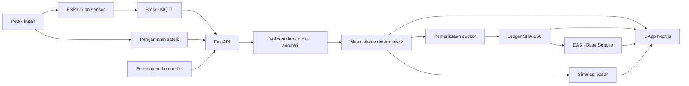
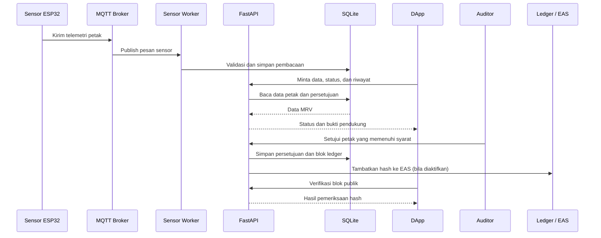

# ExcbonCP

**Prototipe MRV hutan yang merangkai bukti lapangan, pemeriksaan manusia, dan jejak integritas yang dapat diverifikasi.**

[](https://github.com/lilymilo/excboncp/actions/workflows/ci.yml)
[](https://opensource.org/licenses/MIT)

## Pengenalan Proyek

### Latar belakang

Klaim karbon hutan bergantung pada bukti yang dapat dipercaya. Bukti itu tersebar di berbagai sumber: pengukuran sensor di lapangan, pengamatan vegetasi dari satelit, persetujuan masyarakat, serta catatan pemeriksaan auditor. Jika sumber-sumber ini tidak terhubung, pihak luar sulit mengetahui asal data, alasan sebuah petak dinyatakan layak, dan apakah riwayatnya pernah diubah.

ExcbonCP dibuat untuk memperagakan bagaimana bukti tersebut dapat disatukan dalam satu alur *Monitoring, Reporting, and Verification* (MRV). Sistem memvalidasi telemetri IoT, mengaitkannya dengan data petak dan pengamatan satelit, menerapkan aturan status deterministik, mensyaratkan persetujuan komunitas, menyediakan pemeriksaan auditor, lalu mencatat keputusan dalam ledger SHA-256. Ringkasan bukti dapat ditambatkan melalui Ethereum Attestation Service (EAS) di Base Sepolia.

### Solusi dan target pengguna

ExcbonCP adalah aplikasi web untuk demonstrasi alur pembuktian MRV, bukan lembaga sertifikasi atau bursa karbon. Prototipe menyediakan:

- pemantauan petak melalui peta dan dashboard;
- penerimaan data sensor ESP32 melalui MQTT;
- pemeriksaan data, status, persetujuan, dan anomali;
- alur pemeriksaan auditor dan verifikasi integritas ledger;
- atestasi EAS di Base Sepolia atau mode simulasi; serta
- simulasi pasar tanpa uang sungguhan.

Pengguna yang dituju adalah komunitas dan pengelola hutan, auditor, peninjau publik, serta tim teknis yang mengembangkan atau mengevaluasi sistem MRV. Pengguna aplikasi tidak memerlukan dompet kripto. Data seed dan transaksi pasar pada demo bersifat fiktif/simulasi; sistem ini belum menerbitkan kredit karbon yang diakui regulator.

Dokumen naratif proyek: [Blueprint ExcbonCP](docs/Excboncp_Blueprint_System_Modeling_6_Hari_v5.md).

## Technical Documentation

### Arsitektur sistem



ESP32 mengirim telemetri lewat MQTT. Backend FastAPI memvalidasi dan menyimpan data di SQLite, menghubungkan data tersebut dengan status dan persetujuan, kemudian menyediakan API untuk DApp. Keputusan auditor ditulis ke ledger berantai; integritas blok dapat ditambatkan ke EAS. Aturan status adalah deterministik: AI dapat membantu deteksi anomali atau penjelasan, tetapi bukan pengambil keputusan status akhir.

### Diagram alur program



### Referensi teknis

- [Arsitektur sistem](docs/architecture/OVERVIEW.md)
- [Diagram konteks, data, status, deployment, dan pengguna](docs/models/)
- [Kontrak data dan integrasi](docs/contract.md)
- [Keputusan arsitektur (ADR)](docs/decisions.md)
- [Panduan EAS Base Sepolia](docs/guides/eas-attestation.md)
- [Indeks seluruh dokumentasi](docs/INDEX.md)

## Frontend Documentation

### Framework dan pustaka utama

Frontend berada di `src/dapp/` dan menggunakan Next.js 14 App Router, React 18, TypeScript, Tailwind CSS, Radix UI, Leaflet/React Leaflet, Recharts, Framer Motion, serta Three.js/React Three Fiber untuk visualisasi tertentu. Versi dependensi yang tepat tercatat di [`src/dapp/package.json`](src/dapp/package.json) dan `package-lock.json`.

### Struktur komponen UI

```text
src/dapp/src/
├── app/          # Route dan layout App Router
├── components/
│   ├── dapp/     # Komponen pengalaman aplikasi MRV
│   ├── landing/  # Bagian cerita dan halaman awal
│   ├── pages/    # View halaman utama
│   ├── charts/   # Visualisasi data
│   ├── ui/       # Komponen UI bersama
│   └── motion/   # Perilaku animasi
├── context/      # State/provider React
├── lib/          # API client, utilitas, dan helper
└── styles/       # Token dan stylesheet
```

### Aset frontend

Aset yang disajikan statis ditempatkan di `src/dapp/public/`. Direktori penting meliputi `landing-story/` untuk media cerita halaman awal, `keyframe-animation/` untuk rangkaian frame animasi, serta `animations/`, `illustrations/`, `backgrounds/`, `videos/`, dan `vendor/`. Aset di `public/` dirujuk dari aplikasi menggunakan path URL mulai dari `/`, bukan path filesystem.

Detail alur halaman tersedia di [DApp Flowchart](docs/models/DAPP_FLOWCHART.md). Backend API frontend dapat diarahkan melalui `NEXT_PUBLIC_API_URL`; tanpa variabel tersebut, API client menggunakan konfigurasi fallback lokalnya.

## Backend Documentation

### API endpoints utama

Server FastAPI didaftarkan di `server/main.py`. Dokumentasi OpenAPI interaktif tersedia di `/docs` ketika server berjalan; endpoint berikut adalah kelompok utama yang digunakan aplikasi:

| Kelompok | Endpoint penting | Fungsi |
| --- | --- | --- |
| Health dan monitoring | `GET /health`, `GET /api/health`, `GET /api/monitoring/status`, `GET /api/monitoring/metrics` | Status layanan dan metrik |
| Autentikasi | `POST /api/auth/register`, `POST /api/auth/login`, `POST /api/auth/logout`, `GET /api/auth/me` | Akun dan sesi pengguna |
| Sensor | `POST /api/sensor/readings`, `GET /api/sensor/readings`, `GET /api/sensor/summary/{parcel_id}` | Ingest dan baca telemetri |
| Market simulasi | `GET/POST /api/market/orders`, `GET /api/market/parcels/{parcel_id}/settlement` | Order dan ringkasan settlement simulasi |
| Zona | `GET /api/zones/{zone_id}/report` | Laporan alokasi zona |
| Ledger | `POST /approve`, `GET /approvals`, `GET /verify/{block_id}` | Persetujuan auditor dan verifikasi hash |
| Blockchain/EAS | `POST /blockchain/register-schema`, `POST /blockchain/attest/{block_index}`, `GET /blockchain/attestations` | Registrasi dan pemeriksaan atestasi |
| Engineering server | `/api/agents`, `/api/tasks`, `/api/credentials` | Orkestrasi agent, task, dan credential tim |

Endpoint approval dan EAS memerlukan autentikasi/peran yang sesuai. Semua endpoint pasar pada proyek ini merupakan simulasi. Daftar lengkap request, response, dan akses tersedia di [API Reference](docs/api-reference.md) dan OpenAPI `/docs`.

### Skema database

Backend menggunakan SQLite dengan konfigurasi WAL dan foreign key. Database default berada di `./data/excboncp.db`, dapat diubah menggunakan `DATABASE_PATH` atau `DATABASE_URL`. Tabel utama:

| Domain | Tabel |
| --- | --- |
| Identitas dan operasi | `users`, `sessions`, `audit_logs`, `tasks`, `credentials` |
| Petak dan referensi | `parcels`, `zones` |
| Bukti MRV | `sensor_readings`, `satellite_observations`, `consent_records`, `status_results` |
| Integritas dan ekonomi | `ledger_blocks`, `attestations`, `eas_registrations`, `market_orders` |

Skema kolom, constraint, indeks, dan relasi tercantum di [Database Schema](docs/database-schema.md). Data seed di `server/seed.json` adalah data contoh dan ditandai sebagai simulasi.

### Konfigurasi `.env.example`

Salin template sebelum menjalankan aplikasi:

```bash
cp .env.example .env
```

Kelompok pengaturan di `.env.example` meliputi:

- `JWT_SECRET`, `CREDENTIAL_ENCRYPTION_KEY`: rahasia sesi dan enkripsi credential;
- `SERVER_HOST`, `SERVER_PORT`, `LOG_LEVEL`, `CORS_ORIGINS`: server dan akses browser;
- `DATABASE_PATH`: lokasi SQLite;
- `RATE_LIMIT_GENERAL`, `RATE_LIMIT_AUTH`: batas request;
- `MQTT_BROKER`, `MQTT_PORT`, `MQTT_TOPIC_*`: koneksi telemetri;
- `SIMULATION_MODE`, `SIMULATION_INTERVAL_MS`: node IoT simulasi;
- `EVM_*`, `EAS_*`: opsi atestasi Base Sepolia; `EVM_SIMULATION_MODE=true` mempertahankan mode simulasi.

Jangan commit `.env` atau secret. Untuk demo lokal, gunakan simulation mode dan jangan masukkan private key bernilai aset nyata. Jalankan `python scripts/generate-secrets.py`, lalu salin nilai yang dicetak ke `.env`; skrip tidak mengubah file secara otomatis. Alternatifnya, ikuti perintah komentar pada `.env.example`.

## Petunjuk Menjalankan di Localhost

### Prasyarat laptop

- Git
- Docker Desktop atau Docker Engine dengan Docker Compose v2
- Node.js dan npm (Node.js 18 atau lebih baru)
- Koneksi internet untuk mengambil image dan dependency pertama kali

Python lokal tidak wajib untuk jalur ini karena backend dijalankan di container. Firmware fisik ESP32 juga tidak wajib; prototipe dapat diuji tanpa perangkat tersebut.

### Instalasi dan startup yang direkomendasikan

Dari root repository:

```bash
git clone https://github.com/lilymilo/exboncp.git
cd exboncp
cp .env.example .env
```

Untuk penggunaan lokal, pastikan `EVM_SIMULATION_MODE=true`. Buat `JWT_SECRET` dan `CREDENTIAL_ENCRYPTION_KEY` lokal; jangan membagikan `.env` atau memasukkan rahasia ke Git.

Jalankan development stack:

```bash
./scripts/dev.sh
```

Skrip ini membangun dan menyalakan service `server` serta `sensor-worker`, menyiapkan dependency npm frontend jika belum tersedia, menunggu health check backend, lalu menjalankan Next.js. URL lokal:

- Frontend: [http://localhost:3000](http://localhost:3000)
- API docs: [http://localhost:8000/docs](http://localhost:8000/docs)
- API health: [http://localhost:8000/health](http://localhost:8000/health)

### Menjalankan semua service termasuk broker dan node IoT

Jika ingin menyalakan broker Mosquitto dan node IoT dari `docker-compose.yml`, jalankan pada terminal terpisah:

```bash
docker compose up --build
```

Untuk memakai generator telemetri node yang tersedia, set `SIMULATION_MODE=true` di `.env` sebelum menyalakan Compose. Compose memetakan MQTT port `1883` dan gateway IoT `5050` ke host; gunakan hanya di mesin/jaringan pengembangan tepercaya.

### Menghentikan aplikasi

Hentikan proses frontend dengan `Ctrl+C`, lalu hentikan container:

```bash
docker compose down
```

Data SQLite dan Mosquitto disimpan dalam Docker volumes dan bertahan setelah container dihentikan. Untuk menghapus data demo, lihat instruksi reset di [Runbook](docs/runbook.md); jangan menghapus volume jika data masih dibutuhkan.

### Menjalankan tes backend

```bash
python -m venv .venv
source .venv/bin/activate
pip install -r server/requirements.txt -r requirements-dev.txt
pytest
```

Di Windows PowerShell, aktifkan virtual environment dengan `.venv\Scripts\Activate.ps1`.

## Struktur Repository

```text
ai_pipeline/       # Pipeline data satelit dan analisis
contracts/         # Artefak dan dokumentasi kontrak
docs/              # Dokumentasi teknis, arsitektur, dan blueprint
docker/            # Dockerfile backend dan frontend
iot-node/          # Aplikasi gateway/simulator dan firmware ESP32
mosquitto/         # Konfigurasi broker MQTT
scripts/           # Startup, demo, health check, dan utilitas
server/            # FastAPI, autentikasi, MRV, ledger, dan market
src/blockchain/    # Integrasi EAS
src/dapp/          # Frontend Next.js
tests/             # Pengujian backend dan integrasi
```

## License

Didistribusikan di bawah lisensi MIT. Lihat [LICENSE](LICENSE).
