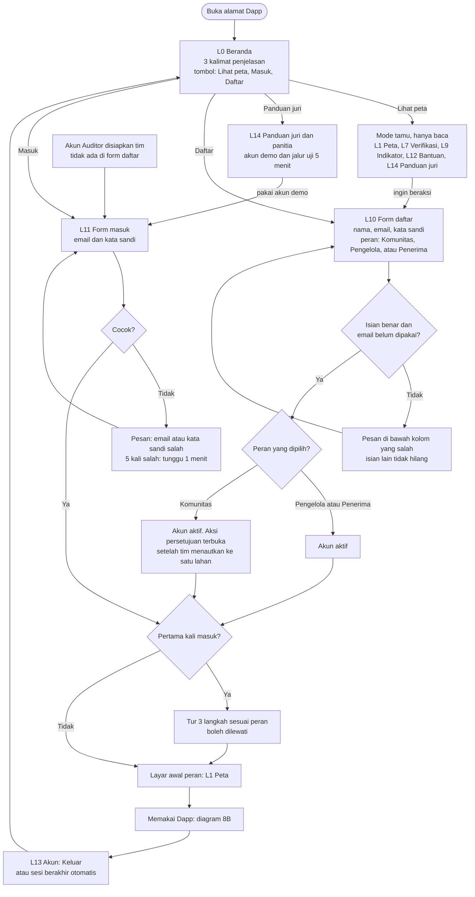
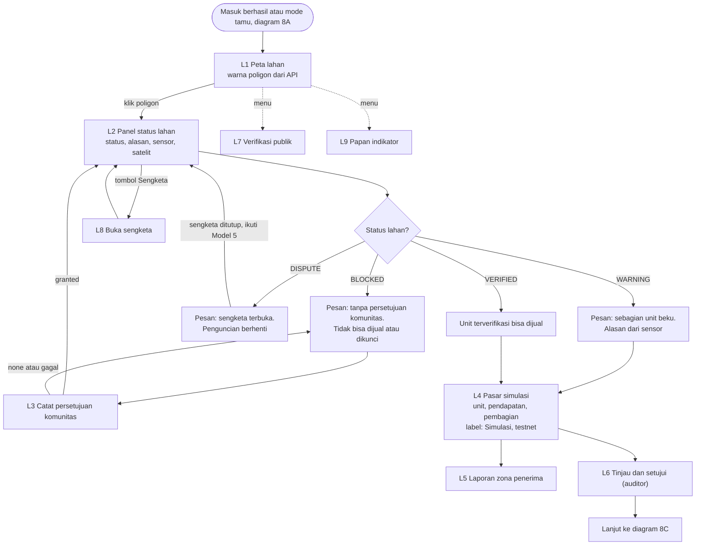
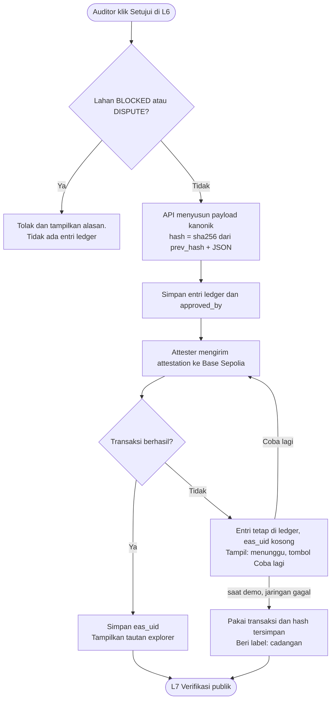
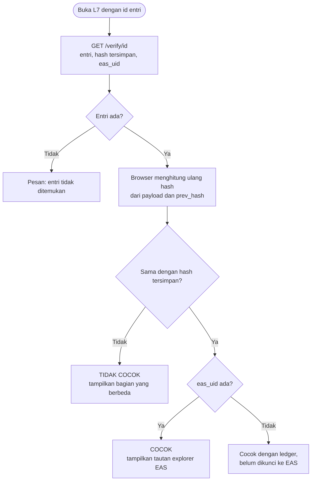
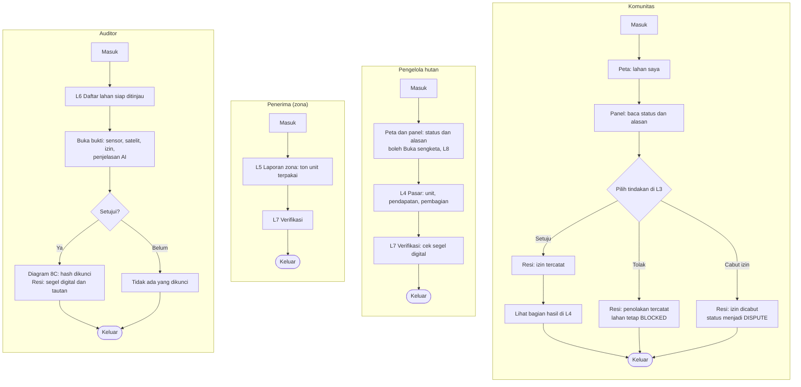

# Excboncp — Blueprint System Modeling (6 Hari)

Nov 8, 2026 · @miloapple · versi 5 (dirapikan)

## Mulai di sini (3 menit)

**Excboncp** = CbonCP + simulasi pasar. Hutan yang buktinya terverifikasi (satelit, sensor ESP, persetujuan komunitas, auditor) bisa "dijual" di sandbox testnet tanpa uang sungguhan, dan hasilnya terbagi ke pengelola dan komunitas. Dokumen ini disusun dengan **System Modeling**: setiap bagian adalah satu model (gambar) yang langsung jadi tugas.

**Cara membaca:** lihat gambar dulu, lalu tabel di bawahnya. Setiap orang mulai dari kartu namanya di bagian **Siapa mengerjakan apa**.

**Checklist hari ini (Minggu 8 Nov)**

- [ ] **Semua:** baca bagian ini, bagian Metode, **Siapa mengerjakan apa**, dan gambar Model 1, 3, dan 8
- [ ] **Revand:** repo + `docker-compose.yml` kosong + `docs/contract.md` (isi dari Model 3 dan 6) + `docs/decisions.md`
- [ ] **Bagus:** satu pesan dari ESP tampil di `mosquitto_sub -t sensor/#`
- [ ] **Davin:** tabel aturan status (bagian 11) menjadi fungsi Python
- [ ] **Malik:** peta dengan 2 poligon contoh (A hijau, B merah) + kerangka layar kosong dari Model 8
- [ ] **Semua:** 15 menit cek realitas: tulis apa yang sudah jalan di repo

**Tiga kalimat yang boleh dihafal**

1. "Kami membangun bukti dulu, baru nilai."
2. "Kode memutuskan, AI menjelaskan, manusia menyetujui."
3. "Semua simulasi di testnet; belum ada dukungan resmi dari pihak mana pun."

## Dapp ini apa? (versi untuk pengguna biasa)

**Satu paragraf yang boleh ditempel di Beranda aplikasi:**

> Excboncp mengumpulkan bukti kondisi hutan (foto satelit, sensor di lapangan, dan izin warga) di satu tempat, lalu mengunci hasilnya dengan segel digital supaya siapa pun bisa memeriksanya. Semua angka uang di sini adalah simulasi, bukan uang sungguhan.

**Web app atau app? Jawabannya: web app.** Dibuka lewat browser di HP atau laptop (alamat web), tidak perlu mengunduh apa pun, dan tampilannya menyesuaikan ukuran layar. Kata **Dapp** bisa membingungkan: di proyek ini artinya *web app yang bukti pentingnya dikunci di blockchain uji coba*. Pengguna **tidak perlu** punya dompet kripto, koin, atau paham blockchain.

| Pertanyaan | Jawaban | Alasan |
| --- | --- | --- |
| Perlu unduh dari Play Store atau App Store? | Tidak | Web app; cukup buka alamat |
| Bisa dibuka di HP? | Ya | Tampilan responsif; dirancang mulai lebar layar sekitar 360 px |
| Perlu dompet kripto atau koin? | Tidak | Penandatangan ada di server (`attester`) dengan kunci testnet |
| Perlu akun? | Untuk beraksi, ya. Melihat peta dan memeriksa bukti, tidak | Mode tamu hanya baca; aksi butuh daftar dan masuk |
| Kenapa bukan aplikasi native? | Tidak muat 6 hari dan 4 orang | Satu kode untuk semua perangkat; juri tinggal membuka alamat; demo berjalan dari laptop lewat Docker |
| Apa yang belum ada? | Notifikasi ke HP, mode offline, aplikasi native | Masuk peta jalan setelah demo, bukan syarat demo |

**Kamu sebagai siapa, bisa apa (bahasa awam):**

| Peran | Bisa apa | Tidak bisa apa |
| --- | --- | --- |
| Tamu (tanpa akun) | Melihat peta, memeriksa keaslian bukti, membaca penjelasan | Beraksi atau melihat pembagian uang |
| Komunitas | Memberi, menolak, atau mencabut izin atas lahannya; membuka sengketa; melihat bagian hasilnya | Menyetujui lahan lain |
| Pengelola hutan | Melihat status, alasan, dan hasil simulasi; membuka sengketa | Mengunci bukti |
| Penerima (zona) | Melihat laporan unit yang dipakai zonanya; memeriksa bukti | Mengubah apa pun |
| Auditor | Meninjau bukti dan menyetujui sehingga segel digital dikunci | Mengubah angka atau status |

**Prinsip supaya mudah dipakai (menjadi R24):**

1. Bahasa Indonesia sehari-hari; istilah teknis diganti (tabel "Bahasa di layar" di Model 8).
2. Satu layar, satu tujuan, satu tombol utama yang besar.
3. Status selalu **warna + ikon + kata**, jangan hanya warna.
4. Setiap tindakan penting ditutup dengan **resi**: "Selesai. Ini buktinya", berisi nomor referensi dan waktu.
5. Pesan gagal menjelaskan apa yang terjadi dan apa yang bisa dilakukan, tanpa kode galat.
6. Selalu ada jalan keluar: tombol Kembali, tombol Bantuan "Apa ini?", dan Keluar.
7. Minta data seperlunya saja: nama, email, kata sandi, peran. Tidak ada NIK atau nomor telepon.
8. Huruf cukup besar (minimal 16 px) dan kontras jelas, supaya terbaca di HP di bawah matahari.

## Keputusan yang perlu dikonfirmasi tim (Hari 0)

Blueprint belum menyatakan hal-hal ini, jadi di dokumen ini tertulis sebagai asumsi. Konfirmasi di standup pertama, lalu catat di `docs/decisions.md`.

| # | Hal | Asumsi saat ini | Penanggung jawab |
| --- | --- | --- | --- |
| 1 | Wallet pengguna | Tidak ada; attester menandatangani dengan kunci testnet di `.env` | Revand |
| 2 | Daftar dan masuk | Sungguhan (email dan kata sandi); akun Auditor disiapkan tim; akun Komunitas ditautkan tim ke satu lahan; identitas nyata belum diverifikasi, tulis jujur di slide | Revand, Bagus |
| 3 | Urutan penguncian | Simpan ke ledger dulu, baru ke EAS | Revand |
| 4 | Jam kerja per orang per hari | 2 sampai 3 jam | Semua |
| 5 | Tanggal final | ______ | Semua |
| 6 | F0 (link dibuka juri dan panitia) dan akhir penilaian | ______ | Semua |
| 7 | Server dan domain | Siapa memilih dan siapa menanggung biaya belum diputuskan | Revand |
| 8 | Format link ke panitia | Mengikuti syarat panitia (belum dicek) | Malik |
| 9 | ESP ke broker | Opsi A (MQTT berkredensial) atau opsi B (HTTPS ke `api`) | Bagus |

## Konsep dan nilai ekonomi

Masalah: bukti karbon hutan sulit diperiksa pihak luar, sehingga pembeli ragu dan komunitas bisa terabaikan. Excboncp menjawab dengan bukti yang bisa diperiksa, lalu memberi nilai ekonomi yang bisa dihitung.

| Pihak | Nilai | Terukur di demo? |
| --- | --- | --- |
| Pengelola hutan / KTH | Pendapatan dari unit terverifikasi | Ya (simulasi) |
| Komunitas | Bagian hasil tertulis, hak menolak | Ya (simulasi) |
| Pembeli / emiten | Bukti yang bisa dicek sendiri | Sebagian |
| Auditor | Bukti terkumpul otomatis | Ya (detik data ke status) |
| Investor besar (termasuk SWF) | Data kualitas aset hutan yang seragam | Tidak, hipotesis |
| Regulator / bursa | Contoh sistem bukti di sandbox | Tidak, hipotesis |

**Konteks pasar** (sumber di bagian terakhir): IDXCarbon Januari 2026 mencatat 117.455 tCO2e senilai sekitar Rp4,7 miliar (sekitar Rp40.000 per ton, hitungan kami), dengan 152 peserta; proyeknya sampai Juli 2026 mayoritas energi dan limbah, bukan hutan. Di pasar sukarela, EDF memperkirakan kredit REDD+ yurisdiksi US$6–12 per ton (2024). Artinya ada celah pasokan hutan terverifikasi.

**Yang tidak boleh dikatakan:** bahwa Danantara, OJK, BEI, atau komunitas mana pun sudah tertarik atau mendukung; bahwa sistem sudah menaikkan harga atau memangkas biaya audit; bahwa ini bursa karbon.

## Metode: System Modeling

**System Modeling** berarti menggambar sistem dari beberapa sudut sebelum menulis kode, supaya semua anggota melihat hal yang sama. Kami memakai delapan model; masing-masing menjawab satu pertanyaan dan menjadi satu berkas kerja.

| # | Model | Pertanyaan yang dijawab | Menjadi | Pemilik |
| --- | --- | --- | --- | --- |
| 1 | Konteks | Siapa dan apa di luar sistem? | Batas lingkup | Revand |
| 2 | Use case | Apa yang bisa dilakukan tiap aktor? | Daftar fitur dan kebutuhan | Malik |
| 3 | Alur data (DFD) | Data apa mengalir ke mana? | Kontrak data `docs/contract.md` | Revand |
| 4 | Urutan (sequence) | Siapa memanggil siapa saat demo api? | Skrip demo dan tes integrasi | Bagus |
| 5 | Status (state) | Kapan status lahan berubah? | Fungsi aturan status | Davin |
| 6 | Data (ERD) | Tabel apa yang disimpan? | Skema SQLite | Revand |
| 7 | Deployment | Layanan apa jalan di mana? | `docker-compose.yml` | Revand |
| 8 | Flowchart Dapp | Layar apa, aksi apa, dan cabang apa yang dialami pengguna? | Peta layar, daftar endpoint, tes layar | Malik (Revand meninjau) |

**Aturan pakai:** gambar adalah sumber kebenaran. Jika kode dan gambar berbeda, perbaiki salah satunya hari itu juga dan beri tahu tim. Perubahan gambar dibahas saat standup pagi, bukan lewat chat acak.

**Mengapa cocok untuk tim 4 orang dalam 6 hari:** model dibuat sekali (hari ini), lalu tiap orang bekerja paralel tanpa saling menunggu karena batasnya sudah jelas.

**Tiga gambar yang sering tertukar**

| Gambar | Menjawab | Contoh | Dipakai untuk |
| --- | --- | --- | --- |
| DFD (Model 3) | Data apa berpindah dari mana ke mana | Pesan sensor menuju P1 | Bentuk JSON di kontrak |
| Urutan (Model 4) | Siapa memanggil siapa, berurutan menurut waktu | ESP, broker, api, layar | Skrip demo dan tes integrasi |
| Flowchart Dapp (Model 8) | Layar dan keputusan yang dialami pengguna | Klik Setujui; jika BLOCKED, ditolak | Layar, endpoint, dan pesan gagal |

Cara cepat memilih gambar: bingung "datanya apa" lihat Model 3; "urutannya bagaimana" lihat Model 4; "layar atau tombol ini harus apa" lihat Model 8; "kenapa statusnya begini" lihat Model 5.

## Siapa mengerjakan apa

Bagian ini menjawab "ini tugas siapa?". Satu hal punya satu penanggung jawab. Penanggung jawab tidak harus mengerjakan semuanya sendiri, tetapi dialah yang memastikan selesai dan menjawab pertanyaan tentangnya. Kolom **Cadangan** adalah orang yang cukup paham untuk menggantikan jika penanggung jawab sakit atau macet.

### Kartu peran (ringkas)

| Orang | Peran dalam satu kalimat | Model | Kebutuhan | Area kode dan berkas | Cadangan |
| --- | --- | --- | --- | --- | --- |
| Revand | Arsitek dan penjaga bukti: kontrak data, ledger, blockchain, deployment | 1, 3, 6, 7 | R8, R9, R10 (sisi server), R14, R25, R29 | `docs/`, `api/ledger/`, `attester/`, `docker-compose.yml`, `.github/` | Bagus |
| Bagus | Penjaga perangkat dan hitungan ekonomi: ESP, MQTT, CO2e, settle, zona, dokumentasi | 4 | R1, R2, R6, R7, R19, R21, R23, R26 (broker), R28 | `firmware/`, `api/sensor/`, `api/economy/`, `api/auth/`, `scripts/`, `mosquitto.conf`, `README.md`, `docs/runbook.md` | Revand |
| Davin | Penjaga aturan dan data lahan: status, persetujuan, satelit, AI | 5 | R3, R4, R5, R7 (sambungan), R16, R17, R26 (API) | `api/rules/`, `api/satellite/`, `api/ai/` | Malik |
| Malik | Penjaga pengalaman pengguna: Dapp, peta, layar, presentasi | 2, 8 | R11, R12, R13, R15, R18, R20, R22, R23 (sisi layar), R24, R10 (sisi layar), R27 | `web/`, `docs/slides/` | Davin |

Nama pertama di kolom Pemilik tabel kebutuhan adalah penanggung jawab; nama kedua adalah pendukung (biasanya pemilik endpoint atau layar pasangannya).

### Kartu per orang

**Revand: arsitek dan penjaga bukti**

- **Mengapa peran ini ada:** supaya semua bagian bicara dengan bahasa data yang sama, dan bukti tidak bisa diubah diam-diam.
- **Memegang:** Model 1, 3, 6, 7; `docs/contract.md`, `docs/decisions.md`, `.env.example`; tabel `user` di kontrak dan akun seed (auditor, komunitas tertaut lahan, penerima tertaut zona); ledger berantai hash (R8); attester ke EAS (R9); endpoint `POST /approve`, `GET /verify/{id}`, `GET /health` (R10, R13 sisi data); `docker-compose.yml` dan CI (R14); server publik, domain, HTTPS, `docker-compose.prod.yml`, skrip deploy dan backup, pemantauan (R25, R29); video cadangan.
- **Menerima dari:** Bagus (bentuk pesan sensor, hasil `settle`), Davin (hasil status untuk dicatat), Malik (kolom yang dibutuhkan layar).
- **Memberi ke:** semua orang. Kontrak data Hari 0, `seed.json` Hari 1, `docker compose up` yang jalan.
- **Selesai berarti:** `docker compose up` di mesin bersih menampilkan seluruh Dapp; mengubah satu entri ledger membuat verifikasi gagal; transaksi EAS terlihat di explorer.
- **Jangan:** mengubah kolom kontrak tanpa kabar di standup; menghapus tabel.

**Bagus: perangkat dan hitungan ekonomi**

- **Mengapa peran ini ada:** supaya bukti fisik (sensor) benar-benar sampai ke sistem, dan angka uang simulasi bisa dihitung ulang siapa pun.
- **Memegang:** Model 4; firmware ESP untuk DHT22, KY-026, dan sensor kelembapan tanah, aturan `sensor_flag` dan kalibrasi, skrip cadangan MQTT (R1, R2); `mosquitto.conf`; rumus CO2e (R6); `settle` (R7); zona contoh (R19); endpoint `POST /auth/register`, `POST /auth/login`, `POST /auth/logout`, `GET /me` dan penjaga peran (R23), serta `GET /market/{id}`, `GET /zones/{id}/report`, `GET /metrics`; broker MQTT berkredensial untuk fase finalis (R26); reset data dan skenario api tanpa ESP (R28); README dan runbook (R21); uji api dan pengukuran detik dari data ke status.
- **Menerima dari:** Revand (kontrak, tabel SQLite), Davin (status untuk menentukan unit yang boleh dijual).
- **Memberi ke:** Malik (hasil pasar dan zona), Revand (hasil `settle` untuk dicatat di ledger), semua (runbook).
- **Selesai berarti:** pesan fisik dari ESP (suhu, kelembapan udara, api, kelembapan tanah) muncul di tabel sensor; api di depan KY-026 menyalakan `sensor_flag`; pesan tanpa `sig` valid ditolak; `settle` lolos 2 tes; skrip cadangan menghasilkan pola data yang sama.
- **Jangan:** mengubah nama topik MQTT atau bentuk pesan tanpa kabar.

**Davin: aturan dan data lahan**

- **Mengapa peran ini ada:** supaya status lahan hanya dihitung kode, bisa diulang, dan hak menolak komunitas selalu dihormati.
- **Memegang:** Model 5; `compute_status` dan 7 tes (R5); persetujuan komunitas (R4); NDVI dan SAR dengan cache (R3); penjelasan AI-1 (R16); anomali AI-2 (R17); endpoint `GET /parcels`, `GET /parcels/{id}`, `POST /consent`, `POST /dispute`; penyambung status ke suplai (R7); keamanan API untuk fase finalis: batas percobaan, validasi isian, CORS, tes peran (R26).
- **Menerima dari:** Revand (`seed.json`, tabel), Bagus (flag sensor).
- **Memberi ke:** Malik (data lahan dan status untuk peta dan panel), Bagus (status yang menentukan unit dijual), Revand (hasil status).
- **Selesai berarti:** 7 tes status lolos; lahan tanpa catatan `granted` tidak bisa dikunci; `POST /consent` hanya diterima dari akun Komunitas yang tertaut ke lahan itu; cache dipakai otomatis saat GEE gagal; AI tidak pernah menentukan status.
- **Jangan:** memakai AI untuk menentukan status atau angka.

**Malik: pengalaman pengguna dan presentasi**

- **Mengapa peran ini ada:** supaya orang yang bukan programmer (juri, auditor, komunitas) bisa memahami dan memeriksa hasilnya, dan supaya cerita demo runtut.
- **Memegang:** Model 2 dan 8; layar L0 sampai L13 (beranda, peta, panel, persetujuan, pasar, zona, auditor, verifikasi, sengketa, indikator, daftar, masuk, bantuan, akun); teks layar dalam bahasa awam dan uji 3 orang awam (R24); `web/mock/`; halaman L14 Panduan juri dan panitia (R27); slide dan jawaban juri sisi use case (R22).
- **Menerima dari:** semua pemilik endpoint (lihat tabel serah-terima). Selama endpoint belum siap, pakai mock dengan bentuk persis kontrak.
- **Memberi ke:** semua. Tangkapan layar tiap layar untuk slide, daftar kolom yang dibutuhkan layar untuk kontrak.
- **Selesai berarti:** semua layar Must di Model 8 bisa dicapai dari menu; tidak ada jalan buntu; setiap cabang gagal punya pesan; layar pasar, zona, dan auditor berlabel "Simulasi, testnet".
- **Jangan:** menulis warna poligon atau angka di kode (harus dari API).

### Berkas dan dokumen non-kode

| Berkas | Isi | Pemilik | Kapan siap |
| --- | --- | --- | --- |
| `docs/contract.md` | Bentuk JSON tiap panah Model 3, tabel Model 6, daftar endpoint | Revand | Hari 0 (final Hari 1) |
| `docs/decisions.md` | Catatan keputusan dan alasannya (format di bagian Model 8) | Revand; semua menulis | Hari 0, diisi terus |
| `.env.example` | Daftar variabel tanpa isi rahasia | Revand | Hari 0 |
| `README.md` | Gambaran proyek, 5 perintah menjalankan, tautan ke 8 model | Bagus | Kerangka Hari 0, final Hari 5 |
| `docs/runbook.md` | Urutan demo, tangga cadangan, hotspot, "jika X mati lakukan Y" | Bagus | Draf Hari 4, diuji Hari 5 |
| `docs/models/` | Sumber 8 gambar (gambar dan teks) | Pemilik tiap model | Diperbarui saat berubah |
| `docs/slides/` | Slide presentasi dan jawaban juri | Malik (Davin: hukum dan AI) | Draf Hari 4, final Hari 5 |
| Video cadangan | Rekaman demo 5 menit | Revand | Hari 6 (rekam ulang dari link di F-1) |
| `docker-compose.prod.yml`, `Caddyfile` | Susunan layanan untuk server publik | Revand | F-5 |
| `mosquitto.prod.conf`, `mosquitto.passwd` | Broker berkredensial | Bagus | F-4 |
| `.env.prod` | Rahasia server; tidak masuk repo | Revand | F-4 |
| `scripts/deploy.sh`, `scripts/backup.sh` | Deploy manual dan backup data | Revand | F-4 |
| `docs/panduan-juri.md` | Sumber isi L14: akun demo, jalur uji 5 menit | Malik | F-5 draf, F-2 final |

### Siapa menunggu siapa (serah-terima)

| Yang dibutuhkan | Dari | Untuk | Paling lambat | Jika telat |
| --- | --- | --- | --- | --- |
| Kontrak JSON dan daftar endpoint | Revand | Semua | Hari 0 malam | Pakai bentuk di tabel panah Model 3 sebagai mock |
| Bentuk pesan sensor | Bagus | Revand, Davin | Hari 0 | Pakai kolom Model 3 |
| `compute_status` | Davin | Revand, Malik | Hari 0 | Malik memakai status tetap di mock |
| `seed.json` (lahan A dan B) | Revand | Davin, Malik | Hari 1 pagi | Malik memakai `web/mock/` |
| `GET /parcels`, `GET /parcels/{id}` | Davin | Malik | Hari 1 siang | Peta dan panel tetap jalan dari mock |
| `GET /verify/{id}` dan ledger | Revand | Malik | Hari 2 | Halaman verifikasi dibangun dari mock |
| `GET /market/{id}` | Bagus | Malik | Hari 2 | Layar pasar dari mock |
| `POST /consent` | Davin | Malik | Hari 2 | Form tampil, tombol kirim ke mock |
| Attester dan `eas_uid` | Revand | Malik | Hari 3 | Tampilkan hash saja, tautan explorer menyusul |
| `POST /approve` | Revand | Malik | Hari 4 pagi | Tombol tampil, jalan ke mock |
| `POST /dispute` | Davin | Malik | Hari 4 | Tombol tampil, jalan ke mock |
| Tabel `user` dan akun seed | Revand | Bagus, Davin, Malik | Hari 1 | Login memakai akun tetap di `web/mock/` |
| `POST /auth/*` dan `GET /me` | Bagus | Malik | Hari 3 | Form masuk memakai akun seed; halaman Daftar disembunyikan |
| Server dan domain siap | Revand | Semua | F-4 | Jalur cepat: tunnel dari laptop |
| Alamat broker dan kredensial ESP | Bagus | Revand | F-4 | ESP dilewati, pakai tombol skenario |
| Daftar endpoint aksi dan perannya | Davin | Bagus, Malik | F-5 | Malik menguji semua tombol manual |

### Cara kerja bersama

- **Mock dulu, jangan menunggu:** tidak ada yang boleh menganggur karena menunggu orang lain. Pakai mock dengan bentuk persis kontrak, lalu ganti ke API asli saat siap.
- **Satu Pull Request per tugas:** nama cabang `r<nomor>-<singkat>`, misalnya `r5-compute-status`. Judul PR memuat nomor R dan model terkait. Isi PR: bukti (tes hijau atau tangkapan layar) dan apakah gambar atau kontrak berubah.
- **Reviewer adalah cadangan:** PR Revand diperiksa Bagus dan sebaliknya; PR Davin diperiksa Malik dan sebaliknya. Review selesai dalam setengah hari kerja.
- **Definisi selesai:** masuk `main` lewat PR, tes lulus, CI hijau, bisa dijalankan lewat `docker compose up`, gambar dan kontrak sesuai, dan cadangannya pernah melihat cara menjalankannya.
- **Standup 10 menit:** kemarin, hari ini, hambatan. Perubahan gambar dan kontrak dibahas di sini.
- **Aturan 30 menit:** macet lebih dari 30 menit, panggil cadangan. Macet lebih dari satu jam, bahas di grup dan putuskan apakah pekerjaan dipotong menurut urutan di bagian rencana.
- **Jika ada yang tidak bisa hadir:** cadangan mengambil tugas yang berada di jalur demo (R1 sampai R14); tugas Should dan Could dipotong lebih dulu.
- **Keputusan dicatat:** satu baris di `docs/decisions.md`, supaya enam hari lagi tidak ada yang bertanya "dulu kenapa begini?".

### Jam tersedia (isi pada Hari 0)

Rencana mengasumsikan 2 sampai 3 jam per orang per hari. Beban terberat: Revand di Hari 2 dan 3 (ledger lalu attester), Malik di Hari 4 (layar auditor dan sengketa).

| Orang | Jam per hari | Hari yang tidak bisa | Catatan |
| --- | --- | --- | --- |
| Revand | ___ | ___ | ___ |
| Bagus | ___ | ___ | ___ |
| Davin | ___ | ___ | ___ |
| Malik | ___ | ___ | ___ |

Jika total jam kurang dari asumsi, potong dari urutan di bagian rencana, jangan menambah jam di Hari 5.

## Model 1: Konteks sistem

&#91;embedded content: Model 1 · diagram konteks\]

Kotak biru adalah batas lingkup; semua di luar kotak tidak kami bangun (satelit, blockchain, perangkat), hanya kami sambungkan. Pemilik: Revand.

## Model 2: Use case

&#91;embedded content: Model 2 · use case per aktor\]

Dua use case berwarna biru adalah gerbang keputusan manusia: tanpa persetujuan komunitas lahan BLOCKED, tanpa auditor hash tidak dikunci. ESP dan satelit adalah aktor sistem, jadi tidak digambar di sini (lihat Model 1 dan 3). Pemilik: Malik. Setiap use case menjadi satu layar atau satu endpoint.

## Model 3: Alur data (DFD)

&#91;embedded content: Model 3 · alur data level 1\]

Setiap panah menjadi satu bentuk JSON di `docs/contract.md`; jika panahnya tidak ada di gambar, datanya tidak boleh dikirim. Pemilik: Revand.

| Panah | Isi minimal | Dari → ke |
| --- | --- | --- |
| Sensor | `device_id`, `ts`, `temp_c`, `humidity_pct`, `flame`, `soil_raw`, `soil_pct`, `source`, `sig` | ESP32 → P1 |
| Satelit | `polygon_id`, `date`, `ndvi_mean`, `sar_vv_db`, `source` | Sentinel → P2 |
| Persetujuan | `polygon_id`, `consent` (`granted`, `none`, `revoked`), `ts` | Komunitas → P3 |
| Hasil | `polygon_id`, `co2e_t`, `status`, `reasons[]`, `rule_version` | P4 → P5 |
| Ledger | `id`, `prev_hash`, `payload`, `hash`, `eas_uid`, `approved_by` | P5 → D2 |

## Model 4: Urutan skenario api

&#91;embedded content: Model 4 · urutan skenario api\]

Ini skrip demo sekaligus tes integrasi: tiap panah adalah satu hal yang harus bisa ditunjuk di layar atau di log. Pemilik: Bagus (skrip pengirim cadangan dan uji api). Jika ESP mati, skrip MQTT mengirim pesan yang sama pada panah pertama. Jika gambar aslinya masih menyebut asap atau suara, Bagus memperbaikinya menjadi KY-026 (api) dan DHT22.

## Model 5: Status lahan

&#91;embedded content: Model 5 · status lahan\]

Status hanya berubah lewat panah di gambar, dan hanya dihitung oleh kode. Davin menulis satu fungsi `compute_status(consent, dispute_open, sensor_flag)` dan satu tes untuk setiap panah (7 panah, 7 tes). Pemilik: Davin.

## Model 6: Data (ERD)

&#91;embedded content: Model 6 · data (ERD)\]

Panah menunjuk dari tabel anak ke induknya (kunci asing). Satu lahan punya banyak pembacaan sensor, observasi satelit, catatan persetujuan, hasil status, dan transaksi simulasi. Tabel berwarna biru adalah yang dikunci hash berantai: `hash = sha256(prev_hash + JSON kanonik)`. Pemilik: Revand. Kolom lain di `docs/contract.md` boleh ditambah, tabelnya tidak boleh dihapus tanpa kesepakatan. Tabel pembacaan sensor memakai kolom Model 3 (`temp_c`, `humidity_pct`, `flame`, `soil_raw`, `soil_pct`, `source`); jika gambar ERD masih memuat kolom lama (`smoke`, `sound`), Revand memperbaikinya.

## Model 7: Deployment Docker

&#91;embedded content: Model 7 · deployment Docker\]

**Docker, CI, CD (jawaban final):** Docker Compose wajib; CI satu file GitHub Actions menjalankan `pytest`; CD otomatis tidak dibuat; di fase demo berjalan dari laptop, dan di fase finalis dipublikasikan ke server dengan skrip deploy manual (lihat Jadwal tambahan fase finalis). Pemilik: Revand.

```yaml
services:
  mqtt:
    image: eclipse-mosquitto:2
    ports: ["1883:1883"]
    volumes: ["./mosquitto.conf:/mosquitto/config/mosquitto.conf"]
  api:
    build: ./api
    env_file: .env
    depends_on: [mqtt]
    ports: ["8000:8000"]
    volumes: ["ledger:/data"]
  attester:
    build: ./attester
    env_file: .env
    ports: ["3000:3000"]
  web:
    build: ./web
    depends_on: [api]
    ports: ["8080:80"]
volumes:
  ledger:
```

Isi `mosquitto.conf` untuk latihan: `listener 1883` dan `allow_anonymous true`, hanya untuk jaringan lokal saat demo.

**Menghubungkan ESP (urutan kerja Bagus)**

1. Masukkan IP laptop (jaringan Wi-Fi yang sama) ke firmware sebagai alamat broker.
2. Kirim satu JSON ke topik `sensor/<device_id>` dengan kolom kontrak Model 3 (suhu, kelembapan udara, api, kelembapan tanah).
3. Cek dengan `mosquitto_sub -t sensor/#`.
4. Baru sambungkan `api` untuk berlangganan topik itu.
5. Jika Wi-Fi sekolah memblokir port 1883, pakai hotspot ponsel; tulis di runbook.

Kolom `sig` (SHA-256 isi pesan + kunci bersama di `.env`) hanya bukti pesan tidak diubah; kunci di firmware bukan keamanan tingkat produksi dan harus disebut jujur.

**Perangkat keras dan sensor (Bagus)**

Tiga sensor yang dipakai, semuanya tersambung ke satu ESP32:

| Sensor | Mengukur | Keluaran | Kolom di pesan | Peran di sistem | Catatan |
| --- | --- | --- | --- | --- | --- |
| DHT22 | Suhu dan kelembapan udara | Digital, satu kabel data | `temp_c`, `humidity_pct` | Suhu di atas ambang menyalakan `sensor_flag`; suhu dan kelembapan juga bahan AI-2 | Dibaca paling cepat sekitar tiap 2 detik; usulan kirim tiap 5 detik |
| KY-026 | Api (cahaya inframerah dari nyala) | Digital (DO) dan analog (AO) | `flame` (0 atau 1) | Pemicu utama demo; api terdeteksi menyalakan `sensor_flag` | Sensitivitas diatur dengan potensiometer di modul; cek polaritas DO saat uji; cahaya matahari atau lampu bisa memicu salah, jadi uji di lokasi demo |
| Sensor kelembapan tanah kapasitif | Kelembapan tanah | Analog | `soil_raw`, `soil_pct` | Konteks risiko kering di panel status; tidak mengubah status | Kalibrasi dua titik: kering (di udara) dan basah (di air); jangan rendam melewati garis batas pada papan |

**Usulan sambungan (Bagus konfirmasi dan catat di runbook):** DHT22 data ke GPIO 4; KY-026 DO ke GPIO 27 dan AO ke GPIO 34; sensor tanah AOUT ke GPIO 35; semua VCC ke 3,3 V dan GND bersama. Sensor analog dipasang di pin ADC1 (GPIO 32 sampai 39) karena ADC2 tidak bisa dipakai saat Wi-Fi aktif.

**Aturan `sensor_flag` (dihitung di `api/sensor/`, bukan di `compute_status`; ambang adalah placeholder yang dikalibrasi di lokasi dan dicatat di `docs/decisions.md`):**

1. `flame` bernilai 1 pada 3 pembacaan berturut-turut (agar kilatan sesaat tidak dihitung) membuat `sensor_flag` menyala.
2. `temp_c` di atas ambang suhu membuat `sensor_flag` menyala.
3. `sensor_flag` kembali mati setelah 10 pembacaan normal berturut-turut (usulan).
4. `soil_pct` rendah hanya tampil sebagai konteks di panel; tidak mengubah status kecuali tim memutuskan lain.

`compute_status` hanya menerima nilai benar atau salah dari `sensor_flag`, jadi 7 tes Davin tidak berubah.

Contoh bentuk satu pesan (angka hanya ilustrasi, bukan hasil ukur):

```json
{"device_id": "esp-01", "ts": "2026-11-12T09:30:05Z", "temp_c": 31.4, "humidity_pct": 68.2, "flame": 0, "soil_raw": 2310, "soil_pct": 57, "source": "esp", "sig": "..."}
```

Kolom `source` berisi `esp` untuk perangkat dan `simulator` untuk skrip cadangan atau tombol skenario, supaya data simulasi selalu bisa dibedakan dan diberi label di layar.

**Keselamatan demo api:** pakai sumber api sekecil mungkin (misalnya korek atau lilin kecil) pada jarak aman dari bahan mudah terbakar, dan minta izin panitia lebih dulu. Jika api tidak diizinkan, pakai tombol Putar skenario api (berlabel data simulasi) atau sumber panas ringan yang aman untuk membuat suhu DHT22 melewati ambang.

**Tangga cadangan**

| Jika gagal | Pakai |
| --- | --- |
| ESP | Skrip pengirim MQTT dengan pola data sama |
| Google Earth Engine | Cache JSON NDVI/SAR |
| LLM API | Template teks |
| Base Sepolia | Transaksi sebelumnya dan hash tersimpan |
| Internet | Semua dari cache dan simulator |
| Daftar dan masuk | Akun seed dengan kata sandi demo, tanpa halaman Daftar |
| Server publik | Tunnel dari laptop (sementara) atau video cadangan |
| ESP saat sesi presentasi | Tombol Putar skenario api (diberi label data simulasi) |

## Model 8: Flowchart Dapp (alur layar dan keputusan)

**Dapp** di proyek ini berarti **web app** (`web`, dibuka lewat browser, bukan aplikasi unduhan) yang tersambung ke backend (`api`) dan layanan penulis blockchain (`attester`), sehingga bukti bisa dikunci dan diperiksa publik. Model 8 menjawab: pengguna melihat layar apa, menekan apa, apa yang terjadi, dan apa yang tampil saat gagal. Pemilik: Malik; Revand meninjau bagian blockchain.

Asumsi yang harus dikonfirmasi Revand pada Hari 0: tidak ada wallet pengguna (attester yang menandatangani dengan kunci testnet di `.env`); pengguna daftar dan masuk sungguhan dengan email dan kata sandi (akun Auditor disiapkan tim, akun Komunitas ditautkan tim ke satu lahan, identitas nyata belum diverifikasi, tulis jujur di slide); ledger disimpan dulu, baru EAS. Jika salah satu berubah, perbarui diagram dan catat di `docs/decisions.md`.

Diagram ditulis sebagai teks Mermaid. Ubah teksnya, jangan gambar ulang.

### 8A: Gerbang masuk (dari membuka alamat sampai keluar)

Ini diagram yang dilihat pengguna pertama kali. Auditor tidak mendaftar sendiri; akunnya disiapkan tim. Akun Komunitas bisa dibuat sendiri, tetapi aksi persetujuan baru terbuka setelah tim menautkannya ke satu lahan (supaya orang asing tidak bisa menyetujui lahan yang bukan miliknya).



Lupa kata sandi: di demo, reset dilakukan tim secara manual (tidak ada layanan email nyata). Tulis jujur di Bantuan.

### 8B: Alur layar setelah masuk

Menu atas menyesuaikan peran (lihat matriks peran) dan selalu memuat Bantuan (L12); setelah masuk, ada juga Akun (L13).



### 8C: Auditor menyetujui, hash dikunci



### 8D: Verifikasi publik



Demo tamper (R13): "ubah satu angka" dilakukan pada salinan yang tampil di browser, bukan pada ledger asli. Ini aman diulang berkali-kali. Jika tim memilih mengubah database, tulis alasannya di `docs/decisions.md`.

### 8E: Perjalanan satu orang dari masuk sampai selesai, per peran

Tiap perjalanan berakhir dengan **resi** (bukti di layar) lalu **Keluar**. Resi berisi nomor referensi dan waktu, supaya pengguna yakin tindakannya tercatat.



### Layar ke endpoint

Setiap layar punya empat keadaan yang harus digambar dan diuji: memuat, kosong, berhasil, gagal. Pesan gagal ditulis dalam bahasa manusia, bukan kode galat. Layar L4, L5, dan L6 wajib berlabel "Simulasi, testnet".

| Kode | Layar | Pengguna | Endpoint | R | Prioritas | Pemilik layar | Pemilik endpoint |
| --- | --- | --- | --- | --- | --- | --- | --- |
| L1 | Peta lahan | Semua | `GET /parcels` | R11 | Must | Malik | Davin |
| L2 | Panel status lahan | Semua | `GET /parcels/{id}` | R11 | Must | Malik | Davin |
| L3 | Catat persetujuan | Komunitas | `POST /consent` | R4 | Must | Malik | Davin |
| L4 | Pasar simulasi | Pengelola, pembeli | `GET /market/{id}` | R12 | Must | Malik | Bagus |
| L5 | Laporan zona penerima | Zona penerima | `GET /zones/{id}/report` | R19 | Should | Malik | Bagus |
| L6 | Tinjau dan setujui | Auditor | `POST /approve` | R10 | Must | Malik | Revand |
| L7 | Verifikasi publik | Publik | `GET /verify/{id}` | R13 | Must | Malik | Revand |
| L8 | Tombol sengketa (di L2) | Komunitas, pengelola | `POST /dispute` | R15 | Should | Malik | Davin |
| L9 | Papan indikator | Semua | `GET /metrics` | R18 | Could | Malik | Bagus |
| - | Cek hidup | Sistem | `GET /health` | R14 | Must | - | Revand |
| L0 | Beranda: penjelasan, tombol Masuk, Daftar, Lihat peta | Semua | - | R20 | Must | Malik | - |
| L10 | Daftar | Tamu | `POST /auth/register` | R23 | Must | Malik | Bagus |
| L11 | Masuk | Tamu | `POST /auth/login` | R23 | Must | Malik | Bagus |
| L12 | Bantuan "Apa ini?" dan tur 3 langkah | Semua | - (halaman statis) | R24 | Must | Malik | - |
| L13 | Akun dan keluar | Sudah masuk | `GET /me`, `POST /auth/logout` | R23 | Must | Malik | Bagus |
| L14 | Panduan juri dan panitia | Semua | - (halaman statis) | R27 | Must | Malik | - |
| L15 | Tombol Putar skenario api (di L4) | Pengelola | `POST /demo/scenario` | R28 | Should | Malik | Bagus |
| - | Reset data demo | Akun tim | `POST /demo/reset` | R28 | Should | - | Bagus |

Daftar endpoint ini usulan; Revand memasukkannya ke `docs/contract.md` pada Hari 0 dan mengubahnya jika ada yang tidak cocok.

### Siapa melihat layar apa (matriks peran)

Isi: **Aksi** = bisa melakukan, **Lihat** = hanya baca, tanda strip = tidak tersedia. Cocokkan dengan aktor di Model 2 (Malik).

| Layar | Tamu | Komunitas | Pengelola | Penerima | Auditor |
| --- | --- | --- | --- | --- | --- |
| L0 Beranda | Lihat | Lihat | Lihat | Lihat | Lihat |
| L1 Peta | Lihat | Lihat | Lihat | Lihat | Lihat |
| L2 Panel status | Lihat (ringkas) | Lihat | Lihat | Lihat | Lihat |
| L3 Persetujuan | - | Aksi (lahan sendiri) | - | - | - |
| L4 Pasar | - | Lihat | Lihat | Lihat | Lihat |
| L5 Laporan zona | - | - | Lihat | Lihat | Lihat |
| L6 Tinjau dan setujui | - | - | - | - | Aksi |
| L7 Verifikasi | Lihat | Lihat | Lihat | Lihat | Lihat |
| L8 Sengketa | - | Aksi | Aksi | - | - |
| L9 Indikator | Lihat | Lihat | Lihat | Lihat | Lihat |
| L12 Bantuan | Lihat | Lihat | Lihat | Lihat | Lihat |
| L13 Akun dan keluar | - | Aksi | Aksi | Aksi | Aksi |
| L14 Panduan juri | Lihat | Lihat | Lihat | Lihat | Lihat |
| L15 Putar skenario api | - | - | Aksi | - | - |

### Bahasa di layar (istilah teknis menjadi kata sehari-hari)

Tulisan ini yang tampil di layar. Istilah teknis tetap ada di kode dan dokumen tim.

| Di kode | Tampil di layar | Penjelasan satu kalimat (muncul saat disentuh) |
| --- | --- | --- |
| VERIFIED | Terverifikasi (hijau, ikon centang) | Bukti lengkap dan tidak ada masalah |
| WARNING | Perlu perhatian (kuning, ikon tanda seru) | Sensor mendeteksi api, suhu di atas ambang, atau lonjakan tidak wajar; sebagian unit ditahan |
| DISPUTE | Ditahan, ada sengketa (oranye, ikon jeda) | Ada keberatan yang belum selesai; pengunciannya berhenti |
| BLOCKED | Belum bisa dijual, menunggu izin komunitas (merah, ikon gembok) | Tanpa izin komunitas, sistem menolak |
| Consent | Izin komunitas | Persetujuan warga yang tinggal atau mengelola lahan itu |
| tCO2e, unit | Unit karbon | 1 unit setara 1 ton karbon dioksida |
| Hash | Segel digital | Sidik jari data; berubah satu huruf, segelnya berubah total |
| EAS, `eas_uid` | Catatan publik (nomor catatan) | Surat keterangan digital yang bisa diperiksa orang luar |
| Ledger | Buku catatan | Catatan berurutan yang tidak bisa diubah diam-diam |
| Testnet | Uji coba, tanpa uang sungguhan | Semua yang terkait uang di sini hanya simulasi |
| Sengketa | Keberatan | Pihak yang tidak setuju bisa menahan proses |

### Dampak daftar dan masuk ke model lain

Daftar dan masuk sungguhan (R23) mengubah beberapa gambar. Perubahan dicatat di kontrak pada Hari 0; gambarnya diperbarui jika tim sepakat.

| Model | Perubahan | Pemilik | Kapan |
| --- | --- | --- | --- |
| 1 Konteks | Pengguna (komunitas, pengelola, penerima, auditor, tamu) sebagai aktor luar; tetap tanpa wallet | Revand | Hari 0 |
| 2 Use case | Tambah: Daftar, Masuk, Keluar, Lihat bantuan; catatan "akun Auditor dibuat tim" | Malik | Hari 0 |
| 3 DFD | Panah baru "Kredensial" dari pengguna ke proses akun dan penyimpanan baru (cocokkan penomoran di gambar); isi minimal `email`, `password` (hanya saat masuk), `role` | Revand | Hari 0 |
| 6 ERD | Tabel `user` (`user_id`, `name`, `email`, `password_hash`, `role`, `parcel_id`, `zone_id`, `created_at`); `approved_by` dan pencatat persetujuan menunjuk `user_id` | Revand | Hari 0 di kontrak |
| 7 Deployment | Tidak ada layanan baru; autentikasi ada di `api` | Revand | - |

**Usulan teknis untuk R23 (Bagus memutuskan, catat di `docs/decisions.md`):** kata sandi disimpan ter-hash, tidak pernah sebagai teks biasa; minimal 8 karakter, aturan tampil di bawah kolom; sesi berakhir otomatis (usulan 8 jam); 5 kali salah masuk membuat tunggu 1 menit; endpoint memeriksa peran di server, bukan hanya menyembunyikan tombol di layar. Karena belum ada verifikasi identitas nyata, tulis jujur di slide dan Bantuan bahwa akun di demo hanya contoh.

## Peta komponen: apa, kenapa, jika mati

Tabel ini untuk anggota baru, juri, dan diri sendiri pada Hari 5 yang lelah.

| Komponen | Apa itu (sederhana) | Kenapa ada | Jika mati | Pemilik |
| --- | --- | --- | --- | --- |
| ESP32 dan sensor | Perangkat kecil dengan DHT22 (suhu, kelembapan udara), KY-026 (api), dan sensor kelembapan tanah kapasitif | Bukti fisik dari lapangan; inti demo api | Skrip pengirim MQTT dengan pola sama | Bagus |
| `mqtt` (Mosquitto) | Kotak pos pesan sensor | Menerima pesan ESP dan meneruskannya ke `api` | Restart kontainer; jika port 1883 diblokir pakai hotspot ponsel | Bagus |
| `api` | Otak sistem: simpan data, hitung status, hitung unit, jual simulasi | Satu tempat aturan, supaya kode yang memutuskan | Tidak ada cadangan; cek `docker compose logs api` | Revand (kerangka), pemilik tiap modul |
| SQLite dan ledger (volume `ledger`) | Tempat data dan catatan berantai hash | Perubahan diam-diam pada bukti langsung ketahuan | Pulihkan dari salinan volume | Revand |
| Satelit (Sentinel lewat GEE) | Kehijauan dan radar hutan dari atas | Bukti kondisi hutan yang tidak bergantung pada kami | Cache JSON NDVI dan SAR | Davin |
| Catatan persetujuan | Data apakah komunitas setuju, menolak, atau mencabut | Hak menolak komunitas; tanpa ini lahan BLOCKED | Isi manual lewat L3 | Davin |
| AI-1 | Penulis ringkasan alasan berlabel "draf AI" | Membantu manusia membaca; tidak menentukan angka | Template teks | Davin |
| AI-2 | Penanda lonjakan statistik (z-score) pada suhu, kelembapan udara, dan kelembapan tanah | Menandai anomali untuk ditinjau | Dimatikan; status tetap dari kode | Davin |
| `attester` | Layanan kecil yang menulis hash ke blockchain | Penandatangan ada di server, bukan di browser | Transaksi dan hash tersimpan | Revand |
| EAS di Base Sepolia | Surat keterangan di blockchain uji, bisa dicabut | Pihak ketiga bisa memeriksa hash tanpa mempercayai kami | Transaksi sebelumnya | Revand |
| `web` (Dapp) | Tampilan yang dipakai semua peran | Membuat bukti bisa dipahami dan diperiksa | Rekaman video cadangan | Malik |
| `proxy` (Caddy, fase finalis) | Pintu depan server: HTTPS dan pembagi ke `web` dan `api` | Hanya satu pintu yang terlihat dari internet | Tunnel dari laptop atau video cadangan | Revand |
| Pemantau `GET /health` (fase finalis) | Pengecek berkala bahwa layanan hidup | Tahu server mati sebelum juri tahu | Piket membuka link tiap pagi | Revand |
| GitHub Actions (CI) | Pengecekan otomatis `pytest` tiap push | `main` selalu bisa dijalankan | Jalankan `pytest` lokal sebelum PR | Revand |

## Catatan keputusan (`docs/decisions.md`)

Tiap kali tim memutuskan sesuatu, tulis satu baris. Tujuannya satu: tidak ada yang bertanya "ini kenapa?" tanpa ada jawaban tertulis.

| Tanggal | Keputusan | Kenapa | Opsi yang ditolak | Siapa |
| --- | --- | --- | --- | --- |
| 8 Nov | Docker Compose wajib; CD tidak dibuat | Demo berjalan dari laptop (alasan ini diperbarui untuk fase finalis) | CD ke server | Blueprint v1 |
| 8 Nov | Fase finalis: dipublikasikan ke server dengan HTTPS; deploy lewat skrip manual | Juri dan panitia mengakses sendiri kapan saja, jadi laptop tidak boleh jadi satu-satunya tempat berjalan | Tetap localhost atau tunnel laptop sebagai satu-satunya akses | Versi 4 |
| 8 Nov | `attester` dan `api` tidak terbuka ke internet; broker MQTT tidak anonim | `attester` menandatangani transaksi; broker anonim tidak aman untuk akses publik | Membuka semua port seperti compose lokal | Versi 4 |
| ___ | ESP: opsi A (MQTT berkredensial) atau opsi B (HTTPS ke `api`) | Bagus memutuskan pada F-5 | ___ | Bagus |
| 8 Nov | Semua simulasi di testnet, tidak ada token dijual | Menghindari soal status aset kripto dan penjualan | Menjual token | Blueprint v1 |
| 8 Nov | Kode memutuskan, AI menjelaskan | Status dan angka harus bisa diulang sama persis | AI menentukan status | Blueprint v1 |
| 8 Nov | Lahan tanpa persetujuan komunitas adalah BLOCKED | Hak menolak komunitas | Boleh dijual dulu | Blueprint v1 |
| 8 Nov | Parameter ekonomi berlabel placeholder | Belum ada sumber harga karbon hutan | Memakai angka pasar seolah nyata | Blueprint v1 |
| 8 Nov | ESP dilengkapi skrip cadangan | Demo tidak boleh bergantung pada satu perangkat | Hanya ESP | Blueprint v1 |
| 8 Nov | Zona penerima hanya nama contoh fiktif | Belum ada kesepakatan dengan pihak nyata | Memakai nama KEK atau perusahaan nyata | Blueprint v1 |
| 8 Nov | Dapp adalah web app responsif, bukan app native | Tidak muat 6 hari dan 4 orang; juri cukup membuka alamat | App native | Versi 3 |
| 8 Nov | Daftar dan masuk sungguhan; Auditor dibuat tim; Komunitas ditautkan tim ke satu lahan | Persetujuan komunitas adalah gerbang utama; orang asing tidak boleh menyetujui lahan orang lain | Peran dipilih bebas dari menu | Versi 3 |
| ___ | Asumsi Dapp lain (tanpa wallet, ledger lalu EAS) | Menunggu konfirmasi Revand | ___ | Revand |

## Aturan keputusan dan aturan ekonomi

Keduanya adalah **tabel aturan di kode**, bukan AI. Dua fungsi murni ini sudah saya jalankan dan lolos semua `assert`.

**Aturan status (urutan prioritas, berhenti di yang pertama cocok)** — pemilik Davin

| Urut | Kondisi | Status |
| --- | --- | --- |
| 1 | `consent` = `none` | BLOCKED |
| 2 | `consent` = `revoked` atau sengketa terbuka | DISPUTE |
| 3 | Sensor melewati ambang atau anomali AI-2 aktif | WARNING |
| 4 | Selain itu | VERIFIED |

```python
def compute_status(consent, dispute_open, sensor_flag):
    if consent == "none": return "BLOCKED"
    if consent == "revoked" or dispute_open: return "DISPUTE"
    if sensor_flag: return "WARNING"
    return "VERIFIED"
```

**Aturan ekonomi simulasi** — pemilik Bagus (fungsi), Davin (menyambung ke status)

Hanya unit VERIFIED yang bisa dijual. Parameter di bawah adalah **placeholder** dan harus tampil berlabel di layar: harga referensi Rp40.000 per ton (dekat rata-rata IDXCarbon Januari 2026, bukan harga karbon hutan), biaya operasi sandbox 2%, bagi hasil komunitas 60% dan pengelola 40%.

```python
def settle(units, price_idr, fee_pct=2, community_pct=60):
    gross = units * price_idr
    fee = gross * fee_pct // 100
    net = gross - fee
    community = net * community_pct // 100
    return {"gross": gross, "fee": fee, "community": community, "manager": net - community}
```

| Skenario | Unit dijual | Pendapatan | Biaya 2% | Komunitas 60% | Pengelola 40% |
| --- | --- | --- | --- | --- | --- |
| Normal | 600 | Rp24.000.000 | Rp480.000 | Rp14.112.000 | Rp9.408.000 |
| Api: 100 unit beku | 500 | Rp20.000.000 | Rp400.000 | Rp11.760.000 | Rp7.840.000 |

Pesan untuk juri: bukti yang bermasalah langsung mengurangi pendapatan semua pihak, jadi semua pihak berkepentingan pada data yang benar. Persentase bagi hasil nyata harus disepakati dengan komunitas dan mengikuti regulasi (belum diverifikasi).

## Kebutuhan yang terlacak ke model

Setiap kebutuhan menunjuk ke model yang mendefinisikannya, jadi tidak ada fitur tanpa gambar dan tidak ada gambar tanpa fitur. Selesai berarti kriteria penerimaan lolos.

| ID | Kebutuhan | Kriteria penerimaan | Model | Prioritas | Pemilik |
| --- | --- | --- | --- | --- | --- |
| R1 | ESP mengirim data lewat MQTT | Pesan fisik dari DHT22, KY-026, dan sensor tanah muncul di tabel sensor; pesan tanpa `sig` valid ditolak | 3, 4, 7 | Must | Bagus |
| R2 | Cadangan data sensor | Skrip MQTT menghasilkan pola yang sama jika ESP mati | 4, 7 | Must | Bagus |
| R3 | Ambil NDVI dan SAR | JSON sesuai kontrak; cache dipakai jika GEE gagal | 3, 7 | Must | Davin |
| R4 | Catat persetujuan komunitas | Tanpa catatan `granted`, lahan BLOCKED dan tidak bisa dikunci | 2, 5, 8 | Must | Davin, Malik |
| R5 | Hitung status | `compute_status` lolos 7 tes, satu per panah Model 5 | 5 | Must | Davin |
| R6 | Hitung CO2e | Fungsi murni dengan 3 nilai uji; parameter bersumber atau berlabel | 3 | Must | Bagus |
| R7 | Aturan ekonomi simulasi | `settle` lolos 2 tes; hanya unit VERIFIED dijual | 3, 5 | Must | Bagus, Davin |
| R8 | Ledger berantai hash | Mengubah satu entri membuat verifikasi gagal | 6 | Must | Revand |
| R9 | Kunci hash ke EAS | Transaksi terlihat di explorer; `eas_uid` tersimpan | 3, 4, 7 | Must | Revand |
| R10 | Persetujuan auditor | Hash hanya dikunci setelah tombol Setujui; tercatat di `approved_by` | 2, 4, 8 | Must | Revand, Malik |
| R11 | Peta dan panel status | Warna poligon dari API, bukan hardcode; menampilkan alasan dan pembacaan sensor terakhir (suhu, kelembapan udara, kelembapan tanah, status api, waktu) | 2, 5, 8 | Must | Malik, Davin |
| R12 | Layar pasar | Menampilkan unit, pendapatan, pembagian, dan label "Simulasi, testnet" | 2, 3, 8 | Must | Malik, Bagus |
| R13 | Halaman verifikasi publik | Hitung ulang hash; ubah satu angka menampilkan "tidak cocok" | 2, 3, 6, 8 | Must | Malik, Revand |
| R14 | Satu perintah menjalankan semua | `docker compose up` pada mesin bersih; CI hijau | 7 | Must | Revand |
| R15 | Tombol sengketa | Status ke DISPUTE dan penguncian berhenti | 2, 5, 8 | Should | Malik, Davin |
| R16 | Penjelasan AI-1 | Pemeriksa angka lolos 10 kasus; cadangan template | 3 | Should | Davin |
| R17 | Anomali AI-2 (z-score) | Lonjakan buatan ditandai; data normal tidak | 3, 5 | Should | Davin |
| R18 | Papan indikator nilai | Ton terverifikasi, bagi hasil komunitas, detik dari data ke status | 2, 8 | Could | Malik, Bagus |
| R19 | Zona penerima | Dua zona contoh fiktif; `trade` mencatat `zone_id`; laporan zona menampilkan ton unit terpakai | 2, 3, 6, 8 | Should | Bagus, Malik |
| R20 | Dapp sesuai Model 8 | Setiap layar Must bisa dicapai dari menu; tidak ada jalan buntu; tiap cabang gagal punya pesan; layar uang berlabel "Simulasi, testnet" | 8 | Must | Malik |
| R21 | Dokumentasi dan runbook | README berisi 5 perintah menjalankan; runbook memuat urutan demo dan tangga cadangan; `docs/decisions.md` terisi | 4, 7 | Must | Bagus |
| R22 | Slide dan tanya jawab | Slide mengikuti tabel skenario; tiap anggota hafal jawaban bagiannya; klaim sesuai daftar "belum diverifikasi" | 1 | Must | Malik, Davin |
| R23 | Daftar, masuk, keluar, dan peran | Pengguna bisa daftar (Komunitas, Pengelola, Penerima), masuk, dan keluar; kata sandi ter-hash; aksi dicek peran di server; Auditor dari akun seed; persetujuan hanya dari akun Komunitas yang tertaut ke lahan | 1, 2, 3, 6, 8 | Must | Bagus, Malik |
| R24 | Mudah dimengerti pengguna biasa | Istilah teknis di layar punya padanan awam; status berupa warna, ikon, dan kata; ada Bantuan dan tur; 3 orang di luar tim, tanpa penjelasan, bisa daftar, masuk, dan menemukan status lahan A beserta alasannya dalam 3 menit | 8 | Must | Malik |
| R25 | Link publik (fase finalis) | Alamat HTTPS terbuka dari HP dengan data seluler; compose produksi menjalankan semuanya; layanan hidup lagi sendiri setelah server restart | 7 | Must | Revand |
| R26 | Keamanan akses publik (fase finalis) | Daftar periksa keamanan lulus semua: `attester` tertutup, broker tidak anonim, rahasia di `.env.prod`, batas percobaan, tes peran | 7 | Must | Revand, Bagus, Davin |
| R27 | Panduan juri dan panitia, L14 (fase finalis) | Halaman publik berisi penjelasan, 4 akun demo, jalur uji 5 menit, label simulasi, kontak tim | 8 | Must | Malik |
| R28 | Reset dan skenario mandiri (fase finalis) | `POST /demo/reset` terlindungi dan reset terjadwal; tombol Putar skenario api jalan tanpa ESP dan berlabel data simulasi | 4, 8 | Should | Bagus, Malik |
| R29 | Operasi selama penilaian (fase finalis) | Pemantauan `GET /health` tiap 5 menit dengan pemberitahuan; piket bergilir; backup; cadangan tunnel atau video siap | 7 | Must | Revand, semua |

Nama pertama di kolom Pemilik adalah penanggung jawab; nama kedua pendukung (endpoint atau layar pasangannya).

**Peran AI (tetap):** AI-1 menulis ringkasan alasan berlabel "draf AI" dan tidak boleh menyebut angka yang tidak ada di input (dicek regex, cadangan template). AI-2 hanya menandai anomali statistik. Keduanya tidak menentukan status, angka, atau persetujuan.

**Kualitas (berlaku untuk semuanya):** hanya testnet dan tanpa nilai uang; rahasia hanya di `.env`; parameter tanpa sumber berlabel "placeholder"; input sama menghasilkan status dan hash sama.

## Rencana 6 hari (centang saat selesai)

Hari 0 = hari ini, Minggu 8 Nov. Tenggat Sabtu 14 Nov. Asumsi 2–3 jam kerja per orang per hari; konfirmasi hari ini di tabel Jam tersedia. Aturan kerja bersama ada di bagian Siapa mengerjakan apa: satu Pull Request per tugas, diperiksa cadangan, `main` selalu bisa dijalankan; standup 10 menit tiap pagi (kemarin, hari ini, hambatan).

Setiap tugas selesai dengan satu bukti: PR yang digabung, tes hijau, atau tangkapan layar. Tanpa bukti, belum selesai.

**Hari 0, Min 8: gambar dan fondasi**

- [ ] Revand: repo, compose kosong, `docs/contract.md` dari Model 3 dan 6
- [ ] Revand: `.env.example`, `docs/decisions.md`, daftar endpoint dari tabel Model 8 di kontrak, tabel `user` (R23), jawab asumsi Dapp
- [ ] Bagus: satu pesan ESP tampil di `mosquitto_sub` (R1)
- [ ] Bagus: kerangka `README.md`
- [ ] Davin: `compute_status` dan 7 tes (R5)
- [ ] Malik: peta dengan 2 poligon contoh
- [ ] Malik: kerangka halaman kosong untuk tiap layar Model 8 (termasuk Beranda, Daftar, Masuk), data dari `web/mock/`
- [ ] Semua: cek realitas 15 menit, tulis yang sudah jalan
- [ ] Semua: isi tabel Jam tersedia, baca Model 8 dan kartu peran masing-masing

**Hari 1, Sen 9: data masuk**

- [ ] Revand: CI (`pytest`) dan tabel SQLite dari Model 6
- [ ] Revand: `seed.json` (lahan A dan B), akun seed, dan `GET /health`
- [ ] Bagus: `api` menyimpan pesan MQTT, tolak `sig` salah (R1)
- [ ] Bagus: aturan `sensor_flag` dari api dan suhu; kalibrasi ambang KY-026, DHT22, dan sensor tanah (R1)
- [ ] Davin: cache NDVI/SAR dan endpoint satelit (R3)
- [ ] Davin: `GET /parcels` dan `GET /parcels/{id}` dari seed dan `compute_status`
- [ ] Malik: panel status membaca API (R11); ganti mock peta ke `GET /parcels` begitu siap
- [ ] Malik: Beranda L0 dengan paragraf penjelasan, form Daftar dan Masuk dengan mock (R23 sisi layar, R24)

**Hari 2, Sel 10: otak sistem**

- [ ] Revand: ledger berantai hash (R8) dan `GET /verify/{id}`
- [ ] Bagus: rumus CO2e dan `settle` dengan tes (R6, R7) dan `GET /market/{id}`
- [ ] Davin: gerbang persetujuan dan suplai dari status (R4, R7) dan `POST /consent`
- [ ] Malik: layar pasar dengan label sandbox (R12)
- [ ] Malik: form catat persetujuan, L3 (R4 sisi layar)

**Hari 3, Rab 11: bukti di blockchain**

- [ ] Revand: attester EAS ke Base Sepolia (R9); pastikan saldo testnet cukup sejak pagi
- [ ] Bagus: skrip cadangan pengirim MQTT (R2)
- [ ] Bagus: `POST /auth/register`, `POST /auth/login`, `POST /auth/logout`, `GET /me`, penjaga peran di server, tautan akun Komunitas ke lahan (R23)
- [ ] Davin: AI-1 dengan pemeriksa angka (R16)
- [ ] Malik: halaman verifikasi publik dan demo tamper (R13)
- [ ] Malik: sambungkan form Daftar, Masuk, dan Keluar ke API asli (R23)

**Hari 4, Kam 12: manusia dalam alur**

- [ ] Revand: `POST /approve` lebih dulu di pagi hari, lalu tombol Setujui dan log (R10)
- [ ] Bagus: rangkaian rapi, uji api dan kalibrasi, ukur detik data ke status; `GET /metrics` dan draf `docs/runbook.md` (R21)
- [ ] Bagus: zona contoh: tabel `zone`, `zone_id` di `trade`, 2 zona fiktif, `GET /zones/{id}/report` (R19), hanya jika sempat
- [ ] Davin: `POST /dispute` lebih dulu, sambungkan status ke suplai secara langsung, AI-2 jika sempat (R17)
- [ ] Malik: layar auditor L6 (R10 sisi layar) dan tombol sengketa (R15)
- [ ] Malik: tur 3 langkah, halaman Bantuan "Apa ini?", dan rapikan teks layar ke bahasa awam (R24); papan indikator dan layar zona hanya jika sempat
- [ ] Davin: draf slide bagian hukum dan AI (R22)

**Hari 5, Jum 13: beku dan latih**

- [ ] Tidak ada fitur baru; hanya perbaiki bug. Tag `freeze-demo` dibuat saat standup pagi
- [ ] Revand: uji `docker compose up` di mesin bersih
- [ ] Bagus: runbook final; uji skenario internet mati dan ESP mati
- [ ] Bagus: kalibrasi ulang KY-026, DHT22, dan sensor tanah di lokasi demo
- [ ] Davin: pastikan semua cadangan jalan (cache GEE, template AI, transaksi tersimpan)
- [ ] Malik: slide final dan jawaban juri sisi use case
- [ ] Malik: uji 3 orang di luar tim (daftar, masuk, temukan status lahan A) lalu perbaiki teks yang membingungkan (R24)
- [ ] Revand dan Bagus: buat 4 akun demo (komunitas, pengelola, penerima, auditor) dan catat di runbook
- [ ] Semua: latihan demo 3 kali dengan peran di tabel skenario, catat waktunya, termasuk skenario internet mati dan ESP mati

**Hari 6, Sab 14: kumpulkan**

- [ ] Revand: tag `v1.0-demo`, rekam video cadangan, cek repo dan README, kumpulkan
- [ ] Davin: cek ulang klaim di slide terhadap daftar "belum diverifikasi"
- [ ] Bagus: siapkan ESP, kabel, power bank, hotspot ponsel, dan laptop cadangan
- [ ] Malik: presentasi; lainnya siaga

**Jika terlambat sehari, potong dari atas:** R18, R19, R17, R16, R15, sensor fisik (pakai skrip). **Tidak boleh dipotong:** R1–R14 dan R20–R24. Jika R23 terlambat, pakai akun seed dengan form Masuk saja, tanpa halaman Daftar.

## Risiko

| Risiko | Tanda awal | Penanganan | Pemilik |
| --- | --- | --- | --- |
| Wi-Fi di tempat demo memblokir port 1883 | Pesan ESP tidak sampai | Hotspot ponsel; skrip cadangan; uji di Hari 5 | Bagus |
| Google Earth Engine gagal | Kredensial atau kuota error | Pakai cache JSON | Davin |
| Transaksi EAS gagal atau saldo testnet habis | Transaksi tertunda atau ditolak | Isi saldo sejak Hari 3; pakai transaksi tersimpan berlabel cadangan | Revand |
| Satu orang sakit atau tidak bisa hadir | Absen di standup | Cadangan mengambil jalur demo; potong Should dan Could | Semua |
| Gambar dan kode berbeda | Anggota bingung "mana yang benar" | Gambar adalah sumber kebenaran; perbaiki hari itu juga | Pemilik model |
| Fitur baru mendadak di akhir | Permintaan di Hari 5 atau 6 | Freeze Hari 5; usulan masuk daftar final | Revand |
| Klaim berlebihan saat presentasi | Slide menyebut dukungan atau manfaat yang belum terbukti | Pakai bagian "Yang tidak boleh dikatakan"; Davin mengecek slide | Malik, Davin |
| Orang asing mendaftar sebagai komunitas lalu menyetujui lahan | Akun baru bisa memberi izin | Persetujuan hanya dari akun yang ditautkan tim ke lahan itu; sebut batas ini jujur | Davin, Bagus |
| Pengguna awam bingung di layar | Uji 3 orang gagal atau lambat | Perbaiki teks dan urutan di Hari 5; bahasa awam sesuai tabel | Malik |
| Server atau link mati saat juri membuka | Pemantau berbunyi, atau juri melapor | Pemantauan tiap 5 menit, piket, tunnel dari laptop, video cadangan | Revand, piket |
| `attester` atau broker terbuka ke internet | Port 3000 atau 1883 bisa dijangkau tanpa kata sandi | Hanya `proxy` yang terbuka; uji dari HP data seluler pada F-2 | Revand, Bagus |
| Banyak orang mengubah data hingga berantakan | Layar tidak sesuai skenario | Reset terjadwal dan reset manual; akun demo bersama | Bagus |
| Akun juri atau panitia mendaftar dengan email nyata | Data pribadi tersimpan | Data minimal, catatan privasi, hapus setelah penilaian | Malik, Davin |
| Biaya atau syarat hosting berubah | Server tidak bisa dipakai | Cek syarat saat memilih; siapkan tunnel sebagai cadangan | Revand |
| Panitia melarang api di tempat demo | Izin belum ditanyakan | Tanya panitia lebih dulu; pakai tombol skenario api atau sumber panas ringan untuk suhu | Bagus, Malik |
| KY-026 menyala karena cahaya sekitar | `sensor_flag` menyala tanpa api | Kalibrasi potensiometer di lokasi demo; syarat 3 pembacaan berturut-turut | Bagus |
| `main` rusak karena PR besar | CI merah | PR kecil, satu tugas satu PR | Revand |

## Skenario demo (5 menit) dan tanya jawab juri

Urutannya mengikuti Model 4; tiap langkah menunjuk model dan kebutuhan supaya tidak ada yang lupa disiapkan. Pembicara utama Malik. Operator laptop Revand. Pemegang ESP dan sumber api Bagus. Davin mengawasi cadangan. Pembagian ini usulan; ubah pada latihan Hari 5 jika kurang pas.

| Menit | Langkah | Kalimat | Model, R | Siapa |
| --- | --- | --- | --- | --- |
| 0:00 | Masalah dan kasus Long Isun | "Kami membangun bukti dulu, baru nilai." | 1 | Malik bicara |
| 0:45 | Peta: A hijau, B merah (tanpa persetujuan) | "Tanpa persetujuan komunitas, sistem menolak." | 5, 8, R4, R11 | Malik bicara, Revand operasikan |
| 1:30 | Layar pasar: A terjual 600 unit, pembagian Rp14.112.000 dan Rp9.408.000 (simulasi) | "Setiap pihak melihat hasilnya tertulis." | 8, R7, R12 | Malik bicara, Revand operasikan |
| 2:30 | Api kecil di depan sensor KY-026: WARNING, 100 unit beku, pembagian turun | "Sensor fisik mengubah pasar langsung." | 4, R1, R5 | Malik bicara, Bagus ESP dan sumber api |
| 3:30 | Auditor setuju, hash terkunci di EAS | "Manusia menyetujui, kode memutuskan." | 8C, R9, R10 | Malik bicara, Revand klik Setujui |
| 4:00 | Halaman verifikasi: cocok; ubah satu angka: "tidak cocok" | "Siapa pun bisa memeriksa." | 8D, R13 | Malik bicara, Revand operasikan |
| 4:30 | Peta jalan: sandbox bersama OJK dan BEI; hanya testnet | "Kami mengusulkan jalur patuh aturan." | Hukum | Malik bicara |

**Sebelum demo:** siapkan 4 akun (komunitas, pengelola, penerima, auditor) yang sudah masuk di tab terpisah. Jangan mendaftar langsung di depan juri kecuali diminta; jika diminta, pakai email contoh.

**Fase finalis:** demo bisa memakai link publik; laptop dengan `localhost` tetap siaga sebagai cadangan. Pemegang ESP tetap Bagus; jika sesi presentasi tidak memungkinkan ESP, pakai tombol Putar skenario api dan sebut jujur bahwa itu data simulasi.

**Aba-aba cadangan:** jika ada yang gagal, Davin berkata "lanjut ke cadangan"; operator pindah ke skrip MQTT, cache, atau transaksi tersimpan. Malik menyebut dengan jujur bahwa layar memakai data cadangan.

**Jika juri bertanya**

- *Ini bursa karbon?* Bukan. Ini simulasi pasar di atas lapisan bukti; perdagangan resmi lewat jalur yang sudah ada. (Malik)
- *Apa manfaat ekonominya?* Yang terukur di demo: unit, pendapatan, bagian komunitas. Selebihnya hipotesis yang ingin diuji bersama mitra. (Bagus)
- *Mengapa Rp40 ribu?* Placeholder dekat rata-rata IDXCarbon Januari 2026; harga nyata butuh data pasar hutan. (Bagus)
- *Apa itu System Modeling di proyek ini?* Delapan gambar yang menentukan batas, fitur, alur data, urutan, status, data, deployment, dan alur aplikasi sebelum kode ditulis. (Revand)
- *Apa peran AI?* Menjelaskan dan menandai anomali; status dan angka dihitung kode. (Davin)
- *Apakah Danantara, OJK, BEI, atau komunitas mendukung?* Belum ada kontak; data demo adalah contoh, dan persetujuan nyata adalah syarat penerapan. (Malik)
- *Mengapa perlu blockchain, bukan database biasa?* Hash berantai di ledger kami bisa dicek siapa pun lewat halaman verifikasi, dan attestation di EAS bisa diperiksa pihak ketiga serta dicabut; keduanya mengurangi kebutuhan percaya pada kami. Semuanya di testnet. (Revand)
- *Bagaimana jika data sensor dipalsukan?* Sensor hanya salah satu bukti (ada satelit, persetujuan, dan auditor). Kolom `sig` hanya membuktikan pesan tidak berubah; kunci di firmware bukan keamanan tingkat produksi. AI-2 menandai lonjakan yang tidak wajar. (Bagus)
- *Bagaimana memastikan yang menyetujui benar-benar komunitas?* Di demo, akun Komunitas ditautkan tim ke satu lahan, jadi hanya akun itu yang bisa menyetujui lahannya; verifikasi identitas nyata belum ada dan menjadi syarat penerapan. (Davin)
- *Ini web app atau aplikasi?* Web app; dibuka lewat browser di HP atau laptop, tanpa unduhan dan tanpa dompet kripto. (Malik)
- *Apakah aplikasinya bisa kami buka sendiri sekarang?* Bisa lewat link; mulai dari halaman Panduan juri dan panitia untuk akun demo dan jalur uji 5 menit. (Malik)
- *Apakah aman dibuka publik?* Hanya pintu HTTPS yang terbuka; layanan penandatangan transaksi dan database tidak bisa dijangkau dari luar; semua di testnet tanpa nilai uang; pengamanan akun masih tingkat demo. (Revand)
- *Siapa yang memegang kunci penandatangan?* Di demo, attester dengan kunci testnet di `.env`; tidak ada wallet pengguna, dan kunci itu tidak bernilai uang. (Revand)

## Setelah demo sampai final

Tanggal final: ______ (isi pada Hari 0). Karena di fase finalis aplikasi bisa dibuka juri dan panitia kapan saja, lihat **Jadwal tambahan fase finalis** untuk mengubah localhost menjadi link. Demo dan final adalah dua titik berbeda; yang dikerjakan setelah demo tidak boleh merusak apa yang sudah berhasil didemokan.

- **Bekukan hasil demo:** tag `v1.0-demo` tidak diubah. Pekerjaan lanjutan di cabang `final`.
- **Retro 30 menit di hari setelah demo:** apa yang jalan, apa yang gagal, pertanyaan juri yang belum terjawab. Catat di `docs/retro.md` dan `docs/decisions.md` (Revand menyimpan).
- **Tetap berlaku:** gambar adalah sumber kebenaran; fitur baru berarti satu R baru dan model terdampak diperbarui; satu PR per tugas; standup pendek.

| Daftar final (usulan) | Pemilik | Alasan |
| --- | --- | --- |
| Selesaikan R15 sampai R19 yang terpotong | Pemilik tiap R | Melengkapi fitur yang tadinya Should atau Could |
| Perkuat hal yang di demo disebut jujur: kunci `sig` per perangkat, matikan `allow_anonymous`, verifikasi identitas nyata untuk komunitas dan auditor, reset kata sandi lewat email | Bagus (MQTT), Revand dan Malik (peran) | Dari catatan "bukan keamanan produksi" |
| Baca sumber primer yang belum dibaca (teks Perpres 110/2025) lalu perbarui tabel hukum | Davin | Banyak klaim masih "belum diverifikasi" |
| Samakan Model 1 sampai 8 dengan kode terakhir | Pemilik tiap model | Supaya gambar tetap sumber kebenaran |
| Uji README: orang di luar tim menjalankan proyek dalam 15 menit | Bagus | Bukti dokumentasi cukup |
| Susun masukan juri menjadi daftar perbaikan | Malik | Bahan prioritas final |

## Jadwal tambahan fase finalis: dari localhost menjadi link

Di fase finalis, aplikasi bisa dibuka juri dan panitia sendiri, kapan saja, dari jaringan dan perangkat mereka. Artinya alasan lama "demo berjalan dari laptop" tidak berlaku lagi: laptop mati atau Wi-Fi putus tidak boleh membuat penilaian gagal. Bagian ini mengubah proyek dari `localhost` menjadi alamat web (HTTPS) yang hidup terus selama masa penilaian.

**Tanggal yang harus diisi tim (Hari 0 atau begitu pengumuman keluar):**

| Penanda | Arti | Tanggal |
| --- | --- | --- |
| F0 | Hari link harus bisa dibuka juri dan panitia | ______ |
| Akhir penilaian | Link boleh dimatikan setelah ini | ______ |

Jadwal di bawah memakai hitungan mundur dari F0 (F-5 berarti lima hari sebelum F0). Jika pengumuman finalis datang kurang dari 5 hari sebelum F0, lompat ke **Jalur cepat** di bawah.

### Apa yang berubah dari localhost ke link

| Hal | Di localhost (fase demo) | Di link (fase finalis) | Pemilik |
| --- | --- | --- | --- |
| Alamat | `localhost:8080` | Domain atau subdomain dengan HTTPS | Revand |
| Tempat berjalan | Laptop | Server yang menyala terus (VPS atau layanan serupa; tim yang memilih) | Revand |
| Port terbuka | Semua (1883, 3000, 8000, 8080) | Hanya 80 dan 443 lewat `proxy`; broker MQTT hanya jika ESP mengirim dari luar | Revand, Bagus |
| `attester` | Terbuka di 3000 | **Tidak boleh terbuka ke internet**; hanya `api` yang memanggil, lewat jaringan Docker | Revand |
| MQTT | `allow_anonymous true` | `allow_anonymous false` dengan nama pengguna dan kata sandi | Bagus |
| Rahasia | `.env` di laptop | `.env.prod` di server, tidak masuk repo | Revand |
| Web memanggil API | `localhost:8000` | Alamat relatif `/api` (lewat `proxy`) | Malik |
| Deploy | `docker compose up` | `scripts/deploy.sh` (manual lewat SSH; CD otomatis tetap tidak dibuat) | Revand |
| Sensor | ESP selalu tersambung | ESP hanya hidup saat sesi presentasi; juri memakai tombol skenario | Bagus |
| Data | Dibuat ulang tiap menjalankan | Bisa berubah karena dipakai banyak orang; ada reset | Bagus |
| Pengguna | Tim sendiri | Juri dan panitia, termasuk yang mendaftar sendiri | Davin, Malik |
| Jika mati | Tim tahu langsung | Perlu pemantauan dan piket | Revand |

### Contoh `docker-compose.prod.yml` (usulan, berkas lengkap, bukan tambahan dari berkas lokal)

```yaml
services:
  proxy:
    image: caddy:2
    restart: unless-stopped
    ports: ["80:80", "443:443"]
    volumes: ["./Caddyfile:/etc/caddy/Caddyfile", "caddy_data:/data"]
    depends_on: [web, api]
  mqtt:
    image: eclipse-mosquitto:2
    restart: unless-stopped
    ports: ["1883:1883"]  # hapus baris ini jika ESP tidak mengirim dari luar
    volumes:
      - ./mosquitto.prod.conf:/mosquitto/config/mosquitto.conf
      - ./mosquitto.passwd:/mosquitto/config/passwd
  api:
    build: ./api
    restart: unless-stopped
    env_file: .env.prod
    depends_on: [mqtt, attester]
    volumes: ["ledger:/data"]
  attester:
    build: ./attester
    restart: unless-stopped
    env_file: .env.prod
  web:
    build: ./web
    restart: unless-stopped
    depends_on: [api]
volumes:
  ledger:
  caddy_data:
```

Isi `Caddyfile` (ganti dengan domain tim; Caddy mengurus sertifikat HTTPS otomatis jika domain mengarah ke server):

```
link.contoh.id {
    handle_path /api/* {
        reverse_proxy api:8000
    }
    handle {
        reverse_proxy web:80
    }
}
```

Isi `mosquitto.prod.conf`: `listener 1883`, `allow_anonymous false`, `password_file /mosquitto/config/passwd`. Perhatikan bahwa `api`, `attester`, dan `web` tidak punya `ports`: hanya `proxy` yang terlihat dari luar.

### Kebutuhan tambahan fase finalis (R25 sampai R29)

Prioritas di bawah berlaku untuk fase finalis; tabel kebutuhan utama memuat baris yang sama.

| ID | Kebutuhan | Kriteria penerimaan | Prioritas | Pemilik |
| --- | --- | --- | --- | --- |
| R25 | Link publik | Alamat HTTPS terbuka dari HP dengan data seluler; `docker compose -f docker-compose.prod.yml up -d` di server menjalankan semuanya; layanan hidup lagi sendiri setelah server restart | Must | Revand |
| R26 | Keamanan untuk akses publik | Daftar periksa keamanan di bawah lulus semua | Must | Revand, Bagus, Davin |
| R27 | Panduan juri dan panitia (L14) | Halaman publik: apa ini, 4 akun demo, jalur uji 5 menit, label simulasi, kontak tim; bisa dibaca tanpa login | Must | Malik |
| R28 | Reset dan skenario mandiri | `POST /demo/reset` terlindungi dan reset terjadwal ke data seed; tombol "Putar skenario api" bekerja tanpa ESP dan memberi label "data simulasi" | Should | Bagus |
| R29 | Operasi selama penilaian | Pemantauan `GET /health` tiap 5 menit dengan pemberitahuan ke grup; piket bergilir; backup data; cadangan siap (tunnel dari laptop atau video) | Must | Revand, semua piket |

### Daftar periksa keamanan sebelum link dibuka (R26)

- [ ] `attester` tidak bisa diakses dari luar server (uji dari HP dengan data seluler: sambungan ke port 3000 gagal) (Revand)
- [ ] Broker MQTT menolak koneksi tanpa kata sandi (Bagus)
- [ ] `.env.prod` tidak ada di repo; kunci testnet hanya berisi saldo uji, tanpa nilai uang (Revand)
- [ ] Batas percobaan masuk dan daftar aktif; isian divalidasi; CORS hanya untuk domain tim (Davin)
- [ ] Tes peran: akun Komunitas tidak bisa memanggil `POST /approve`; akun tamu tidak bisa memanggil endpoint aksi (Davin)
- [ ] `POST /demo/reset` hanya bisa dipanggil akun tim (Bagus)
- [ ] Data pengguna hanya nama, email, dan kata sandi ter-hash; ada catatan privasi satu paragraf di halaman Daftar dan L14 (Malik)
- [ ] Label "Simulasi, testnet" dan "belum ada dukungan resmi dari pihak mana pun" tampil di Beranda, L4, L5, L6, dan L14 (Malik)
- [ ] Tidak ada nama atau logo instansi nyata sebagai pembeli atau pendukung (Malik, Davin)

### Jadwal F-5 sampai F0 (centang saat selesai)

Asumsi tetap 2–3 jam per orang per hari. Fase demo (R1–R24) harus sudah selesai; jadwal ini hanya menambah.

**F-5: keputusan dan fondasi**

- [ ] Revand: pilih server dan domain; siapkan server kosong yang bisa dimasuki lewat SSH
- [ ] Revand: tulis `Caddyfile` dan `docker-compose.prod.yml`; catat pilihan di `docs/decisions.md`
- [ ] Bagus: putuskan ESP kirim lewat MQTT berkredensial (opsi A) atau HTTPS ke `api` (opsi B); catat alasannya
- [ ] Davin: tulis daftar endpoint yang mengubah data dan peran yang boleh memanggilnya
- [ ] Malik: kerangka L14 Panduan juri dan panitia
- [ ] Semua: isi tanggal F0 dan akhir penilaian; isi tabel piket

**F-4: server hidup**

- [ ] Revand: halaman Beranda terbuka lewat domain dengan HTTPS (`proxy` dan `web` saja dulu); `.env.prod` di server
- [ ] Revand: `scripts/deploy.sh` (tarik kode lalu jalankan compose produksi) dan `scripts/backup.sh`
- [ ] Bagus: broker berkredensial (`mosquitto.prod.conf`, `mosquitto.passwd`); firmware ESP diarahkan ke alamat broker publik
- [ ] Davin: batas percobaan, validasi isian, CORS
- [ ] Malik: web memanggil `/api` relatif, bukan `localhost`; isi L14

**F-3: semua fitur jalan lewat link**

- [ ] Revand: seed dan 4 akun demo di server; attester menulis ke Base Sepolia dari server (saldo testnet cukup); ledger di volume yang bertahan saat restart
- [ ] Bagus: `POST /demo/reset` dan tombol "Putar skenario api" tanpa ESP (R28)
- [ ] Davin: tes peran untuk semua endpoint aksi; cache NDVI dan SAR aktif sebagai bawaan agar tidak bergantung kuota
- [ ] Malik: uji tiap layar dari HP dengan data seluler dan dari dua browser; catat yang rusak

**F-2: gerbang lanjut atau tahan**

- [ ] Semua: jalankan seluruh daftar periksa keamanan; centang di rapat 15 menit
- [ ] Malik: 3 orang di luar tim membuka link tanpa penjelasan (baca L14, masuk dengan akun demo, temukan status lahan A); perbaiki yang membingungkan
- [ ] Revand: uji matikan server lalu hidupkan; layanan kembali sendiri
- Jika ada item Must yang belum lulus, tunda ke F-1 pagi dan potong Should (R28 dahulu)

**F-1: beku dan siaga**

- [ ] Tidak ada fitur baru; tag `freeze-finalis`; hanya perbaikan bug yang disetujui dua orang
- [ ] Revand: aktifkan pemantauan `GET /health` tiap 5 menit dengan pemberitahuan ke grup; backup pertama
- [ ] Bagus: reset terjadwal ke data seed (usulan sekali per hari pada jam sepi); simpan cara reset manual di runbook
- [ ] Revand: rekam ulang video cadangan dari link publik
- [ ] Semua: latihan skenario demo lewat link, termasuk skenario "link mati, pindah ke cadangan"

**F0: link dibuka**

- [ ] Revand: pastikan semua layanan hidup, jalankan `scripts/deploy.sh` terakhir bila perlu, cek sertifikat HTTPS
- [ ] Malik: kirim link dan tautan L14 ke panitia sesuai format yang diminta
- [ ] Semua: piket pertama mulai

**Selama penilaian (F0 sampai akhir penilaian)**

- Piket bergilir; satu orang bertanggung jawab per jadwal dan membalas pemberitahuan dalam 30 menit.
- Setiap pagi: cek `GET /health`, buka Beranda dari HP, cek saldo testnet, jalankan reset jika data berantakan.
- Perubahan kode hanya untuk bug kritis, disetujui dua orang, dilakukan di jam sepi lewat `scripts/deploy.sh`, lalu dites lewat link.
- Jika server mati dan tidak pulih dalam 30 menit: pindah ke tunnel dari laptop dan beri tahu panitia alamat sementara; jika itu pun gagal, kirim video cadangan.

| Tanggal | Pagi | Siang | Malam |
| --- | --- | --- | --- |
| ______ | ______ | ______ | ______ |

**Setelah penilaian selesai**

- [ ] Revand: matikan server atau tutup port yang tidak perlu, simpan backup terakhir
- [ ] Malik, Davin: hapus akun pengguna yang mendaftar sendiri (email) atau umumkan lama penyimpanannya
- [ ] Semua: catat di `docs/retro.md` apa yang jalan dan apa yang gagal di akses publik

### Jalur cepat (jika waktu kurang dari 5 hari)

Urutan potong dari atas: R28 (tombol skenario), reset terjadwal (tetap sediakan reset manual), pemantauan otomatis (ganti piket yang membuka link tiap pagi), domain sendiri (pakai tunnel dari laptop yang menyala terus dan dijaga). **Tidak boleh dipotong:** `attester` tidak terbuka ke internet, broker tidak anonim, HTTPS, L14 dengan akun demo, label simulasi, video cadangan.

## KEK dan green city: tempat manfaat terasa

Hutan adalah sumber bukti; **KEK dan kota hijau adalah tempat unit itu dipakai dan manfaatnya terasa**. Excboncp menambah satu konsep: **zona penerima** (KEK atau kota) yang "memakai" unit VERIFIED dalam simulasi, sehingga hutan, komunitas, dan kawasan industri terhubung dalam satu catatan.

**Alurnya:** hutan terverifikasi → unit dibeli simulasi oleh zona penerima → ledger mencatat `zone_id` → laporan zona menampilkan ton unit yang dipakai → komunitas hutan menerima bagi hasil (aturan di bagian sebelumnya).

| Tempat | Mengapa relevan | Peran di Excboncp | Status bukti |
| --- | --- | --- | --- |
| KEK Industropolis Batang | Sedang didorong menjadi *eco industrial park*; tenant dinilai kesiapannya untuk praktik hijau; Jawa Tengah disebut penghasil emisi terbesar kedua (InvestorTrust, 8 Agustus 2026) | Contoh zona penerima untuk laporan jejak karbon | Artikel dibaca |
| KEK secara umum | Judul berita: investasi KEK Rp32 triliun semester I 2026; enam KEK baru direncanakan 2026; investor Eropa melirik energi hijau dan teknologi | Pasar masa depan bagi bukti karbon yang seragam | Hanya judul, isi belum dibaca |
| IKN / Nusantara | Judul berita: ditargetkan menjadi kota netral karbon pertama Indonesia | Contoh kota hijau penerima | Hanya judul, isi belum dibaca |
| Kota hijau lain, dalam dan luar negeri | Butuh bukti offset yang bisa diperiksa | Peta jalan: konfigurasi zona baru tanpa mengubah kode | Rancangan |

**Manfaat yang terasa, per pihak**

- **KEK dan tenant:** satu laporan bukti yang seragam untuk investor dan rantai pasok, tanpa audit terpisah tiap kali.
- **Kota hijau:** pendanaan yang jelas arahnya ke hutan penyangga, dengan bukti yang bisa dicek warga.
- **Komunitas hutan:** bagi hasil tertulis, dan hak menolak tetap berlaku (lahan tanpa persetujuan tetap BLOCKED).
- **Investor:** dua sisi (sumber dan penerima) dalam satu ledger.

**Batas yang jujur**

- Di demo, zona hanyalah dua **zona contoh bernama fiktif** ("Zona contoh A (KEK)", "Zona contoh B (kota hijau)"). Jangan memakai nama perusahaan atau kawasan nyata sebagai pembeli, karena belum ada kesepakatan dengan siapa pun.
- Unit karbon tidak menggantikan pengurangan emisi langsung di kawasan; sebut sebagai pelengkap (prinsip umum, perlu dicek sumbernya sebelum dikutip).
- Insentif atau aturan khusus KEK untuk karbon belum kami verifikasi.

**Perubahan teknis kecil (R19):** tabel `zone` (`zone_id`, `name`, `type` = `kek` atau `kota`, `jurisdiction`) dan kolom `zone_id` pada `trade`. Gambar ERD (Model 6) belum menampilkan ini; Revand menambahkannya di kontrak pada Hari 0, Bagus mengimplementasikannya (R19, Hari 3), dan gambarnya diperbarui jika disepakati.

## Hukum, Danantara, dan klaim yang belum diverifikasi

Excboncp aman selama **semua yang berbau pasar bersifat simulasi**: testnet, tanpa uang sungguhan, tanpa penjualan token. Rincian regulasi ada di CbonCP Project Brief; ringkasnya:

| Hal | Fakta atau status | Sikap tim |
| --- | --- | --- |
| Perdagangan karbon | Perpres 110/2025 menggantikan Perpres 98/2021; perdagangan lewat bursa maupun langsung (menurut berita) | Sebut sebagai dasar hukum; jangan klaim berizin |
| Bursa karbon | IDXCarbon, diawasi OJK (POJK 14/2023, diubah POJK 10/2026) | Sebut "simulasi pasar", bukan bursa |
| Aset kripto | Diawasi OJK (POJK 27/2024) | Tidak ada token dijual; hanya hash attestation |
| Unit karbon yang ditokenkan | Status hukum belum jelas | Tulis "belum jelas", usulkan sandbox |
| Bagi hasil ke komunitas | Aturan rinci belum diverifikasi dari teks resmi | 60/40 hanya contoh |
| Unit standar internasional | Perlu persetujuan menteri (Pasal 63 ayat 2, menurut berita) | Bukan bagian lomba |

**Danantara dan SWF:** konteksnya ada (Danantara mulai menyalurkan sekitar US$12 miliar per Januari 2026; reforestasi masuk pembahasan UAE–Indonesia pada Februari 2025; Verra dan Indonesia saling mengakui registri sejak 3 Oktober 2025), tetapi **tidak ada bukti minat**. Cara menawarkan: "lapisan bukti seragam untuk uji tuntas aset hutan", lewat sandbox satu lahan percontohan.

**Belum diverifikasi, jangan disebut fakta**

- Minat Danantara, OJK, BEI, atau komunitas mana pun.
- Isi lengkap Perpres 110/2025 (hanya ringkasan berita yang dibaca) dan aturan bagi hasil komunitas.
- Rp40 ribu sebagai harga karbon hutan (ini rata-rata unit IDXCarbon yang mayoritas energi).
- Angka 12–18 bulan audit, 79% akurasi, 90% *phantom credits* dari Blueprint (sumber primer belum dibaca).
- Detail Bloomberg dan Reccessary (terbaca sebagian).
- Kondisi repo dan Notion: belum dilihat; cek realitas di Hari 0.
- Pilihan hosting, harga, dan batas gratisnya; aturan panitia soal link dan akses (belum dicek).

Dokumen ini bukan nasihat hukum; buka teks resmi sebelum menyebut pasal di slide.

## Glosarium dan sumber

| Istilah | Arti sederhana |
| --- | --- |
| System Modeling | Menggambar sistem dari beberapa sudut sebelum menulis kode |
| DFD | Gambar aliran data antar proses dan penyimpanan |
| ERD | Gambar tabel data dan hubungannya |
| Use case | Daftar hal yang bisa dilakukan tiap aktor |
| dMRV | Mengukur, melaporkan, memverifikasi karbon secara digital |
| tCO2e | Satu ton setara karbon dioksida (satuan "unit") |
| NDVI / SAR | Kehijauan vegetasi dari satelit / radar yang menembus awan |
| MQTT | Cara perangkat kecil mengirim pesan ke server |
| Hash | Sidik jari data; satu huruf berubah, hasil berubah total |
| EAS | Layanan blockchain untuk surat keterangan (attestation) yang bisa dicabut |
| Testnet | Blockchain uji coba, koinnya tanpa nilai |
| Sandbox | Ruang uji yang diizinkan regulator |
| SWF | Dana kekayaan negara; Danantara milik Indonesia |
| CI | Pengecekan otomatis tiap kode di-push |
| Dapp | Aplikasi web yang tersambung ke blockchain; di sini: `web` + `api` + `attester` |
| Flowchart | Diagram langkah dan percabangan keputusan; di sini dipakai untuk alur layar Dapp (Model 8) |
| Endpoint | Alamat di `api` yang bisa dipanggil layar, misalnya `GET /parcels` |
| Mock | Data tiruan berbentuk sama dengan kontrak, dipakai selagi API asli belum siap |
| Attester | Layanan kecil yang menulis hash ke EAS |
| Pull Request (PR) | Usulan perubahan kode yang diperiksa orang lain sebelum masuk `main` |
| Seed data | Data awal contoh (lahan A dan B) supaya semua orang bekerja dari data yang sama |
| Runbook | Panduan langkah demi langkah saat demo, termasuk jika ada yang mati |
| Freeze | Masa tanpa fitur baru, hanya perbaikan bug |
| Web app | Aplikasi yang dibuka lewat browser, tanpa unduhan |
| Peran | Jenis akun (komunitas, pengelola, penerima, auditor) yang menentukan apa yang boleh dilakukan |
| Sesi | Waktu seseorang tetap masuk sebelum otomatis keluar |
| Resi | Bukti di layar setelah tindakan penting, berisi nomor referensi dan waktu |
| Akun seed | Akun contoh yang disiapkan tim, misalnya akun auditor |
| Localhost | Alamat yang hanya bisa dibuka dari laptop sendiri |
| Server (VPS) | Komputer yang menyala terus di internet tempat aplikasi berjalan |
| Domain | Nama alamat web, misalnya `link.contoh.id` |
| HTTPS | Sambungan terenkripsi (gembok di browser) |
| Proxy | Pintu depan server yang meneruskan permintaan ke layanan yang tepat |
| Tunnel | Cara sementara membuat laptop bisa dibuka lewat internet |
| Piket | Giliran seseorang memantau dan memperbaiki selama penilaian |
| F0 | Hari link harus bisa dibuka juri dan panitia |
| DHT22 | Sensor suhu dan kelembapan udara |
| KY-026 | Modul sensor api (inframerah) dengan keluaran digital dan analog |
| Sensor kelembapan tanah kapasitif | Sensor kelembapan tanah yang mengukur kapasitas, bukan arus, sehingga lebih awet |
| ADC | Pembaca sinyal analog di ESP32; pakai pin ADC1 saat Wi-Fi aktif |
| Kalibrasi | Menyesuaikan nilai sensor agar sesuai keadaan nyata di lokasi |

**Sumber** (semua dibuka dan dibaca 8 November 2026)

| Sumber | Dipakai untuk |
| --- | --- |
| [Kabar Bursa: perdagangan karbon Januari 2026](https://www.kabarbursa.com/carbon-trading/perdagangan-karbon-indonesia-januari-2026-turun-nilai-transaksi-rp47-miliar) | Volume, nilai, peserta IDXCarbon |
| [Databoks: 10 proyek di IDX Carbon, Juli 2026](https://databoks.katadata.co.id/lingkungan/statistik/6aa10d9eccad8/10-proyek-perdagangan-unit-karbon-di-idx-carbon-pada-juli-2026) | Jenis proyek di bursa resmi |
| [Investortrust: Perpres baru karbon](https://investortrust.id/esg/82351/prabowo-teken-perpres-baru-ri-siap-jadi-pusat-pasar-karbon-global) | Isi Perpres 110/2025 menurut berita |
| [Fastmarkets: perjanjian Indonesia–Verra](https://www.fastmarkets.com/insights/carbon-market-updates-indonesia-verra-agreement-unlocks-redd-potential-amid-carbon-market-constraints/) | Pengakuan timbal balik, harga Katingan, moratorium 2022 |
| [EDF: harga kredit JREDD+](https://www.edf.org/media/average-prices-jurisdictional-redd-credits-reach-15-2028) | Kisaran US$6–12 (2024) |
| [Bloomberg: Danantara 2026](https://www.bloomberg.com/news/articles/2026-01-22/danantara-shifts-into-deployment-era-with-12-billion-war-chest) | Penyaluran sekitar US$12 miliar (terbaca sebagian) |
| [Reccessary: UAE dan Danantara](https://reccessary.com/En/news/uae-interest-indonesia-danantara-renewable-energy) | Pembahasan reforestasi (Feb 2025, terbaca sebagian) |

**Belum dibuka, untuk dicek tim:** [teks resmi Perpres 110/2025](https://www.peraturan.go.id/files/perpres-no-110-tahun-2025.pdf). Regulasi lain mengikuti CbonCP Project Brief.

## Riwayat versi

| Versi | Isi |
| --- | --- |
| 1 | Blueprint awal: tujuh model, aturan status dan ekonomi, kebutuhan R1 sampai R18, rencana 6 hari, skenario demo |
| 2 | Model 8 (flowchart Dapp), Siapa mengerjakan apa, peta komponen, catatan keputusan, R19 sampai R22, risiko, setelah demo sampai final |
| 3 | Penjelasan Dapp untuk pengguna biasa (web app), gerbang masuk, perjalanan per peran, matriks peran, bahasa awam, R23 dan R24 |
| 4 | Jadwal fase finalis (localhost menjadi link), keamanan akses publik, panduan juri dan panitia, R25 sampai R29 |
| 5 | Dirapikan untuk PDF (ringkasan perubahan digabung, penanda tugas baru dihapus, daftar isi) dan sensor diperbarui sesuai perangkat Bagus: DHT22, KY-026, sensor kelembapan tanah kapasitif |
