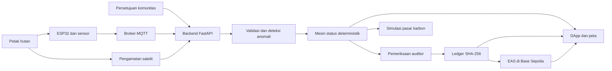

# ExcbonCP: Dari Hutan yang Dijaga Menjadi Bukti yang Dapat Dipercaya

> Blueprint naratif proyek *Decentralized Monitoring, Reporting, and Verification* (MRV) untuk kredit karbon hutan.

## Ringkasan

ExcbonCP lahir dari satu pertanyaan sederhana: **bagaimana kondisi hutan dapat dibuktikan secara terbuka, bukan hanya dinyatakan dalam sebuah laporan?**

Hutan menyimpan karbon, menopang kehidupan masyarakat, dan memiliki nilai ekologis yang besar. Namun, ketika manfaat itu hendak diterjemahkan menjadi unit karbon, muncul persoalan yang jauh lebih rumit. Data lapangan tersebar, citra satelit tidak selalu mudah dipahami, persetujuan masyarakat dapat terpisah dari proses teknis, dan hasil audit sering hanya terlihat oleh pihak tertentu. Akibatnya, pihak luar sulit mengetahui dari mana sebuah klaim berasal, siapa yang menyetujuinya, dan apakah datanya pernah diubah.

ExcbonCP dibangun sebagai prototipe jawaban atas persoalan tersebut. Sistem ini menghubungkan sensor lapangan, pengamatan satelit, persetujuan komunitas, aturan verifikasi yang deterministik, pemeriksaan auditor, serta jejak integritas digital dalam satu alur yang dapat ditelusuri.

Proyek ini tidak memulai cerita dari perdagangan. Ia memulai cerita dari **bukti**.

> **Bukti dibangun lebih dahulu. Nilai ekonomi hanya dapat dibicarakan setelahnya.**

---

## 1. Latar Belakang: Nilai Hutan Bergantung pada Kepercayaan

### 1.1 Hutan memiliki nilai yang tidak selalu terlihat

Pohon menyerap karbon, tanah menyimpan air, dan tutupan vegetasi menjaga keseimbangan ekosistem. Akan tetapi, manfaat tersebut tidak muncul sebagai angka yang langsung dapat diperiksa. Untuk menyatakan bahwa suatu area hutan menyerap atau menyimpan sejumlah karbon, dibutuhkan rangkaian pengukuran, pelaporan, dan verifikasi yang dikenal sebagai **MRV** (*Monitoring, Reporting, and Verification*).

MRV adalah fondasi kepercayaan dalam proyek karbon:

- **Monitoring** menjawab apa yang sedang terjadi di lapangan.
- **Reporting** menyusun hasil pengamatan menjadi informasi yang dapat dibaca.
- **Verification** memastikan klaim didukung oleh bukti dan aturan yang jelas.

Tanpa MRV yang dapat dipercaya, angka karbon hanyalah angka. Pembeli tidak memiliki dasar yang kuat untuk menilai kualitasnya, auditor harus bekerja dengan data yang terpecah, dan masyarakat sekitar hutan berisiko hanya menjadi objek dalam proses yang tidak mereka kendalikan.

### 1.2 Bukti kondisi hutan datang dari banyak tempat

Kondisi satu petak hutan tidak cukup dinilai dari satu sumber. Sensor dapat membaca kelembapan atau suhu di lokasi tertentu, tetapi tidak melihat seluruh tutupan lahan. Satelit dapat membaca perubahan vegetasi dalam cakupan luas, tetapi tidak selalu menjelaskan kondisi mikro di permukaan. Laporan manusia memberikan konteks, tetapi perlu dikaitkan dengan waktu, lokasi, dan data pendukung.

Karena itu, proses verifikasi menghadapi beberapa kesenjangan:

1. **Kesenjangan data** — data sensor, satelit, persetujuan, dan audit berada di tempat berbeda.
2. **Kesenjangan waktu** — pengukuran dapat terjadi hari ini, sedangkan pemeriksaan dilakukan jauh setelahnya.
3. **Kesenjangan pemahaman** — data teknis sulit dibaca oleh masyarakat atau pengguna umum.
4. **Kesenjangan integritas** — perubahan pada data lama tidak selalu mudah diketahui.
5. **Kesenjangan kewenangan** — sistem teknis dapat berjalan tanpa menempatkan persetujuan masyarakat sebagai syarat utama.

ExcbonCP tidak menganggap satu teknologi dapat menyelesaikan semua kesenjangan itu. Sensor, satelit, AI, blockchain, dan aplikasi web masing-masing hanya mengerjakan bagian yang sesuai dengan kemampuannya.

### 1.3 Persoalannya bukan sekadar mengumpulkan data

Menambah jumlah data tidak otomatis menambah kepercayaan. Sistem tetap harus menjawab pertanyaan berikut:

- Dari petak mana data berasal?
- Kapan data direkam?
- Apakah pembacaan sensor masih masuk akal?
- Apakah pengamatan satelit mendukung kondisi lapangan?
- Apakah komunitas memberikan persetujuan aktif?
- Aturan apa yang menghasilkan status akhir?
- Siapa yang memeriksa keputusan tersebut?
- Apakah catatan lama berubah setelah disetujui?

Inilah alasan ExcbonCP dirancang sebagai **rantai pembuktian**, bukan sekadar dashboard pemantauan.

### 1.4 Masyarakat bukan catatan tambahan

Sebuah area dapat terlihat sehat dari sensor dan satelit, tetapi itu belum cukup untuk menjadikannya layak masuk ke simulasi ekonomi. Ada manusia yang tinggal di sekitar hutan, mengelolanya, bergantung padanya, dan menanggung dampak dari keputusan tentang lahan tersebut.

Dalam ExcbonCP, persetujuan komunitas adalah bagian dari logika sistem. Jika persetujuan tidak ada atau dicabut, status petak tidak dapat menjadi `VERIFIED`. Keputusan ini sengaja ditempatkan di dalam aturan utama agar hak komunitas tidak berhenti sebagai teks kebijakan yang terpisah dari aplikasi.

### 1.5 Mengapa proyek ini perlu dibuat

ExcbonCP dibuat untuk memperlihatkan bahwa proses MRV dapat disusun menjadi alur yang:

- menghubungkan bukti lapangan dan pengamatan jarak jauh;
- menghasilkan status melalui aturan yang dapat diulang;
- menempatkan persetujuan komunitas sebagai syarat;
- menyediakan ruang pemeriksaan bagi auditor;
- mencatat keputusan dalam jejak yang mudah diuji integritasnya;
- menjelaskan hasil teknis dengan bahasa yang lebih mudah dipahami; dan
- memperagakan hubungan antara bukti terverifikasi dan nilai ekonomi tanpa melibatkan uang sungguhan.

Proyek ini adalah prototipe dan lingkungan demonstrasi. Ia belum menjadi lembaga verifikasi, bursa karbon, atau pengganti audit lapangan.

---

## 2. Gagasan Utama ExcbonCP

ExcbonCP adalah aplikasi web MRV hutan yang mengumpulkan beberapa lapisan bukti untuk satu petak lahan, menjalankan aturan status, lalu menyimpan keputusan tersebut dalam catatan yang dapat diperiksa.

Nama **ExcbonCP** mewakili gagasan tentang *carbon proof*: karbon tidak cukup diklaim, tetapi perlu ditopang oleh bukti yang memiliki asal, waktu, aturan, persetujuan, dan jejak integritas.

Sistem ini dibangun di atas tiga prinsip:

1. **Kode memutuskan.** Status utama ditentukan oleh aturan deterministik, bukan oleh model AI yang sulit dijelaskan.
2. **AI menjelaskan.** AI membantu menerjemahkan anomali dan keputusan teknis ke bahasa manusia, tetapi tidak menjadi pemegang keputusan akhir.
3. **Manusia menyetujui.** Komunitas memberikan atau mencabut persetujuan, sedangkan auditor memeriksa bukti sebelum penguncian akhir.

Secara singkat, ExcbonCP mengubah alur berikut:

```text
Kondisi hutan
    ↓
Data sensor + pengamatan satelit + persetujuan komunitas
    ↓
Validasi dan aturan status
    ↓
Pemeriksaan auditor
    ↓
Ledger hash + atestasi testnet
    ↓
Bukti yang dapat diperiksa publik
    ↓
Simulasi nilai ekonomi
```

---

## 3. Cerita Sebuah Petak Hutan di Dalam Sistem

Untuk memahami ExcbonCP, bayangkan satu petak hutan yang baru didaftarkan.

### Babak 1 — Petak mendapatkan identitas

Sebuah area hutan didaftarkan dengan identitas petak, luas, batas geografis, pengelola, dan komunitas yang berkaitan dengannya. Identitas ini menjadi titik temu seluruh data berikutnya. Pembacaan sensor, citra satelit, persetujuan, status, dan catatan audit tidak berdiri sendiri; semuanya merujuk pada petak yang sama.

Tanpa hubungan ini, sistem hanya memiliki banyak angka tanpa konteks.

### Babak 2 — Hutan mulai “berbicara” melalui sensor

Perangkat ESP32 di lapangan mengirimkan telemetri melalui MQTT. Sensor mencatat kondisi seperti suhu, kelembapan udara, kelembapan tanah, lokasi, dan indikator kebakaran. Data diberi waktu pengamatan dan identitas perangkat sebelum diterima oleh backend.

Sistem kemudian memeriksa apakah formatnya benar, nilainya masuk akal, dan data tidak merupakan duplikasi. Ketika koneksi terputus, perangkat dirancang untuk mempertahankan data sementara agar pengamatan tidak langsung hilang.

Sensor tidak disebut sebagai kebenaran tunggal. Sensor dapat rusak, dipindahkan, kehilangan daya, atau menghasilkan pembacaan yang tidak wajar. Karena itu, data lapangan perlu dibandingkan dengan sumber lain.

### Babak 3 — Satelit melihat gambar yang lebih luas

Pengamatan satelit memberikan konteks terhadap tutupan vegetasi dan perubahan area dari atas. Nilai seperti NDVI membantu sistem melihat apakah pola vegetasi mendukung cerita yang diberikan oleh sensor di lapangan.

Jika sensor menyatakan kondisi baik, tetapi pengamatan satelit menunjukkan penurunan vegetasi yang mencolok, sistem tidak menutupi perbedaan tersebut. Perbedaan menjadi **anomali** yang perlu ditinjau.

Tujuannya bukan mencari sumber mana yang selalu benar, melainkan mengungkap bagian yang perlu diperiksa manusia.

### Babak 4 — Komunitas menentukan apakah proses boleh berlanjut

Anggota komunitas melihat petak yang berkaitan dengan mereka dan dapat memberikan, menolak, atau mencabut persetujuan. Persetujuan disimpan dengan waktu dan identitas tindakan.

Jika persetujuan aktif tidak tersedia, petak tidak dapat mencapai status terverifikasi. Data teknis mungkin tetap ada untuk kepentingan pemeriksaan, tetapi proses menuju simulasi nilai ekonomi berhenti.

Dengan cara ini, persetujuan bukan lampiran administratif. Ia adalah gerbang sistem.

### Babak 5 — Mesin status menyusun keputusan

Backend menggabungkan hasil validasi sensor, pengamatan satelit, anomali, dan status persetujuan. Mesin status kemudian menghasilkan salah satu dari empat keadaan:

| Status | Arti dalam cerita petak |
| --- | --- |
| `VERIFIED` | Bukti memenuhi aturan, persetujuan aktif, dan tidak ada masalah yang memblokir. |
| `WARNING` | Ada kondisi yang perlu diperhatikan, tetapi belum menghentikan seluruh proses. |
| `DISPUTE` | Ada sengketa atau ketidaksesuaian yang membutuhkan penyelesaian manusia. |
| `BLOCKED` | Syarat mendasar tidak terpenuhi, misalnya persetujuan tidak aktif atau risiko kritis terdeteksi. |

Aturan ini deterministik: masukan yang sama harus menghasilkan status yang sama. AI tidak boleh diam-diam mengganti keputusan tersebut.

### Babak 6 — AI membantu menjelaskan, bukan menghakimi

Data MRV mudah berubah menjadi istilah teknis dan angka yang sulit dimengerti. Lapisan AI digunakan untuk membantu menandai pola tidak biasa dan menyusun penjelasan yang lebih mudah dibaca.

Contohnya, AI dapat membantu menjelaskan bahwa status `WARNING` muncul karena kelembapan tanah turun dan hasil satelit menunjukkan perubahan vegetasi. Namun, sumber angka dan aturan status tetap dapat dilihat. Pengguna tidak diminta mempercayai jawaban AI tanpa jejak data.

### Babak 7 — Auditor memeriksa sebelum bukti dikunci

Auditor melihat data pendukung, persetujuan, anomali, dan hasil mesin status. Auditor dapat menyetujui atau menolak proses sesuai bukti yang tersedia. Persetujuan auditor tidak mengubah angka sesuka hati; fungsinya adalah memeriksa bahwa rangkaian bukti dan aturan telah dijalankan dengan benar.

Tahap ini mempertahankan peran manusia pada keputusan yang memiliki konsekuensi penting.

### Babak 8 — Keputusan mendapatkan sidik jari digital

Setelah keputusan lolos, sistem menulis peristiwa ke ledger berantai SHA-256. Setiap blok membawa hash blok sebelumnya. Jika catatan lama diubah, hubungan hash akan rusak dan perubahan dapat terdeteksi.

Ringkasan bukti kemudian dapat diatestasi melalui Ethereum Attestation Service pada Base Sepolia. Blockchain dipakai sebagai jangkar eksternal untuk integritas, bukan sebagai tempat menyimpan seluruh data sensitif dan bukan sebagai pengganti database operasional.

Pengguna tidak perlu memiliki dompet kripto. Interaksi testnet ditangani oleh layanan sistem.

### Babak 9 — Bukti menjadi dasar simulasi nilai

Hanya setelah petak memiliki bukti dan status yang memenuhi aturan, estimasi unit karbon dapat dibawa ke simulasi pasar. Pengguna dapat melihat bagaimana unit terverifikasi mungkin dicatat, dialokasikan, atau diselesaikan.

Semua transaksi pada tahap ini adalah **simulasi**:

- tidak memakai uang sungguhan;
- tidak menerbitkan aset investasi nyata;
- tidak menjadikan ExcbonCP sebuah bursa;
- tidak menyatakan kredit telah diakui regulator; dan
- tidak menjanjikan pendapatan kepada pihak mana pun.

Simulasi hanya menunjukkan hubungan logis antara kualitas bukti dan potensi aktivitas ekonomi.

---

## 4. Siapa yang Terlibat

ExcbonCP dirancang untuk beberapa sudut pandang, karena satu pihak saja tidak dapat membangun kepercayaan yang utuh.

### Komunitas

Komunitas dapat melihat petak yang terkait, memahami bukti dalam bahasa yang lebih sederhana, serta memberikan atau mencabut persetujuan. Mereka juga dapat mengangkat sengketa ketika kondisi sistem tidak sesuai dengan kenyataan yang mereka alami.

### Pengelola hutan

Pengelola memantau kondisi petak, melihat riwayat status, memahami alasan peringatan, dan mengikuti hasil simulasi. Pengelola tidak dapat menghapus jejak lama hanya karena hasilnya tidak menguntungkan.

### Auditor

Auditor meninjau bukti, melihat anomali, dan memberikan keputusan pada titik pemeriksaan. Auditor tidak boleh mengubah pembacaan sensor atau hasil kalkulasi tanpa meninggalkan jejak baru.

### Pengguna publik atau tamu

Tamu dapat melihat informasi publik, status petak, dan memeriksa integritas bukti tanpa harus memahami blockchain atau memiliki akun kripto. Aksi yang memengaruhi sistem tetap membutuhkan autentikasi dan kewenangan.

### Pengembang dan operator

Tim teknis menjaga perangkat, broker pesan, API, basis data, model analisis, dan antarmuka. Kewenangan operator dibatasi agar pekerjaan pemeliharaan tidak berarti bebas mengubah riwayat keputusan.

---

## 5. Cara Setiap Lapisan Menjawab Masalah

| Masalah | Lapisan ExcbonCP | Jawaban yang diberikan |
| --- | --- | --- |
| Kondisi lapangan tidak terlihat secara rutin | ESP32 dan sensor | Telemetri berkala dari petak hutan |
| Sensor hanya melihat satu titik | Pengamatan satelit | Konteks vegetasi pada area yang lebih luas |
| Data berasal dari banyak saluran | FastAPI dan SQLite | Validasi, penyatuan identitas, dan penyimpanan terstruktur |
| Keputusan sulit diulang | Mesin status deterministik | Masukan yang sama menghasilkan status yang sama |
| Ketidaksesuaian mudah terlewat | Deteksi anomali | Penanda untuk perbedaan yang perlu ditinjau |
| Informasi teknis sulit dipahami | Penjelasan berbantuan AI | Ringkasan manusiawi dengan sumber data tetap tersedia |
| Hak komunitas mudah dipisahkan dari proses | Modul persetujuan | Persetujuan aktif menjadi syarat verifikasi |
| Keputusan penting memerlukan pemeriksaan | Alur auditor | Titik kontrol manusia sebelum penguncian |
| Riwayat dapat diubah tanpa terlihat | Ledger SHA-256 | Perubahan pada rantai dapat dideteksi |
| Bukti hanya tersimpan di satu server | EAS di Base Sepolia | Jangkar integritas eksternal pada testnet |
| Hubungan bukti dan ekonomi terlalu abstrak | Simulasi pasar | Demonstrasi alur tanpa uang sungguhan |

---

## 6. Arsitektur yang Mengikuti Alur Kepercayaan



### Lapisan lapangan

ESP32 membaca sensor suhu, kelembapan udara, kelembapan tanah, GPS, dan indikator kebakaran. MQTT dipilih karena ringan untuk komunikasi perangkat. Perangkat mengirim identitas petak dan waktu pengamatan agar setiap data memiliki konteks.

### Lapisan aplikasi

FastAPI menerima data, melakukan validasi, menjalankan aturan bisnis, mengelola autentikasi, dan menyediakan endpoint bagi DApp. SQLite digunakan untuk prototipe karena sederhana, mudah dipindahkan, dan cukup untuk demonstrasi terkontrol.

### Lapisan data dan AI

Pengamatan satelit memberi konteks vegetasi. Deteksi anomali membandingkan sumber data. Sistem penjelasan membantu pengguna memahami hasil tanpa mengambil alih kewenangan mesin status atau auditor.

### Lapisan integritas

Ledger SHA-256 menyimpan hubungan antarperistiwa. EAS di Base Sepolia menambatkan ringkasan bukti pada jaringan testnet sehingga integritasnya dapat diperiksa dari luar server aplikasi.

### Lapisan pengalaman pengguna

DApp menyajikan peta, dashboard, riwayat bukti, alur persetujuan, ruang auditor, verifikasi publik, dan simulasi pasar. Antarmuka dirancang untuk browser desktop maupun ponsel; pengguna tidak perlu memasang aplikasi native.

---

## 7. Mengapa Teknologinya Dibagi seperti Ini

### Mengapa tidak hanya memakai blockchain?

Blockchain tidak mengetahui kondisi hutan dengan sendirinya. Ia juga bukan tempat yang tepat untuk telemetri berukuran besar atau data yang mungkin sensitif. ExcbonCP memakai blockchain hanya untuk menambatkan bukti integritas, sementara data operasional tetap berada di sistem aplikasi.

### Mengapa tidak membiarkan AI menentukan status?

Status MRV harus dapat dijelaskan dan diulang. Model AI dapat berubah, memiliki bias, atau menghasilkan jawaban berbeda. Karena itu, keputusan kritis dibuat oleh aturan deterministik. AI digunakan pada wilayah yang sesuai: menemukan pola dan membantu penjelasan.

### Mengapa sensor dan satelit dipakai bersama?

Sensor memiliki kedalaman lokal tetapi cakupan sempit. Satelit memiliki cakupan luas tetapi resolusi konteks lapangan yang terbatas. Menggabungkan keduanya tidak membuat hasil sempurna, tetapi memperbesar peluang untuk menemukan ketidaksesuaian.

### Mengapa persetujuan masuk ke mesin status?

Karena persetujuan yang hanya dicatat dalam dokumen terpisah mudah diabaikan. Menjadikannya syarat sistem membuat proses teknis berhenti ketika hak komunitas belum terpenuhi.

### Mengapa masih memerlukan auditor?

Data dapat lengkap secara teknis tetapi kehilangan konteks sosial atau lapangan. Auditor menjadi titik pemeriksaan untuk kasus yang tidak seharusnya diselesaikan otomatis.

---

## 8. Prinsip Perancangan

### Bukti sebelum nilai

Tidak ada simulasi ekonomi yang seharusnya mendahului kualitas bukti. Urutan ini mencegah sistem berfokus pada transaksi sambil mengabaikan asal klaim karbon.

### Dapat ditelusuri, bukan sekadar terlihat canggih

Setiap status harus dapat ditarik kembali ke data, aturan, persetujuan, dan waktu keputusan. Teknologi hanya berguna jika memperjelas jejak tersebut.

### Hak komunitas adalah kondisi sistem

Persetujuan dapat diberikan dan dicabut. Ketiadaan persetujuan aktif memblokir verifikasi, bukan hanya menghasilkan peringatan kecil.

### Keputusan kritis tetap deterministik

Hasil utama tidak boleh bergantung pada jawaban acak atau model generatif. Aturan dapat diuji dan perubahan aturan harus terdokumentasi.

### Integritas tidak sama dengan kebenaran

Hash dan atestasi dapat menunjukkan bahwa suatu catatan tidak berubah. Keduanya tidak membuktikan bahwa sensor dipasang dengan benar atau bahwa seluruh fakta lapangan telah tercatat. Kebenaran tetap memerlukan metodologi, kalibrasi, pemeriksaan, dan tata kelola.

### Transparan tentang batas

Label simulasi dan testnet harus terlihat. ExcbonCP tidak boleh mengesankan adanya transaksi nyata, dukungan regulator, atau pengakuan kredit yang belum ada.

### Mudah digunakan oleh nonteknis

Status ditampilkan dengan kata, ikon, dan warna. Tindakan penting menghasilkan resi. Pesan kesalahan menjelaskan apa yang terjadi dan apa yang dapat dilakukan berikutnya.

---

## 9. Pengalaman Pengguna yang Dituju

Seorang pengguna tidak seharusnya perlu memahami MQTT, SHA-256, atau EAS untuk memeriksa sebuah petak. Di layar, perjalanan yang diharapkan adalah:

1. membuka peta dan memilih petak;
2. melihat status terkini beserta waktu pembaruan;
3. membaca ringkasan kondisi sensor dan satelit;
4. memahami apakah persetujuan komunitas aktif;
5. melihat alasan status dan anomali yang ditemukan;
6. membuka riwayat keputusan;
7. memeriksa hash atau atestasi jika membutuhkan bukti teknis; dan
8. melihat simulasi unit hanya ketika petak memenuhi syarat.

Setiap peran mendapatkan tampilan sesuai kewenangannya. Tamu membaca, komunitas mengelola persetujuan, pengelola memantau, dan auditor memeriksa. Sistem tidak meminta pengguna umum memiliki dompet kripto.

---

## 10. Skenario Demonstrasi

Demonstrasi utama menceritakan dua petak dengan hasil berbeda agar aturan sistem terlihat jelas.

### Petak A: bukti selaras

1. Sensor mengirim data dalam rentang wajar.
2. Pengamatan satelit mendukung kondisi vegetasi.
3. Persetujuan komunitas aktif.
4. Tidak ada anomali kritis.
5. Mesin menghasilkan status `VERIFIED`.
6. Auditor meninjau dan menyetujui.
7. Keputusan masuk ke ledger dan ditambatkan ke testnet.
8. Unit estimasi muncul pada simulasi pasar.

### Petak B: bukti tidak cukup

1. Sensor menunjukkan indikator kebakaran atau nilai yang tidak wajar.
2. Pengamatan satelit menunjukkan perubahan yang perlu diperiksa.
3. Persetujuan tidak aktif atau terdapat sengketa.
4. Mesin menghasilkan `DISPUTE` atau `BLOCKED`.
5. Proses penguncian dan simulasi ekonomi dihentikan.
6. Pengguna melihat alasan, sumber bukti, dan langkah tindak lanjut.

Dua petak ini menunjukkan nilai utama sistem: ExcbonCP tidak hanya memperlihatkan petak yang lolos, tetapi juga menjelaskan mengapa petak lain harus berhenti.

---

## 11. Apa yang Sudah Dibangun dalam Prototipe

Repositori ExcbonCP memuat komponen untuk:

- telemetri IoT dan komunikasi MQTT;
- API FastAPI dan penyimpanan SQLite;
- autentikasi dan pembatasan akses berbasis peran;
- status MRV dan kalkulasi CO2e;
- data satelit serta deteksi anomali;
- persetujuan komunitas dan alur auditor;
- ledger berantai SHA-256;
- integrasi EAS pada Base Sepolia;
- DApp responsif dengan peta dan dashboard;
- verifikasi bukti publik; dan
- simulasi pasar karbon.

Status implementasi setiap kebutuhan dapat berubah seiring pengembangan. Sumber yang lebih tepat untuk menilai kelengkapan teknis adalah [`requirements-traceability.md`](requirements-traceability.md), hasil pengujian, dan kode pada repositori—bukan klaim dalam narasi ini.

---

## 12. Batasan dan Hal yang Tidak Diklaim

Blueprint ini sengaja membatasi klaim agar prototipe tidak dipahami sebagai produk produksi.

### ExcbonCP saat ini bukan

- lembaga sertifikasi atau verifikasi karbon;
- bursa karbon;
- platform investasi;
- penerbit kredit karbon yang diakui regulator;
- pengganti audit lapangan dan metodologi ilmiah;
- bukti bahwa suatu komunitas nyata telah memberikan persetujuan; atau
- sistem yang siap menyimpan data sensitif berskala nasional.

### Batas teknis prototipe

- Perangkat sensor dapat gagal, perlu kalibrasi, dan belum mewakili seluruh variasi lapangan.
- Data satelit dipengaruhi resolusi, awan, waktu pengambilan, dan ketersediaan layanan.
- Deteksi anomali bergantung pada kualitas data dan baseline.
- Penjelasan AI dapat keliru sehingga sumber data asli harus tetap menjadi rujukan.
- SQLite sesuai untuk demo, tetapi arsitektur produksi memerlukan evaluasi skala, replikasi, dan pemulihan.
- Base Sepolia adalah jaringan uji coba, bukan jaringan transaksi produksi.
- Estimasi CO2e dan harga dalam simulasi bukan dasar keputusan finansial nyata.
- Identitas dan persetujuan pada demo belum menggantikan proses hukum atau sosial di lapangan.

### Pernyataan yang tidak boleh dibuat

Tim tidak boleh menyatakan bahwa regulator, bursa, investor, perusahaan, atau komunitas tertentu telah mendukung ExcbonCP tanpa bukti resmi. Tim juga tidak boleh menyatakan bahwa sistem telah menurunkan biaya audit, menaikkan harga kredit, atau menghilangkan kecurangan sebelum ada pengujian lapangan yang memadai.

---

## 13. Risiko yang Perlu Dijaga

| Risiko | Dampak | Mitigasi dalam rancangan |
| --- | --- | --- |
| Sensor rusak atau dimanipulasi | Status dibangun dari data keliru | Validasi rentang, perbandingan satelit, penanda anomali, audit lapangan |
| Data lama diubah | Riwayat keputusan kehilangan kepercayaan | Ledger SHA-256 dan jangkar EAS |
| AI memberi penjelasan salah | Pengguna menerima alasan menyesatkan | AI tidak menentukan status; bukti dan aturan asli tetap terlihat |
| Persetujuan hanya formalitas | Hak komunitas terabaikan | Persetujuan aktif menjadi gerbang `VERIFIED` |
| Testnet dianggap transaksi nyata | Pengguna salah memahami risiko | Label simulasi/testnet pada UI dan dokumentasi |
| Akun berkewenangan disalahgunakan | Keputusan penting berubah tanpa hak | JWT, RBAC, audit trail, dan pemisahan peran |
| Layanan eksternal tidak tersedia | Alur data terhenti | Buffer perangkat, status layanan, dan mode data demo yang jelas |
| Data lokasi terlalu terbuka | Privasi dan keamanan petak terganggu | Pembatasan detail publik dan evaluasi klasifikasi data |

---

## 14. Arah Pengembangan Setelah Prototipe

ExcbonCP baru bermakna di dunia nyata jika teknologi diikuti kerja metodologis dan sosial. Tahap berikutnya bukan langsung menjual unit, melainkan memperkuat kualitas pembuktian.

### Tahap 1 — Validasi teknis

- kalibrasi perangkat pada kondisi lapangan;
- uji kehilangan koneksi dan sinkronisasi ulang;
- ukur tingkat kesalahan sensor;
- validasi hasil satelit dengan observasi lapangan;
- uji integritas ledger dan pemulihan sistem; dan
- audit keamanan aplikasi serta pengelolaan kunci.

### Tahap 2 — Validasi bersama pengguna

- menyusun proses persetujuan bersama komunitas, bukan hanya untuk komunitas;
- menguji apakah bahasa aplikasi benar-benar dipahami;
- memastikan mekanisme pencabutan persetujuan dan sengketa dapat digunakan;
- melibatkan auditor untuk menilai kelengkapan bukti; dan
- menentukan data mana yang boleh tampil ke publik.

### Tahap 3 — Kesesuaian metodologi

- memetakan kalkulasi terhadap metodologi karbon yang relevan;
- mendokumentasikan ketidakpastian dan kualitas data;
- menetapkan prosedur kalibrasi dan inspeksi;
- menyusun tata kelola perubahan aturan; dan
- meminta kajian hukum serta regulasi.

### Tahap 4 — Kesiapan operasional

- mengganti atau memperkuat komponen penyimpanan sesuai skala;
- menambahkan observabilitas, cadangan, dan pemulihan bencana;
- memperkeras autentikasi dan pengelolaan rahasia;
- menetapkan SLA perangkat dan layanan; dan
- menjalankan pilot terbatas dengan kriteria keberhasilan yang terukur.

Hanya setelah tahapan tersebut, hubungan ke ekosistem ekonomi nyata layak dievaluasi.

---

## 15. Ukuran Keberhasilan

Keberhasilan ExcbonCP tidak diukur dari banyaknya istilah teknologi yang digunakan. Prototipe dianggap berhasil jika dapat menunjukkan bahwa:

1. setiap data dapat ditarik kembali ke petak, perangkat, dan waktu pengamatan;
2. status yang sama muncul untuk masukan yang sama;
3. persetujuan yang dicabut benar-benar menghentikan verifikasi;
4. anomali terlihat dan tidak disembunyikan;
5. auditor dapat memeriksa alasan sebelum menyetujui;
6. perubahan pada riwayat ledger dapat terdeteksi;
7. pengguna nonteknis dapat memahami mengapa petak lolos atau berhenti;
8. batas antara simulasi dan transaksi nyata tidak membingungkan; dan
9. seluruh alur dapat dijalankan ulang dalam demonstrasi yang konsisten.

---

## 16. Kalimat Inti Proyek

### Versi satu kalimat

**ExcbonCP mengubah data hutan yang tersebar menjadi rantai bukti yang dapat ditelusuri, disetujui komunitas, diperiksa auditor, dan diuji integritasnya.**

### Versi singkat untuk presentasi

Hutan tidak kekurangan nilai; yang sering kurang adalah bukti yang dapat dipercaya bersama. ExcbonCP menyatukan sensor lapangan, pengamatan satelit, persetujuan komunitas, aturan verifikasi, dan jejak integritas digital agar perjalanan sebuah klaim karbon dapat diperiksa dari awal sampai akhir. Setelah bukti lolos, sistem memperagakan nilai ekonominya melalui simulasi—bukan transaksi nyata.

### Tiga kalimat yang menjadi pegangan

1. **Kami membangun bukti lebih dahulu, baru membicarakan nilai.**
2. **Kode memutuskan, AI menjelaskan, manusia menyetujui.**
3. **Semua aktivitas ekonomi adalah simulasi dan semua atestasi blockchain berjalan di testnet.**

---

## 17. Peta Dokumen Teknis

Blueprint naratif ini menjelaskan alasan dan perjalanan proyek. Detail implementasi dipisahkan agar cerita tetap mudah dibaca.

| Kebutuhan pembaca | Dokumen |
| --- | --- |
| Arsitektur lengkap | [`architecture/OVERVIEW.md`](architecture/OVERVIEW.md) |
| Kontrak data antarkomponen | [`contract.md`](contract.md) |
| Skema basis data | [`database-schema.md`](database-schema.md) |
| Diagram konteks | [`models/CONTEXT_DIAGRAM.md`](models/CONTEXT_DIAGRAM.md) |
| Aliran data | [`models/DATA_FLOW_DIAGRAM.md`](models/DATA_FLOW_DIAGRAM.md) |
| Perjalanan pengguna DApp | [`models/DAPP_FLOWCHART.md`](models/DAPP_FLOWCHART.md) |
| Urutan proses | [`models/SEQUENCE_DIAGRAM.md`](models/SEQUENCE_DIAGRAM.md) |
| Aturan status | [`models/STATE_DIAGRAM.md`](models/STATE_DIAGRAM.md) |
| Kebutuhan dan status implementasi | [`requirements-traceability.md`](requirements-traceability.md) |
| Keputusan arsitektur | [`decisions.md`](decisions.md) |
| Blueprint teknis v5 asli | [`context/Excboncp_Blueprint_System_Modeling_6_Hari_v5.md`](context/Excboncp_Blueprint_System_Modeling_6_Hari_v5.md) |

---

## Penutup

ExcbonCP bukan cerita tentang menaruh hutan di blockchain. Ia adalah cerita tentang membangun kepercayaan secara bertahap.

Kepercayaan dimulai ketika data memiliki asal. Ia tumbuh ketika sumber yang berbeda dapat dibandingkan. Ia menjadi adil ketika masyarakat memiliki hak untuk berkata tidak. Ia menjadi dapat diuji ketika aturan keputusan terbuka. Ia menjadi lebih tahan terhadap perubahan tersembunyi ketika riwayat memiliki jejak integritas. Dan baru setelah semua itu, nilai ekonomi dapat dibicarakan dengan bertanggung jawab.

Itulah proyek ini: **sebuah prototipe rantai pembuktian untuk hutan, dari kondisi lapangan hingga bukti yang dapat diperiksa bersama.**
