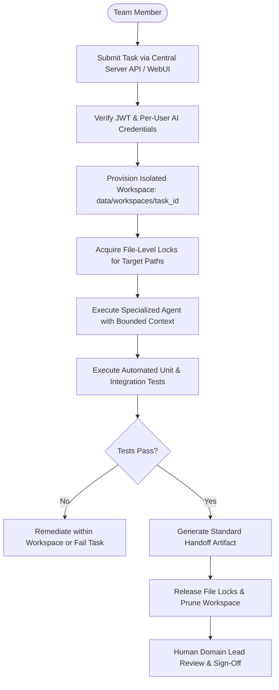

# ExcbonCP Agent Workflow & Orchestration Protocol

> Operational protocol governing task assignment, context boundaries, workspace isolation, inter-agent handoffs, and human escalation.

---

## 1. Agent Execution Lifecycle



---

## 2. Standardized Agent Handoff Formats

To ensure clear traceability and context transfer between specialized agents, all inter-agent task handoffs must adhere to JSON schema contracts:

### Architect $\rightarrow$ Any Agent
```json
{
  "from": "architect",
  "to": "backend",
  "decision": "ADR-006",
  "action": "Implement SHA-256 hash chaining algorithm in server/ledger/service.py",
  "acceptance_criteria": [
    "Canonical JSON formatting enforced",
    "Previous block hash validated before appending",
    "Unit test coverage >= 90%"
  ]
}
```

### IoT $\rightarrow$ Backend
```json
{
  "from": "iot",
  "to": "backend",
  "topic": "excboncp/sensors/{parcel_id}",
  "payload": {
    "device_id": "esp32-node-01",
    "timestamp": 1731067200,
    "temperature_c": 26.4,
    "humidity_pct": 78.2,
    "soil_moisture_pct": 42.0,
    "gps": {"lat": -6.9175, "lon": 107.6191}
  }
}
```

### Backend $\rightarrow$ Frontend
```json
{
  "from": "backend",
  "to": "frontend",
  "endpoint": "/api/v1/parcels/{id}/status",
  "schema": {
    "parcel_id": "PARCEL-001",
    "status": "VERIFIED",
    "co2e_metric_tons": 142.85,
    "last_updated": "2026-11-08T14:30:00Z"
  }
}
```

### Security $\rightarrow$ Any Agent
```json
{
  "from": "security",
  "to": "backend",
  "finding": "SEC-004: JWT expiration exceeds recommended testing threshold",
  "severity": "P3",
  "remediation": "Update JWT_EXPIRY_HOURS in server/config.py to default to 24h with refresh mechanism"
}
```

### Reviewer $\rightarrow$ Any Agent
```json
{
  "from": "reviewer",
  "to": "backend",
  "verdict": "approved",
  "items": [
    "Test coverage confirmed at 94%",
    "Linting checks passed clean with Ruff"
  ]
}
```

---

## 3. Directory Boundary Enforcement

Agents must strictly honor their configured allowed and restricted directory boundaries:
- If a task attempts to read or write restricted files (e.g. `.env`, another user's credentials, or hardware firmware without IoT role), the execution runtime must abort the task immediately.
- Agents operate on files inside `data/workspaces/<task_id>/` before changes are reconciled into the primary working tree.

---

## 4. Escalation Procedures

An agent must immediately halt execution and trigger human escalation when:
1. An ambiguous domain rule is encountered (e.g. contradictory consent status and dispute claim).
2. A required secret or API credential is missing.
3. A consequential operation is reached (attestation on Base Sepolia, production deployment, firmware flash).
4. File locks cannot be acquired due to active concurrent edits.
