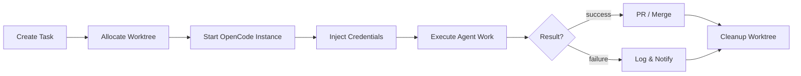

# Central Engineering Server Architecture

> Multi-user development server powering AI-assisted engineering for the ExcbonCP team. Provides authenticated access, encrypted credential management, task orchestration, and per-user agent runtime.

---

## Overview

The Central Engineering Server is a FastAPI application that serves as the team's shared development gateway. It authenticates team members, securely stores their AI provider credentials, orchestrates development tasks with workspace isolation, and manages per-user OpenCode agent instances for AI-assisted coding.

## Component Diagram

```mermaid
flowchart TB
    subgraph Clients["Team Clients"]
        Revand["Revand\n(Architect)"]
        Bagus["Bagus\n(IoT/Backend)"]
        Davin["Davin\n(Data/AI)"]
        Malik["Malik\n(DApp/UX)"]
    end

    subgraph Gateway["FastAPI Gateway (:8000)"]
        Auth["JWT Authentication\nMiddleware"]
        Router["API Router"]
        RateLimit["Rate Limiter"]
        AuditLog["Audit Logger"]

        Auth --> Router
        Router --> RateLimit
        Router --> AuditLog
    end

    subgraph Services["Core Services"]
        UserSvc["User Service\n(registration, login, roles)"]
        CredSvc["Credential Service\n(Fernet encryption)"]
        TaskSvc["Task Orchestrator\n(workspace isolation)"]
        AgentSvc["Agent Manager\n(skill routing)"]
        HealthSvc["Health & Monitoring\nService"]
    end

    subgraph Runtime["Agent Runtime"]
        OC1["OpenCode Instance\n(Revand)"]
        OC2["OpenCode Instance\n(Bagus)"]
        OC3["OpenCode Instance\n(Davin)"]
        OC4["OpenCode Instance\n(Malik)"]
    end

    subgraph Storage["Storage"]
        UserDB["users.db\n(SQLite)"]
        CredStore["credentials/\n(encrypted files)"]
        TaskDB["tasks.db\n(SQLite)"]
        Worktrees["Git Worktrees\n(/worktrees/)"]
    end

    Clients -->|HTTPS + JWT| Gateway
    Router --> Services
    UserSvc --> UserDB
    CredSvc --> CredStore
    TaskSvc --> TaskDB
    TaskSvc --> Worktrees
    AgentSvc --> Runtime
    TaskSvc --> Runtime
    CredSvc -->|inject keys| Runtime
end
```

## Components

### 1. FastAPI Gateway

The HTTP entry point for all team interactions.

- **Port:** 8000 (configurable)
- **Framework:** FastAPI with Uvicorn ASGI server
- **Middleware stack:**
  - CORS (configured for team client origins)
  - JWT authentication (RS256 or HS256)
  - Rate limiting (per-user, per-endpoint)
  - Request/response audit logging
  - Error handling with structured responses

### 2. JWT Authentication

All endpoints (except `/auth/register` and `/auth/login`) require a valid JWT bearer token.

- **Token format:** JWT with `sub` (user ID), `role` (owner/member), `exp` (expiry), `iat` (issued at)
- **Token lifetime:** Access token = 30 minutes, Refresh token = 7 days
- **Storage:** Tokens are stateless; validation uses the server's signing key
- **Password hashing:** bcrypt with configurable rounds

### 3. Credential Service (Encrypted Storage)

Each user's AI provider credentials (API keys for OpenAI, Anthropic, etc.) are encrypted at rest using Fernet symmetric encryption.

- **Encryption:** `cryptography.fernet.Fernet` with per-user derived keys
- **Key derivation:** PBKDF2-HMAC-SHA256 from a master secret + user salt
- **Storage:** Individual encrypted files per user in `credentials/` directory
- **Access:** Credentials are decrypted only in-memory when injected into an OpenCode instance
- **Rotation:** Users can update credentials via API; old encrypted files are overwritten

### 4. Task Orchestrator

Manages development tasks with full workspace isolation.

- **Workspace isolation:** Each task operates in a dedicated Git worktree branched from the main repository
- **Lifecycle:** `PENDING` → `RUNNING` → `COMPLETED` / `FAILED` / `CANCELLED`
- **Concurrency:** Configurable max concurrent tasks per user (default: 2)
- **Cleanup:** Completed worktrees are pruned after a configurable retention period

#### Task Workflow



### 5. Agent Manager & Skill System

Routes tasks to the appropriate agent based on the skill system defined in [AGENTS.md](../../AGENTS.md).

- **Agent definitions:** 8 agents (Architect, Backend, Frontend, IoT, Data/AI, Blockchain, Security, Reviewer)
- **Skill routing:** Task descriptions are matched to agent capabilities via keyword and context analysis
- **Scope enforcement:** Each agent instance is restricted to its allowed directories
- **Handoff protocol:** Agents communicate via structured JSON handoff messages

### 6. Per-User OpenCode Instances

Each team member gets a dedicated OpenCode process for AI-assisted development.

- **Process isolation:** Separate OS process per user with scoped filesystem access
- **Credential injection:** AI provider keys are decrypted and passed as environment variables at process startup
- **Session management:** Instances are started on-demand and stopped after idle timeout (default: 30 minutes)
- **Configuration:** Per-user `.opencode.json` with model preferences and agent settings

### 7. Monitoring & Health Checks

Continuous system observability.

- **Health endpoint:** `GET /health` returns system status, uptime, active users, running tasks
- **Metrics tracked:**
  - Active OpenCode instances
  - Task queue depth and completion rate
  - API response times (p50, p95, p99)
  - Credential access frequency
  - Error rates by endpoint
- **Audit log:** Every authenticated request logged with user ID, endpoint, method, timestamp, response code
- **Log format:** Structured JSON to stdout, rotated daily

## Database Schema (Central Server)

The central server uses its own SQLite databases, separate from the MRV application database.

### `users.db`

| Table | Purpose |
|-------|---------|
| `users` | User accounts (id, username, password_hash, role, created_at) |
| `sessions` | Active JWT sessions for optional server-side revocation |

### `tasks.db`

| Table | Purpose |
|-------|---------|
| `tasks` | Task records (id, user_id, description, agent, status, worktree_path, created_at, completed_at) |
| `task_logs` | Execution logs per task (id, task_id, level, message, timestamp) |
| `audit_log` | API audit trail (id, user_id, method, endpoint, status_code, timestamp) |

## Directory Structure

```
excboncp/
├── src/
│   └── server/           # Central server source
│       ├── main.py        # FastAPI application entry
│       ├── auth/          # Authentication module
│       ├── credentials/   # Credential encryption service
│       ├── tasks/         # Task orchestration
│       ├── agents/        # Agent management & skills
│       └── monitoring/    # Health checks & metrics
├── config/
│   └── server.toml        # Server configuration
├── data/
│   ├── users.db           # User database
│   ├── tasks.db           # Task database
│   └── credentials/       # Encrypted credential files
└── worktrees/             # Git worktree directory
```

## Security Considerations

- **No plaintext credentials:** All AI keys encrypted at rest with Fernet
- **JWT validation:** Every request validated; expired tokens rejected
- **Scope isolation:** Agents cannot access directories outside their allowlist
- **Audit trail:** All API calls logged for forensic analysis
- **Rate limiting:** Prevents abuse and runaway AI API costs
- **Process isolation:** OpenCode instances run as separate processes with limited filesystem scope

## Configuration

Key environment variables and configuration:

| Variable | Description | Default |
|----------|-------------|---------|
| `EXCBONCP_SECRET_KEY` | JWT signing key | Required |
| `EXCBONCP_MASTER_KEY` | Credential encryption master key | Required |
| `EXCBONCP_DB_PATH` | Path to database directory | `./data` |
| `EXCBONCP_MAX_TASKS` | Max concurrent tasks per user | `2` |
| `EXCBONCP_IDLE_TIMEOUT` | OpenCode idle timeout (seconds) | `1800` |
| `EXCBONCP_LOG_LEVEL` | Logging level | `INFO` |
| `EXCBONCP_CORS_ORIGINS` | Allowed CORS origins | `["http://localhost:3000"]` |
