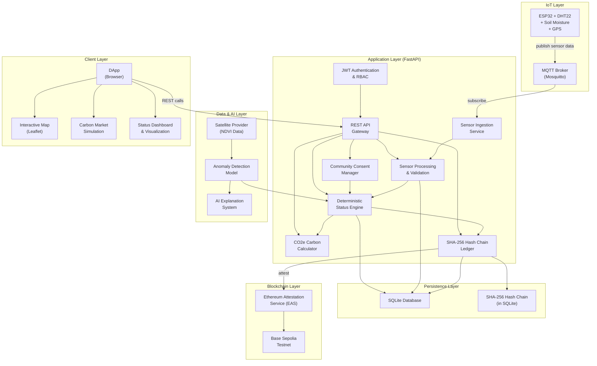

# ExcbonCP System Architecture Overview

> Decentralized MRV (Monitoring, Reporting, Verification) Forest System for transparent carbon economy with IoT sensors, satellite imagery, blockchain attestation, and community governance.

---

## System Summary

ExcbonCP is a full-stack MRV platform that monitors forest land parcels using IoT sensors and satellite data, determines parcel health status through a deterministic status engine, records decisions in a tamper-evident SHA-256 hash chain ledger, attests results on-chain via Ethereum Attestation Service (EAS) on Base Sepolia, and presents everything through an interactive DApp with maps and a simulated carbon market.

## High-Level Architecture

## Component Descriptions

### IoT Layer
- **ESP32 Microcontrollers** — Battery-powered field devices with DHT22 (temperature/humidity), capacitive soil moisture sensors, and GPS modules. Each device is assigned to a land parcel and publishes readings at configurable intervals.
- **MQTT Broker (Mosquitto)** — Lightweight message broker receiving sensor telemetry on topic `excboncp/sensors/{parcel_id}`. Supports QoS 1 for reliable delivery and TLS for transport security.

### Application Layer
- **Sensor Ingestion Service** — Subscribes to MQTT topics, validates incoming payloads, assigns timestamps, and writes raw readings to the database.
- **Sensor Processing & Validation** — Applies range checks, deduplication, and data quality scoring. Flags suspicious readings for anomaly review.
- **Deterministic Status Engine** — Core business logic. Evaluates each parcel against defined thresholds and conditions to produce one of four statuses: `VERIFIED`, `WARNING`, `DISPUTE`, or `BLOCKED`. The algorithm is fully deterministic — same inputs always produce same output.
- **CO2e Carbon Calculator** — Computes estimated carbon sequestration per parcel based on sensor data, parcel area, vegetation type, and NDVI values.
- **Community Consent Manager** — Tracks consent grants and revocations from community members. A parcel cannot reach `VERIFIED` status without active consent.
- **SHA-256 Hash Chain Ledger** — Every status change, attestation, and significant event is appended to an append-only ledger. Each entry includes a SHA-256 hash of the previous entry, creating a tamper-evident chain.
- **JWT Authentication & RBAC** — Issues and validates JWT tokens. Enforces role-based access control (owner, member, auditor).
- **REST API Gateway** — FastAPI-based HTTP interface exposing all services as RESTful endpoints.

### Data & AI Layer
- **Satellite Provider (NDVI)** — External service providing Normalized Difference Vegetation Index data for registered parcels. Used for independent verification of ground sensor data.
- **Anomaly Detection Model** — Compares sensor readings against satellite data and historical baselines. Detects discrepancies that may indicate sensor tampering, environmental events, or equipment failure.
- **AI Explanation System** — Generates human-readable explanations for status decisions and anomaly detections. Helps community members and auditors understand why a parcel received a particular status.

### Persistence Layer
- **SQLite Database** — Single-file embedded database storing all application data: users, parcels, readings, consents, statuses, carbon credits, and audit logs.
- **SHA-256 Hash Chain** — Stored as a table within SQLite. Each row contains the entry data, its SHA-256 hash, and the hash of the previous entry.

### Blockchain Layer
- **Ethereum Attestation Service (EAS)** — Used to create on-chain attestations of verified parcel statuses and carbon calculations. Each attestation references a ledger hash, providing an immutable anchor point.
- **Base Sepolia Testnet** — Ethereum L2 testnet used for development and demonstration. Low gas costs enable frequent attestations.

### Client Layer
- **DApp** — Browser-based single-page application providing the user interface. Built with modern JavaScript framework.
- **Interactive Map (Leaflet)** — Geographic visualization of registered land parcels with color-coded status indicators and drill-down details.
- **Carbon Market Simulation** — Simulated trading interface where verified carbon credits can be listed, bought, and sold.
- **Status Dashboard** — Real-time visualization of sensor readings, parcel statuses, anomaly alerts, and carbon calculations.

## Central Engineering Server

The project includes a central engineering server (documented in [CENTRAL_SERVER.md](CENTRAL_SERVER.md)) that provides:
- Multi-user FastAPI gateway for team collaboration
- Per-user OpenCode agent instances for AI-assisted development
- Encrypted credential storage for AI provider API keys
- Task orchestration with Git worktree isolation
- Agent skill system aligned with the 8 agents defined in [AGENTS.md](../../AGENTS.md)

## Data Flow Summary

1. **Sensor → Database:** ESP32 → MQTT → Ingest → Validate → Store in SQLite
2. **Satellite → Status:** Satellite API → NDVI Analysis → Anomaly Detection → Status Engine
3. **Status Determination:** Sensor Data + Satellite Data + Consent Status → Deterministic Engine → Status Record
4. **Ledger & Attestation:** Status Change → Hash Chain Entry → EAS Attestation → Base Sepolia
5. **User Interface:** DApp → REST API → Query Database → Render Map/Dashboard/Market

## Technology Stack

| Layer | Technology |
|-------|-----------|
| Firmware | C/C++ (PlatformIO), ESP32 Arduino Framework |
| Broker | Mosquitto MQTT 2.x |
| Backend | Python 3.14, FastAPI, Uvicorn |
| Database | SQLite 3 |
| Blockchain | EAS SDK, ethers.js, Base Sepolia |
| Frontend | JavaScript/TypeScript, Leaflet.js |
| AI/ML | Python, scikit-learn (anomaly), LLM API (explanations) |
| DevOps | Docker, Docker Compose, Nginx |

## Design Principles

1. **Determinism** — The status engine produces identical outputs for identical inputs. No randomness in critical paths.
2. **Transparency** — Every decision is recorded in the ledger with an explanation. Community members can audit the full chain.
3. **Tamper Evidence** — SHA-256 hash chain makes any data modification detectable. On-chain attestations provide external anchors.
4. **Community Sovereignty** — Land parcels cannot be monetized without explicit community consent. Consent can be revoked at any time.
5. **Offline Resilience** — ESP32 devices buffer data when disconnected. The system reconciles on reconnection.
6. **Simplicity** — SQLite over PostgreSQL, MQTT over Kafka, direct EAS over custom contracts. Each choice favors simplicity and auditability.
