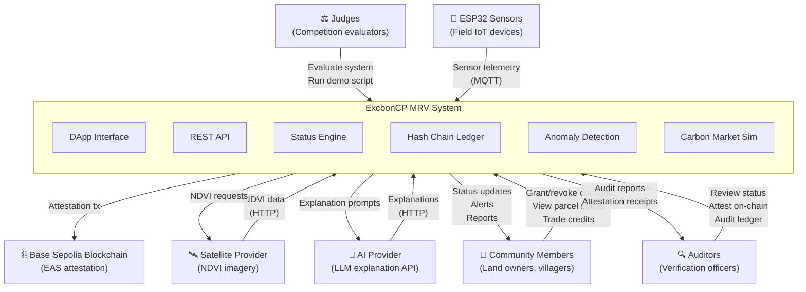

# Context Diagram

> System boundary view of ExcbonCP showing external actors and their interactions with the system.

---

## External Actors

| Actor | Type | Interaction | Protocol |
|-------|------|------------|----------|
| **Community Members** | Human | Grant consent, view parcel status, trade carbon credits, receive notifications | HTTPS (DApp) |
| **Auditors** | Human | Review parcel statuses, verify ledger integrity, create on-chain attestations | HTTPS (DApp + API) |
| **Judges** | Human | Evaluate system during competition, run demonstration scripts | HTTPS (DApp) |
| **ESP32 Sensors** | Device | Publish temperature, humidity, soil moisture, and GPS readings | MQTT (QoS 1, TLS) |
| **Satellite Provider** | Service | Provide NDVI vegetation index data for registered parcels | HTTPS (REST API) |
| **Base Sepolia Blockchain** | Infrastructure | Receive and store EAS attestation transactions | HTTPS (JSON-RPC) |
| **AI Provider** | Service | Generate natural-language explanations for status decisions and anomalies | HTTPS (REST API) |

## System Boundary

The ExcbonCP system boundary encompasses:
- All backend services (API, status engine, ledger, carbon calculator)
- All persistence (SQLite database, hash chain)
- All processing (sensor validation, anomaly detection, CO2e calculation)
- The DApp frontend
- The MQTT broker

External to the boundary:
- Physical sensors (ESP32 hardware)
- Satellite imagery providers
- Blockchain network (Base Sepolia)
- AI/LLM providers
- Human users (community, auditors, judges)
