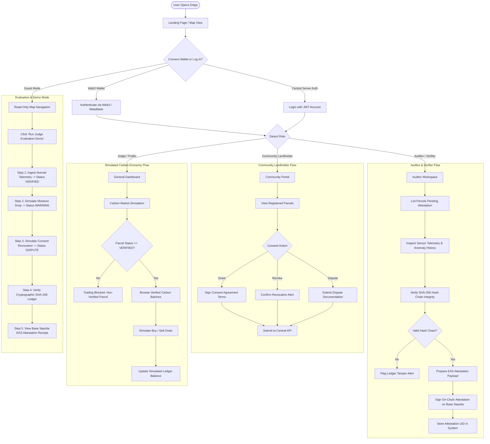

# DApp Flowchart

> User interaction flows and screen transitions within the ExcbonCP decentralized application (DApp).

---

---

## Screen Inventory

| Screen / Modal | Target Audience | Primary Functionality | Required API Endpoints |
|---|---|---|---|
| **Interactive Map (`/map`)** | All | Leaflet map with colored polygon overlays (Green = Verified, Amber = Warning, Red = Dispute, Gray = Blocked). | `GET /api/v1/parcels`, `GET /api/v1/parcels/{id}/status` |
| **Parcel Detail (`/parcel/:id`)** | All | Historical telemetry charts (DHT22, soil), satellite NDVI trends, AI summary explanations. | `GET /api/v1/parcels/{id}/telemetry`, `GET /api/v1/ai/explanation/{id}` |
| **Community Governance (`/consent`)** | Community | Sign, revoke, or dispute land monitoring consent. | `POST /api/v1/parcels/{id}/consent`, `POST /api/v1/parcels/{id}/dispute` |
| **Auditor Verification (`/auditor`)** | Auditor | Cryptographic verification of SHA-256 blocks; trigger EAS Base Sepolia attestations. | `GET /verify/{id}`, `POST /api/v1/attestations/submit` |
| **Marketplace (`/market`)** | All | Simulated spot market for verified carbon credits with clear "SIMULATION" badges. | `GET /api/v1/market/orders`, `POST /api/v1/market/order` |
| **Judge Demo Walkthrough (`/demo`)** | Judges | Step-by-step interactive script running live demonstration scenarios. | `POST /api/v1/demo/scenario/{step}` |

---

## Metadata
- **Source File:** `docs/models/DAPP_FLOWCHART.md`
- **Related Requirements:** R4, R7, R10, R13, R14, R16, R18, R20, R27
- **Responsible Owner:** Malik (DApp, UX, Maps, Presentations)
