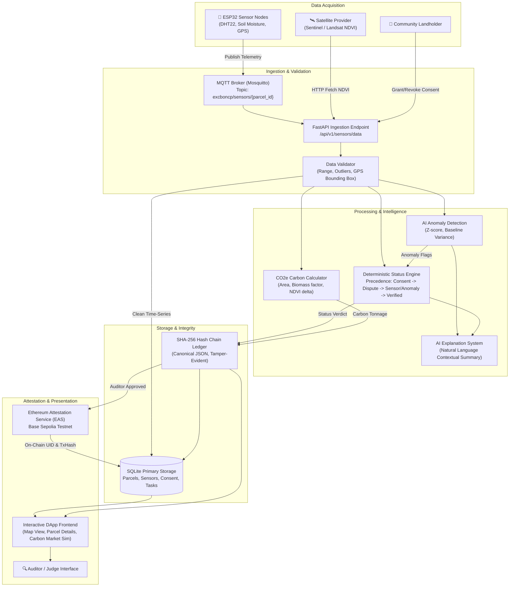

# Data Flow Diagram (DFD)

> End-to-end data pipeline from physical IoT sensor telemetry and satellite imagery to deterministic verification, ledgering, EAS attestation, and DApp visualization.

---

---

## Data Flow Descriptions

1. **IoT Ingestion:** ESP32 nodes capture humidity, temperature, volumetric soil moisture, and GPS fix every 60 seconds, publishing JSON payloads to `excboncp/sensors/{parcel_id}` over TLS MQTT (QoS 1).
2. **Deterministic Processing:** Raw readings are validated against geographic and physical bounds. The status engine evaluates consent status, sensor thresholds, and anomaly flags deterministically without non-deterministic AI interference.
3. **Ledgering:** Verified parcel states and calculated CO2e tons are serialized to canonical JSON and appended to the local SHA-256 hash chain.
4. **Attestation:** Once reviewed by an auditor, the state hash and metadata are signed and attested on Base Sepolia using EAS.
5. **Presentation:** DApp renders real-time color-coded parcel states (VERIFIED, WARNING, DISPUTE, BLOCKED) and simulated credit trading.

---

## Metadata
- **Source File:** `docs/models/DATA_FLOW_DIAGRAM.md`
- **Related Requirements:** R1, R2, R3, R4, R5, R6, R7, R8, R9, R10, R11, R12, R13
- **Responsible Owner:** Bagus (IoT/Backend) & Davin (Data/AI)
