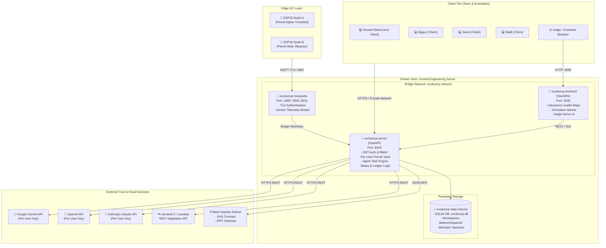

# Deployment Diagram

> Infrastructure topology and container networking for the ExcbonCP system in development, staging, and competition demonstration environments.

---



---

## Network Segmentation & Port Map

| Component | Port | Protocol | Exposure | Security Control |
|---|---|---|---|---|
| **Central Server API** | 8000 | HTTP/HTTPS | Private network / Localhost | JWT Bearer token required for all non-health routes |
| **DApp Frontend** | 3000 | HTTP | Private network / Localhost | Static SPA bundle, CORS configured |
| **MQTT Broker** | 1883 | TCP/TLS | Edge network / Localhost | Client certificate or user/password authentication |
| **MQTT WebSockets** | 9001 | WSS | Private network | In-browser real-time telemetry updates |
| **SQLite DB** | N/A | File I/O | Internal volume only | Never exposed to network ports |

---

## Reproducible Startup
To start the complete environment in single-command mode:
```bash
# Production / Staging deployment
docker compose up -d --build

# Development mode with hot-reloading
docker compose -f docker-compose.yml -f docker-compose.dev.yml up
```

---

## Metadata
- **Source File:** `docs/models/DEPLOYMENT_DIAGRAM.md`
- **Related Requirements:** R1, R2, R11, R12, R13, R25, R29
- **Responsible Owner:** Revand (Docker & Deployment)
