```mermaid
erDiagram
    USERS ||--o{ SESSIONS : "establishes"
    USERS ||--o{ CREDENTIALS : "owns"
    USERS ||--o{ TASKS : "creates / executes"
    USERS ||--o{ AUDIT_LOGS : "triggers"

    PARCELS ||--o{ SENSOR_READINGS : "monitored_by"
    PARCELS ||--o{ CONSENT_RECORDS : "governed_by"
    PARCELS ||--o{ LEDGER_BLOCKS : "recorded_in"
    PARCELS ||--o{ ATTESTATIONS : "attested_by"
    PARCELS ||--o{ MARKET_ORDERS : "traded_in"

    USERS {
        TEXT id PK
        TEXT username UK
        TEXT password_hash
        TEXT display_name
        TEXT role "owner | member | auditor"
        INTEGER is_active
        TEXT created_at
        TEXT updated_at
    }

    CREDENTIALS {
        TEXT id PK
        TEXT user_id FK
        TEXT provider "openai | anthropic | gemini | custom"
        TEXT encrypted_key "Fernet AES-128-CBC"
        TEXT display_label
        INTEGER is_active
        TEXT created_at
        TEXT updated_at
    }

    TASKS {
        TEXT id PK
        TEXT title
        TEXT description
        TEXT assigned_to FK
        TEXT created_by FK
        TEXT agent_type "architect | backend | frontend | iot | data_ai | blockchain | security | reviewer"
        TEXT status "pending | running | completed | failed | cancelled"
        TEXT workspace_path
        TEXT result
        TEXT created_at
        TEXT started_at
        TEXT completed_at
    }

    AUDIT_LOGS {
        TEXT id PK
        TEXT user_id FK
        TEXT action
        TEXT resource_type
        TEXT resource_id
        TEXT details
        TEXT ip_address
        TEXT created_at
    }

    SESSIONS {
        TEXT id PK
        TEXT user_id FK
        TEXT token_hash
        TEXT expires_at
        TEXT created_at
        INTEGER revoked
    }

    PARCELS {
        TEXT id PK
        TEXT name
        TEXT polygon_geojson
        REAL area_hectares
        TEXT vegetation_type
        REAL baseline_ndvi
        TEXT current_status "VERIFIED | WARNING | DISPUTE | BLOCKED"
        TEXT owner_wallet
        TEXT created_at
    }

    SENSOR_READINGS {
        TEXT id PK
        TEXT parcel_id FK
        TEXT device_id
        REAL temperature_celsius
        REAL humidity_percent
        REAL soil_moisture_percent
        REAL gps_latitude
        REAL gps_longitude
        TEXT recorded_at
    }

    CONSENT_RECORDS {
        TEXT id PK
        TEXT parcel_id FK
        TEXT community_account
        TEXT consent_state "GRANTED | REVOKED | DISPUTED"
        TEXT signature
        TEXT terms_version
        TEXT recorded_at
    }

    LEDGER_BLOCKS {
        INTEGER block_index PK
        TEXT parcel_id FK
        TEXT timestamp
        REAL co2e_metric_tons
        TEXT parcel_status
        TEXT prev_hash "SHA-256 hex"
        TEXT current_hash "SHA-256 hex"
        TEXT canonical_data "Canonical JSON string"
    }

    ATTESTATIONS {
        TEXT id PK
        TEXT parcel_id FK
        TEXT block_hash
        TEXT eas_uid UK "EAS Attestation UID on Base Sepolia"
        TEXT tx_hash "Transaction Hash"
        TEXT schema_uid
        TEXT auditor_id FK
        TEXT attested_at
    }

    MARKET_ORDERS {
        TEXT id PK
        TEXT parcel_id FK
        TEXT seller_account
        TEXT buyer_account
        REAL credit_amount "Verified CO2e metric tons"
        REAL simulated_price_usd
        TEXT order_status "LISTED | MATCHED | COMPLETED | CANCELLED"
        TEXT created_at
    }
```

# Entity-Relationship Diagram (ERD)

> Database schema and entity relationships for the ExcbonCP SQLite database, supporting engineering server operations, MRV processing, and decentralized governance.

---

---

## Storage & Integrity Principles
1. **Single File Persistence:** SQLite embedded database stored at `./data/excboncp.db`.
2. **Write-Ahead Logging (WAL):** Enabled via `PRAGMA journal_mode=WAL` to permit concurrent readers during writes.
3. **Foreign Key Enforcement:** Enabled via `PRAGMA foreign_keys=ON`.
4. **Append-Only Ledger:** `LEDGER_BLOCKS` forms an unbroken cryptographic hash chain where `current_hash = SHA256(canonical(data) + prev_hash)`.

---

## Metadata
- **Source File:** `docs/models/ER_DIAGRAM.md`
- **Related Requirements:** R6, R7, R11, R12, R14, R15, R17
- **Responsible Owner:** Revand (Database & Ledger)
