```mermaid
erDiagram
    ZONES ||--o{ USERS : "scopes"
    ZONES ||--o{ MARKET_ORDERS : "reports"

    PARCELS ||--o{ USERS : "scopes"
    PARCELS ||--o{ SENSOR_READINGS : "monitored_by"
    PARCELS ||--o{ SATELLITE_OBSERVATIONS : "observed_by"
    PARCELS ||--o{ CONSENT_RECORDS : "governed_by"
    PARCELS ||--o{ STATUS_RESULTS : "evaluated_in"
    PARCELS ||--o{ LEDGER_BLOCKS : "recorded_in"
    PARCELS ||--o{ ATTESTATIONS : "attested_by"
    PARCELS ||--o{ MARKET_ORDERS : "traded_in"

    USERS ||--o{ SESSIONS : "establishes"
    USERS ||--o{ CREDENTIALS : "owns"
    USERS ||--o{ TASKS : "creates"
    USERS ||--o{ TASKS : "is_assigned"
    USERS ||--o{ AUDIT_LOGS : "triggers"
    USERS ||--o{ CONSENT_RECORDS : "grants"
    USERS ||--o{ LEDGER_BLOCKS : "approves"
    USERS ||--o{ ATTESTATIONS : "audits"

    ZONES {
        TEXT id PK
        TEXT name
        TEXT type "kek | kota"
        TEXT jurisdiction
        TEXT created_at
    }

    PARCELS {
        TEXT id PK
        TEXT name
        TEXT polygon_geojson
        REAL area_hectares
        TEXT vegetation_type
        REAL baseline_ndvi
        TEXT current_status "VERIFIED | WARNING | DISPUTE | BLOCKED"
        TEXT owner_wallet
        TEXT created_at
    }

    USERS {
        TEXT id PK
        TEXT username UK
        TEXT password_hash
        TEXT display_name
        TEXT email UK "nullable"
        TEXT role "owner | admin | member | auditor | community | manager | receiver"
        TEXT parcel_id FK "nullable"
        TEXT zone_id FK "nullable"
        INTEGER is_active
        TEXT created_at
        TEXT updated_at
    }

    CREDENTIALS {
        TEXT id PK
        TEXT user_id FK
        TEXT provider
        TEXT encrypted_key "Fernet ciphertext"
        TEXT display_label
        INTEGER is_active
        TEXT created_at
        TEXT updated_at
    }

    TASKS {
        TEXT id PK
        TEXT title
        TEXT description
        TEXT assigned_to FK "nullable"
        TEXT created_by FK
        TEXT agent_type
        TEXT status "pending | running | completed | failed | cancelled"
        TEXT workspace_path
        TEXT result
        TEXT created_at
        TEXT started_at
        TEXT completed_at
    }

    AUDIT_LOGS {
        TEXT id PK
        TEXT user_id "nullable"
        TEXT action
        TEXT resource_type
        TEXT resource_id
        TEXT details
        TEXT ip_address
        TEXT created_at
    }

    SESSIONS {
        TEXT id PK
        TEXT user_id FK
        TEXT token_hash
        TEXT expires_at
        TEXT created_at
        INTEGER revoked
    }

    SENSOR_READINGS {
        TEXT id PK
        TEXT parcel_id FK
        TEXT device_id
        TEXT ts
        REAL temp_c
        REAL humidity_pct
        INTEGER flame
        INTEGER soil_raw
        REAL soil_pct
        TEXT source "esp | simulator"
        TEXT sig "nullable"
        TEXT received_at
    }

    SATELLITE_OBSERVATIONS {
        TEXT id PK
        TEXT parcel_id FK
        TEXT observed_at
        REAL ndvi_mean
        REAL sar_vv_db "nullable"
        TEXT source
        TEXT created_at
    }

    CONSENT_RECORDS {
        TEXT id PK
        TEXT parcel_id FK
        TEXT user_id FK
        TEXT consent_state "granted | none | revoked"
        TEXT signature "nullable"
        TEXT terms_version
        TEXT recorded_at
    }

    STATUS_RESULTS {
        TEXT id PK
        TEXT parcel_id FK
        TEXT status "VERIFIED | WARNING | DISPUTE | BLOCKED"
        TEXT reasons "JSON array"
        TEXT rule_version
        INTEGER sensor_flag
        TEXT consent_state "granted | none | revoked"
        INTEGER dispute_open
        TEXT computed_at
    }

    LEDGER_BLOCKS {
        INTEGER block_index PK
        TEXT parcel_id FK
        TEXT timestamp
        REAL co2e_metric_tons
        TEXT parcel_status "VERIFIED | WARNING | DISPUTE | BLOCKED"
        TEXT prev_hash "SHA-256 hex"
        TEXT current_hash "SHA-256 hex"
        TEXT canonical_data "Canonical JSON string"
        TEXT approved_by FK "nullable"
        TEXT eas_uid "nullable"
    }

    ATTESTATIONS {
        TEXT id PK
        TEXT parcel_id FK
        TEXT block_hash
        TEXT eas_uid UK "EAS attestation UID on Base Sepolia"
        TEXT tx_hash
        TEXT schema_uid
        TEXT auditor_id FK
        TEXT attested_at
    }

    MARKET_ORDERS {
        TEXT id PK
        TEXT parcel_id FK
        TEXT seller_account
        TEXT buyer_account "nullable"
        REAL credit_amount
        REAL simulated_price_idr
        TEXT zone_id FK "nullable"
        TEXT order_status "LISTED | MATCHED | COMPLETED | CANCELLED"
        TEXT created_at
    }
```

# Entity-Relationship Diagram (ERD)

> Database schema and entity relationships for the ExcbonCP SQLite database,
> covering the central engineering server, MRV data pipeline, and simulated market.
>
> **Authority:** Blueprint v5 Model 6. The concrete DDL is maintained in
> `server/database.py` and documented in `docs/database-schema.md`.

---

---

## Relationship Notes

1. **Parcel scope:** `users.parcel_id` links community and manager accounts to a
   parcel. `users.zone_id` links receiver accounts to a zone.
2. **Sensor telemetry:** every reading belongs to one parcel and uses the Blueprint
   v5 Model 3 field names. `source` keeps ESP data distinguishable from simulator data.
3. **Consent gate:** consent is append-only history. A parcel can only be `VERIFIED`
   when the latest consent state is `granted`.
4. **Status history:** `status_results` stores deterministic decision inputs and
   outputs. It is not an AI output table.
5. **Ledger chain:** `ledger_blocks` is append-only. The intended invariant is
   `current_hash = SHA-256(prev_hash || canonical_data)`.
6. **Attestation:** an attestation references the ledger block hash and a human
   auditor. AI must never sign or submit an attestation.
7. **Simulated market:** `market_orders` stores application-level simulation only;
   no real money or on-chain settlement is represented.

---

## Storage & Integrity Principles

1. **Single-file persistence:** SQLite database at `./data/excboncp.db` by default.
2. **Write-Ahead Logging:** `PRAGMA journal_mode=WAL` permits concurrent readers.
3. **Foreign key enforcement:** `PRAGMA foreign_keys=ON`.
4. **Append-only ledger:** `LEDGER_BLOCKS` forms a cryptographic hash chain.
5. **Additive migrations:** legacy `users` tables receive `email`, `parcel_id`, and
   `zone_id` without data loss.

---

## Metadata

- **Source file:** `docs/models/ER_DIAGRAM.md`
- **Schema implementation:** `server/database.py`
- **Schema reference:** `docs/database-schema.md`
- **Related requirements:** R6, R7, R11, R12, R14, R15, R17, R19, R23
- **Responsible owner:** Revand (Database & Ledger)
