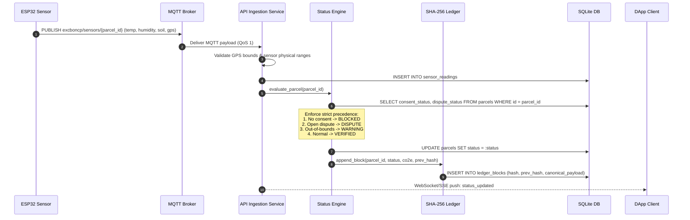
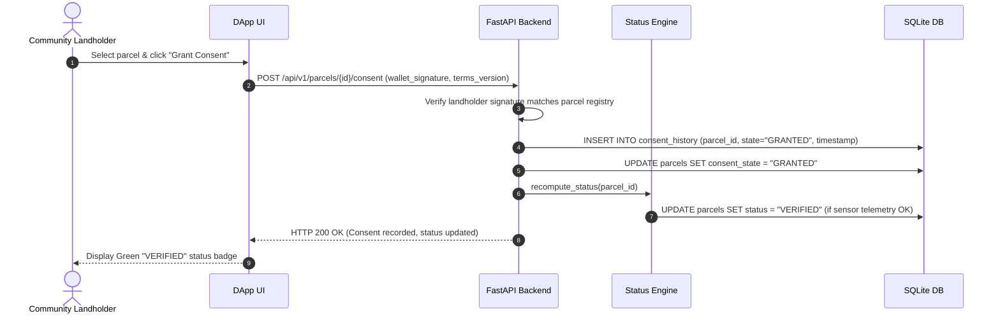
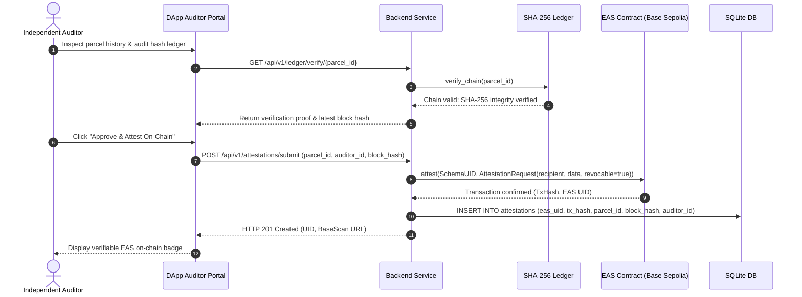

# Sequence Diagram

> Key operational sequences: Sensor Ingestion, Status Determination, Community Consent, and On-Chain EAS Attestation.

---

## 1. Sensor Ingestion & Deterministic Evaluation

---

## 2. Community Consent Workflow

---

## 3. EAS Blockchain Attestation Workflow

---

## Metadata
- **Source File:** `docs/models/SEQUENCE_DIAGRAM.md`
- **Related Requirements:** R1, R2, R3, R4, R6, R7, R11, R15, R17
- **Responsible Owner:** Revand (Architecture & Blockchain) & Davin (Status Engine)
