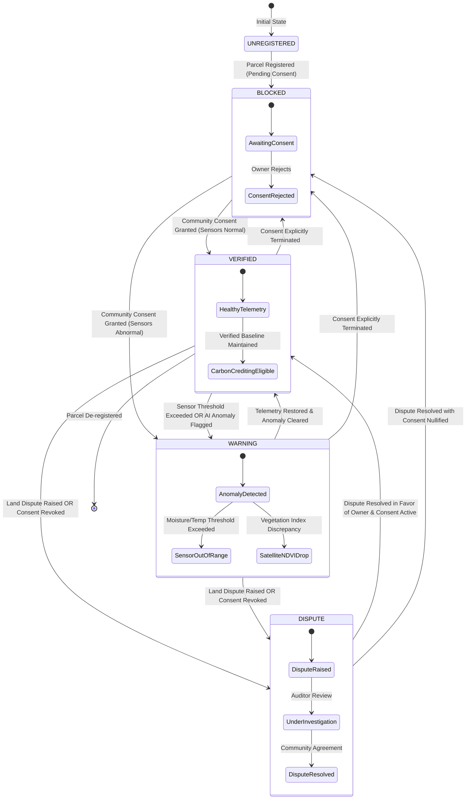

# State Diagram — Parcel Status Engine

> State machine specification for ExcbonCP land parcel verification. Defines all allowed states, transition triggers, and the strict deterministic precedence hierarchy.

---



---

## Precedence Hierarchy

The deterministic status engine evaluates parcel condition using the following immutable precedence hierarchy:

```
Priority 1: Community Consent Absence?
            └── YES ──▶ BLOCKED
            └── NO  ──▶ Continue to Priority 2

Priority 2: Active Dispute or Revoked Consent?
            └── YES ──▶ DISPUTE
            └── NO  ──▶ Continue to Priority 3

Priority 3: Sensor Warning (e.g. soil dry out-of-spec) OR Active Anomaly?
            └── YES ──▶ WARNING
            └── NO  ──▶ Continue to Priority 4

Priority 4: All criteria satisfied?
            └── YES ──▶ VERIFIED
```

---

## Domain Invariants
1. **Deterministic Logic:** Land status is computed via pure python code; AI models **never** dictate or override status.
2. **Trading Eligibility:** **ONLY** parcels in the `VERIFIED` state may have their estimated carbon sequestration minted or traded in the simulated carbon market.
3. **Attestation Prerequisite:** EAS attestation on Base Sepolia requires a currently `VERIFIED` status backed by valid ledger history.

---

## Metadata
- **Source File:** `docs/models/STATE_DIAGRAM.md`
- **Related Requirements:** R3, R4, R9, R10, R14
- **Responsible Owner:** Davin (Status Engine) & Bagus (Backend)
