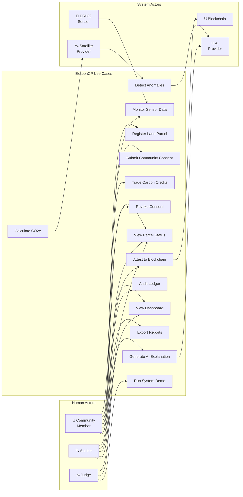

# Use Case Diagram

> Primary use cases of the ExcbonCP system organized by actor.

---

## Use Case Descriptions

| ID | Use Case | Primary Actor | Description | Preconditions |
|----|----------|--------------|-------------|---------------|
| UC1 | Register Land Parcel | Community Member | Register a new forest land parcel with geographic boundaries, area, and vegetation type. | User authenticated |
| UC2 | Submit Community Consent | Community Member | Grant consent for a registered parcel to be monitored and participate in carbon economy. | Parcel registered, user is parcel stakeholder |
| UC3 | Monitor Sensor Data | ESP32 Sensor | Continuously collect and transmit temperature, humidity, soil moisture, and GPS data. | Sensor deployed, MQTT broker running |
| UC4 | View Parcel Status | Community Member, Auditor, Judge | View current status (VERIFIED/WARNING/DISPUTE/BLOCKED) and status history of a parcel. | Parcel exists |
| UC5 | Calculate CO2e | System | Compute estimated carbon sequestration based on sensor data, area, vegetation, and NDVI. | Sensor data available, NDVI data fetched |
| UC6 | Attest to Blockchain | Auditor | Create an EAS attestation on Base Sepolia for a verified parcel's status and carbon data. | Parcel VERIFIED, auditor authenticated |
| UC7 | Trade Carbon Credits | Community Member | List, buy, or sell carbon credits on the simulated market. | Credits exist, user authenticated |
| UC8 | Detect Anomalies | System (Satellite) | Compare sensor data with satellite NDVI and historical baselines to flag discrepancies. | Sensor and satellite data available |
| UC9 | Generate AI Explanation | Auditor, System | Generate human-readable explanation for a status decision or anomaly detection. | Status determined or anomaly detected |
| UC10 | Audit Ledger | Auditor | Verify the SHA-256 hash chain integrity and review ledger entries. | Ledger has entries |
| UC11 | Revoke Consent | Community Member | Withdraw previously granted consent, changing parcel status to DISPUTE. | Consent previously granted |
| UC12 | View Dashboard | Community Member, Judge | View data visualization dashboard with charts, graphs, and map overview. | System has data |
| UC13 | Export Reports | Auditor | Export sensor data, status history, or carbon reports as CSV/PDF. | Data available |
| UC14 | Run System Demo | Judge | Execute guided demonstration script showcasing all system features. | System deployed, demo data loaded |

## Actor Descriptions

| Actor | Role | Key Interactions |
|-------|------|-----------------|
| **Community Member** | Land owner or village stakeholder | Registers parcels, manages consent, monitors status, trades credits |
| **Auditor** | Verification officer | Reviews data, creates attestations, audits ledger, exports reports |
| **Judge** | Competition evaluator | Views dashboards, runs demos, evaluates system capabilities |
| **ESP32 Sensor** | IoT field device | Publishes telemetry data to MQTT broker |
| **Satellite Provider** | External data source | Provides NDVI imagery for anomaly detection and CO2e calculation |
| **Blockchain** | Base Sepolia network | Stores EAS attestation records immutably |
| **AI Provider** | LLM API service | Generates explanations for status decisions and anomalies |
