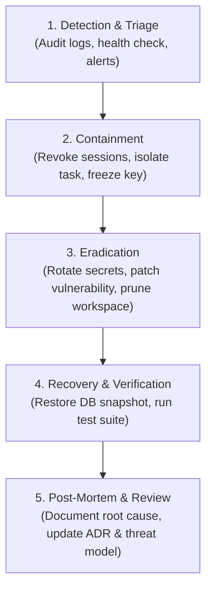

# ExcbonCP Incident Response Plan

> Triage, containment, eradication, and recovery procedures for security incidents in the ExcbonCP ecosystem.

---

## 1. Incident Classification Matrix

| Severity Level | Description | Example Scenarios | Response Time SLA | Escalation Target |
|---|---|---|---|---|
| **P1 - Critical** | Direct compromise of secrets, database corruption, or fraudulent on-chain attestation. | Leaked `CREDENTIAL_ENCRYPTION_KEY`, rogue EAS attestation on Base Sepolia, unauthorized root access. | Immediate (< 1 hour) | Revand (Architecture Lead) & Team |
| **P2 - High** | Service disruption, authentication failure, or active anomaly in sensor processing. | DoS attack on central server, widespread sensor telemetry injection, expired JWT signing key. | < 4 hours | Davin (Security) & Bagus (Backend) |
| **P3 - Medium** | Policy violation or isolated non-critical failure. | Unmatched GPS coordinates for a parcel, unhandled agent crash, failing non-critical test. | < 24 hours | Assigned component owner |
| **P4 - Low** | Minor cosmetic or documentation discrepancies. | Formatting issue, stale documentation link, warning-level linter notice. | Next sprint | Component author |

---

## 2. Incident Response Workflow



---

## 3. Playbooks for Common Incidents

### Playbook A: Leaked AI Provider API Key
1. **Identify Owner:** Query audit logs for the credential ID:
   ```bash
   sqlite3 ./data/excboncp.db "SELECT user_id, provider, updated_at FROM credentials WHERE id = '<id>';"
   ```
2. **Revoke Upstream:** User immediately logs into the provider dashboard (e.g. OpenAI / Anthropic console) and revokes the compromised API key.
3. **Deactivate in ExcbonCP:**
   ```bash
   curl -X DELETE "http://localhost:8000/api/credentials/<id>" -H "Authorization: Bearer <token>"
   ```
4. **Issue New Key:** User registers a newly generated key in the ExcbonCP dashboard.

### Playbook B: Database Tampering or Corruption
1. **Stop Server Immediately:**
   ```bash
   # Docker mode
   docker compose down
   # Local mode
   pkill -f "uvicorn server.main:app"
   ```
2. **Verify Cryptographic Ledger:** Run verification script to check SHA-256 chain integrity.
3. **Restore Last Known Good Snapshot:**
   ```bash
   ./scripts/restore.sh <backup_filename.tar.gz>
   ```
4. **Run Health & Integrity Check:**
   ```bash
   ./scripts/health-check.sh
   ```

### Playbook C: Rogue EAS Attestation Alert
1. **Isolate On-Chain Signer:** Revoke compromised wallet permissions or pause testnet contract if emergency stop is implemented.
2. **Flag in Status Engine:** Set affected land parcel to `DISPUTE` status in SQLite.
3. **Audit Trail Review:** Inspect `audit_logs` for `attestation.create` events to identify the offending account and timestamp.

---

## 4. Post-Incident Review

A formal incident report must be completed within 48 hours of any P1 or P2 resolution, containing:
1. Executive summary and timeline.
2. Root cause analysis (RCA).
3. Impact assessment (financial, reputational, data integrity).
4. Preventative action items assigned to specific team members.
