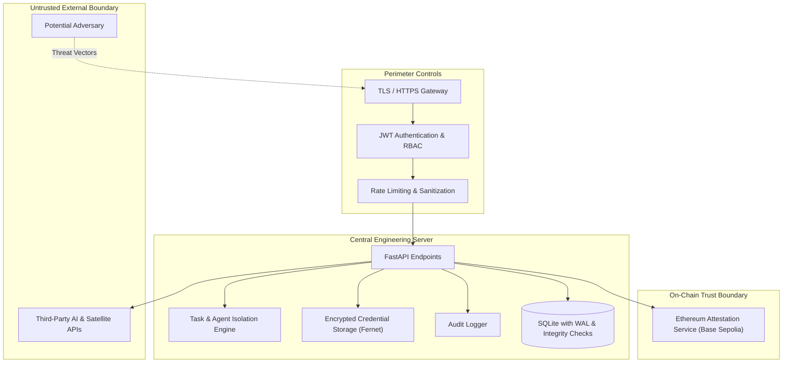

# ExcbonCP Threat Model

> STRIDE threat analysis and mitigation controls for the ExcbonCP Decentralized MRV Forest System and Central Engineering Server.

---

## 1. Scope and System Boundaries

The ExcbonCP platform encompasses three primary threat boundaries:
1. **Edge & IoT Boundary:** ESP32 devices, sensor inputs (DHT22, soil moisture, GPS), and the MQTT transport layer.
2. **Central Application & Engineering Server:** FastAPI application, SQLite database, per-user AI credential vault, task workspaces, and agent orchestration.
3. **External Trust Boundaries:** Base Sepolia blockchain / Ethereum Attestation Service (EAS), satellite imagery providers, and third-party AI provider APIs.

---

## 2. STRIDE Threat Analysis

| Threat Category | Threat Description | Affected Component | Severity | Implemented Mitigation |
|---|---|---|---|---|
| **S - Spoofing** | Attacker impersonates a team member to access system or execute unauthorized tasks. | Authentication Gateway | High | Individual JWT authentication (HS256) with short expiration, bcrypt password hashing, secure session revocation. |
| **S - Spoofing** | Rogue ESP32 device publishes forged sensor telemetry. | MQTT Broker & Ingestion Service | High | Per-device MQTT credentials/TLS client certs, GPS coordinate boundary validation, parcel ownership verification. |
| **S - Spoofing** | Unauthorized entity submits fraudulent carbon attestation on-chain. | EAS Attestation Service | Critical | Auditor role requirement, multi-signature verification, SHA-256 hash ledger confirmation before submission. |
| **T - Tampering** | Malicious alteration of land parcel records or sensor history in SQLite. | Database Layer | High | SHA-256 chained hash ledger with canonical JSON serialization. Any altered record breaks the cryptographic chain. |
| **T - Tampering** | Concurrent AI agent execution corrupts project source files. | Agent Execution Workspaces | High | Task workspaces isolated under `data/workspaces/<task_id>`, in-memory file locking, directory-based agent restrictions. |
| **R - Repudiation** | User denies altering parcel status, revoking consent, or running an agent task. | Audit Trail | Medium | Immutable append-only `audit_logs` table tracking user ID, IP address, timestamp, action, and affected resource. |
| **I - Information Disclosure** | Exposure of member AI provider API keys (OpenAI, Anthropic, Gemini, etc.). | Credential Management | Critical | Fernet symmetric encryption at rest using dedicated server key (`CREDENTIAL_ENCRYPTION_KEY`). Keys are never logged, never returned in API responses, and never shared between users. |
| **I - Information Disclosure** | Secrets leaked in repository version control or commit history. | Git & CI Pipeline | High | Comprehensive `.gitignore`, `.env.example` with blank placeholders only, automated Gitleaks secret scanning in CI. |
| **D - Denial of Service** | Volumetric HTTP flooding exhausts server thread pool or database locks. | FastAPI Ingestion & API | Medium | Per-IP rate limiting (auth endpoints: 10 req/min, general: 100 req/min), SQLite WAL mode enabled for non-blocking concurrent reads. |
| **E - Elevation of Privilege** | Normal team member attempts to alter system settings or delete users. | Authorization (RBAC) | High | Server-side role enforcement via FastAPI dependencies (`require_owner`, `require_role`). Permissions cannot be overridden by frontend claims. |

---

## 3. Defense-in-Depth Architecture

1. **Authentication & Identity:**
   - Password minimum requirements: 12+ characters, mixed case, numbers.
   - Cryptographic password hashing using `passlib` with `bcrypt`.
   - Signed JSON Web Tokens (JWT) verified on every protected request.

2. **Credential Isolation:**
   - Each team member must configure their own API credentials.
   - Credentials are stored in `credentials` table encrypted with AES-128-CBC + HMAC-SHA256 (Fernet).
   - Only masked display labels (`****...`) are exposed via the API.
   - Strict `user_id` database query constraint prevents cross-tenant access.

3. **Workspace Isolation:**
   - Every task gets a separate execution directory (`data/workspaces/<task_id>`).
   - File locks are acquired prior to task modification and released on completion.
   - Completed or failed workspaces are cleanly pruned.

4. **Domain Rule Protection:**
   - AI models are strictly prohibited from deciding land status, calculating carbon, or granting consent.
   - Deterministic status engine enforces:
     - No consent $\rightarrow$ `BLOCKED`
     - Revocation / Open dispute $\rightarrow$ `DISPUTE`
     - Sensor warning / Active anomaly $\rightarrow$ `WARNING`
     - Normal operations with consent $\rightarrow$ `VERIFIED`

---

## 4. Verification and Compliance

- **Threat Model Review Frequency:** Prior to each major release and after any architectural modification.
- **Automated Validation:** Gitleaks scans, static code analysis (Ruff/Semgrep), automated unit and integration tests.
- **Responsible Owner:** Davin (API Security) and Security Agent.
