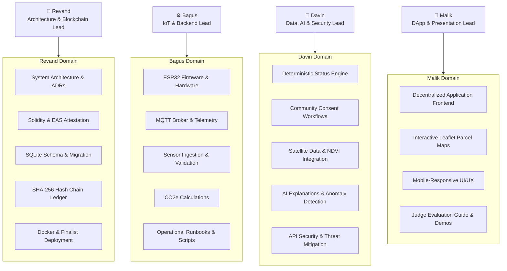

# Team Ownership & Human Accountability Matrix

> Preserves human accountability boundaries in accordance with the ExcbonCP Master Directive. AI agents assist team leads; they do not replace human ownership.

---

## 1. Primary Human Ownership Areas

---

## 2. Detailed Ownership Matrix

| Team Member | Functional Area | Associated Requirements | Primary AI Agent Assistant | Allowed Write Directories |
|---|---|---|---|---|
| **Revand** | Architecture, Smart Contracts, SQLite, SHA-256 Ledger, EAS Integration, Docker, Deployment | R6, R7, R11, R17, R25 | Architect Agent, Blockchain Agent | `docs/`, `contracts/`, `src/blockchain/`, `src/db/`, `docker/`, `scripts/` |
| **Bagus** | ESP32, MQTT, Sensor Processing, CO2e, Authentication, Operational Docs | R1, R2, R5, R12, R19, R23, R28, R29 | IoT Agent, Backend Agent | `src/firmware/`, `src/api/`, `src/core/`, `config/mqtt/`, `scripts/` |
| **Davin** | Status Engine, Community Consent, Satellite Data, AI Explanation, Anomaly Detection, API Security | R3, R4, R8, R9, R10, R15, R26 | Data/AI Agent, Security Agent | `src/core/`, `src/ai/`, `src/satellite/`, `docs/security/`, `tests/security/` |
| **Malik** | DApp, Maps, UX, Screens, Judge Guide, Presentations | R13, R14, R16, R18, R20, R21, R22, R24, R27 | Frontend Agent, Reviewer Agent | `src/dapp/`, `public/`, `docs/judge-guide.md`, `tests/e2e/` |

---

## 3. Human Governance Invariants (Rules 9 & 10)

1. **No Autonomous Approvals:** An AI agent is technically barred from:
   - Modifying a land parcel's status to `VERIFIED`.
   - Creating or signing an on-chain EAS attestation.
   - Authorizing a simulated carbon market transfer.
   - Performing production deployment.
2. **Review & Merge:** All AI-generated code changes must undergo pull request review by the respective human domain lead before merging into `main`.
3. **Escalation Trigger:** Any conflict between agent outputs and domain invariants must be escalated immediately to **Revand** as Architecture Lead.
